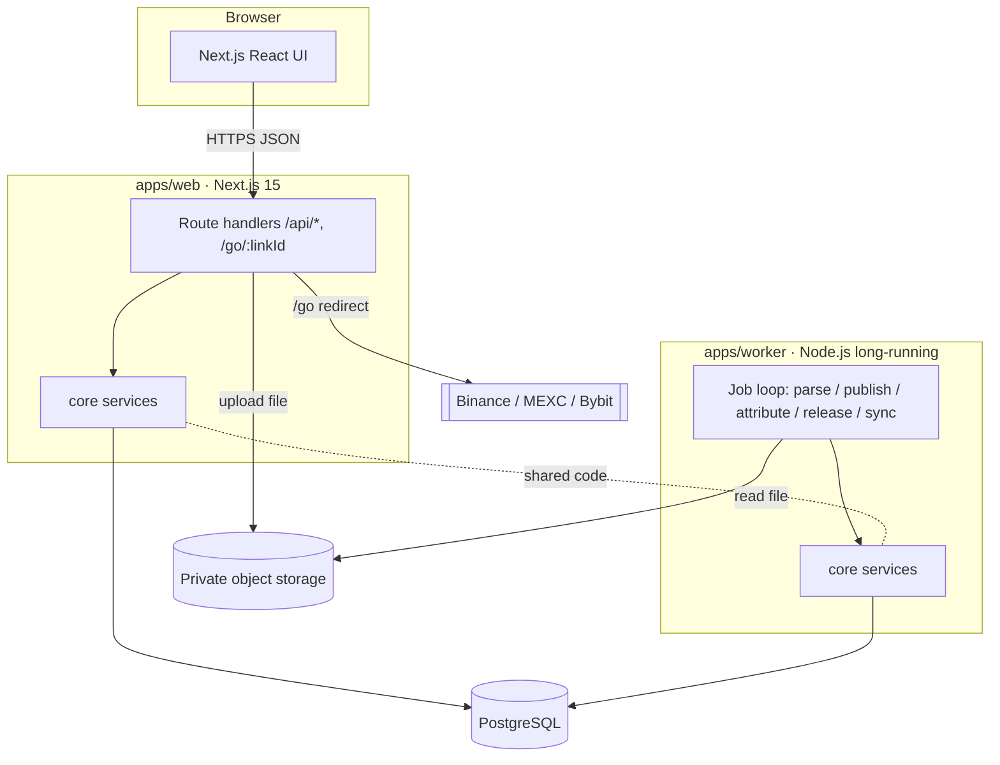
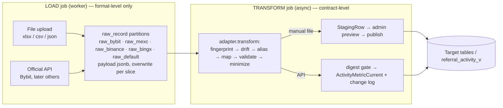
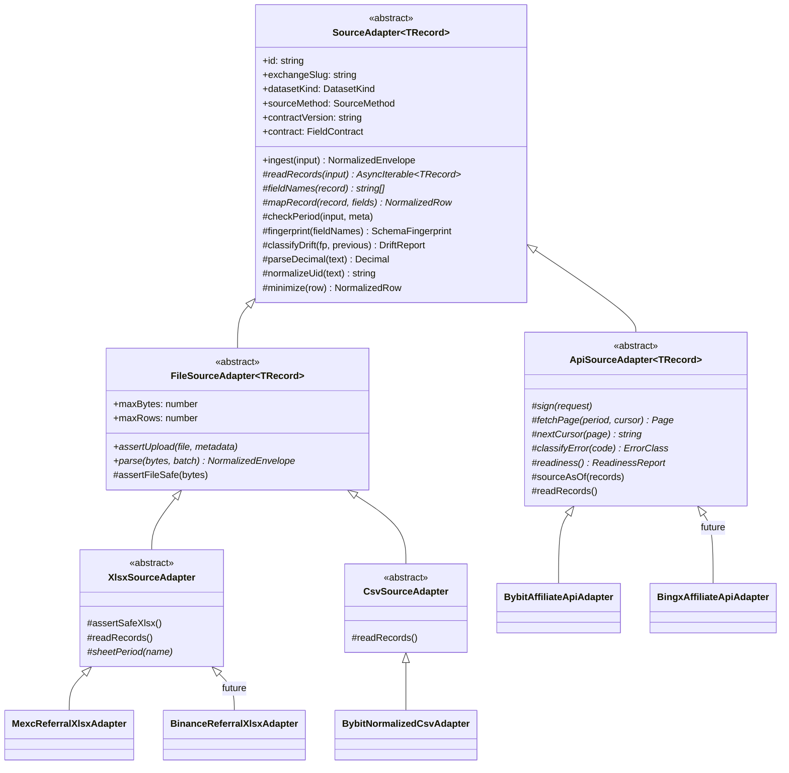
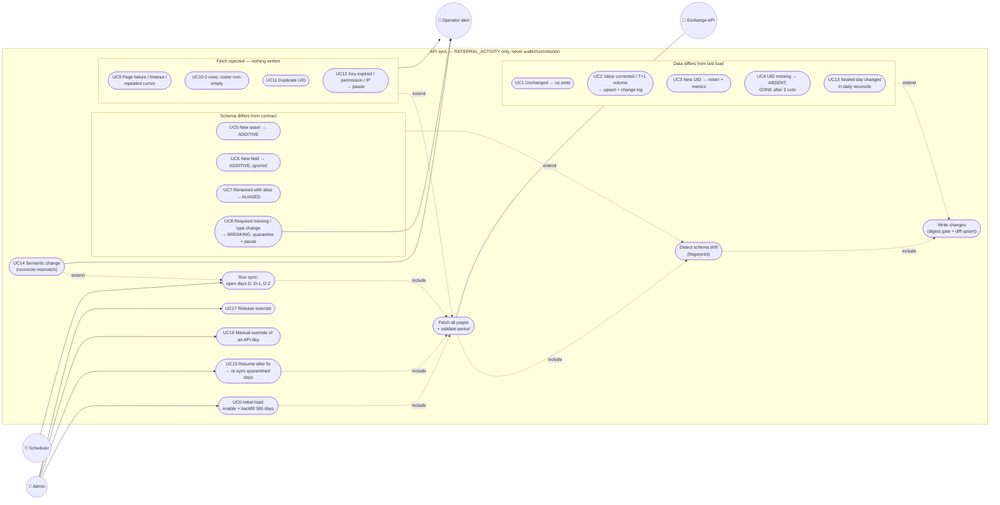
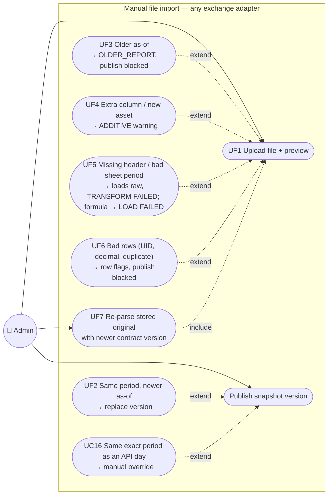
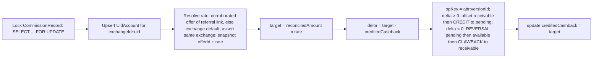
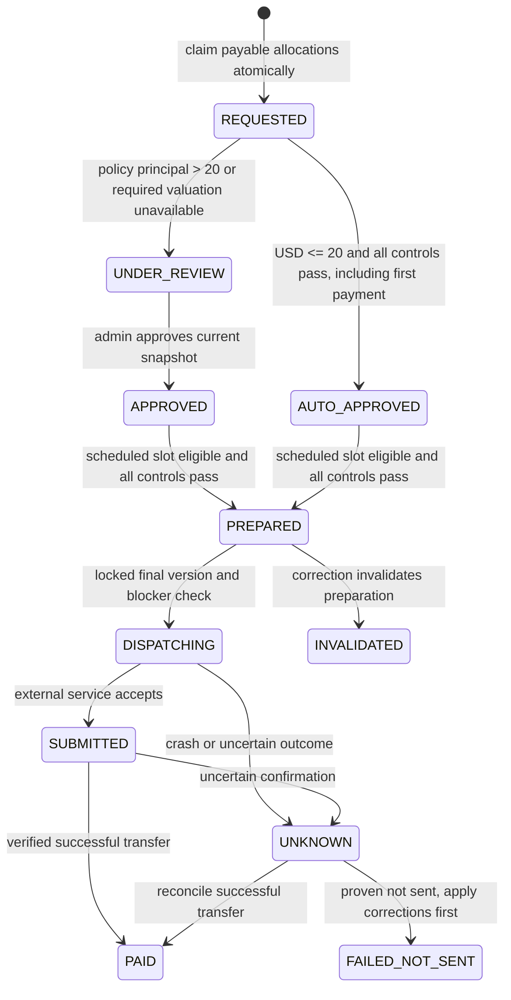
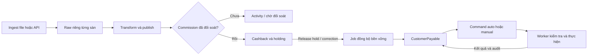
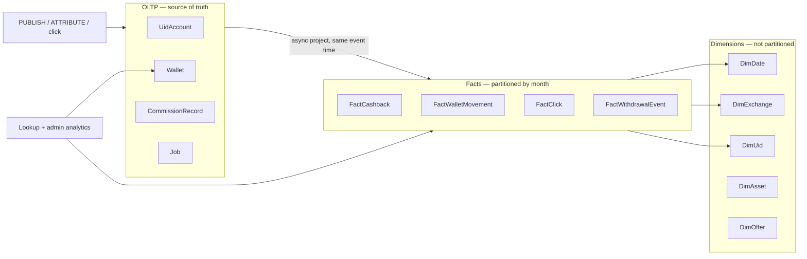

# Design — Cashback Affiliate Platform

- **Status:** Draft v1.0 (UID-first; adapter framework, drift policy, API write model)
- **Last updated:** 2026-10-14
- **Based on:** `docs/specs/cashback-platform/requirements.md` (Draft v0.9), `architecture.html` v0.4 (context only)
- **Audience:** implementers and AI coding agents (Claude / Codex / agy)

> This document turns the requirements into a concrete technical design: component
> boundaries, data model, flows, and cross-cutting concerns. Items marked **[PENDING]** map to open decisions in the requirements and must be
> confirmed before their dependent code is built. Per spec governance, `requirements.md`
> and `design.md` are the source of truth; `architecture.html` is background context only.
>
> **Reference convention:** `Req N.M` cites an EARS acceptance criterion in
> `requirements.md`. `Open decision #N` cites a numbered row in `requirements.md` →
> "Open decisions" (a stakeholder answer), NOT Requirement N.

> **Rà soát ngày 2026-10-14:** Người dùng tự đọc và báo sửa; không cần hỏi xác nhận ở từng bước. Dark Aurora và calculator theo plan (#23–25, Req 19–20) đã triển khai Docker local; tên mới (#22) còn mở. Req 21 tiếp tục rà soát riêng. Quyết định chưa chốt nằm trong Open decisions của requirements và Open design decisions; hoàn thiện requirements → design → tasks trước code.

## Overview

The platform is a TypeScript monorepo with two runtime apps sharing a PostgreSQL
database:

- **`apps/web`** — Next.js 15 (App Router). Serves the public site
  (lookup công khai; không ví riêng hoặc customer money writes), and admin area. Contains all HTTP route handlers (`/api/*`,
  `/go/:linkId`).
- **`apps/worker`** — long-running Node.js process. Parses reports, attributes
  commission, releases holds, and runs scheduled affiliate API sync jobs.

Shared logic lives in packages so web and worker never diverge:

- **`packages/core`** — services: normalization, cashback engine, attribution, wallet,
  validation. No HTTP, no React.
- **`packages/db`** — Prisma schema, migrations, generated client, repository helpers.
- **`packages/contracts`** — zod schemas + TypeScript types for API request/response and
  report row shapes. No secrets. Safe to import from the browser bundle.

The browser never touches the database or `core`/`db` directly; it only calls `/api/*`.

## Architecture

### System context



### Technology & key decisions

| Concern | Decision | Rationale |
|---------|----------|-----------|
| Language | TypeScript everywhere | Single toolchain, shared types. |
| Web | Next.js 15 App Router | SSR public pages + colocated API routes. |
| Worker | Node.js long-running process | Long jobs off the request path (Req 12). |
| Monorepo | pnpm workspaces + Turborepo | Shared packages, cached builds. |
| DB | PostgreSQL + Prisma | Relational integrity, migrations, job queue. |
| Job queue | PostgreSQL `SKIP LOCKED` | No Redis at launch scale (Req 12.6). |
| Validation | zod in `packages/contracts` | One schema for API + parser boundaries. |
| Money | `Decimal` (Prisma `Decimal`/numeric); API returns strings | No float error (Req 7.4). |
| Auth | **[PENDING]** provider (open decision #13); interim email+password | Abstracted behind an auth port; see Components/Auth. |
| Styling (public site) | Tailwind CSS v4 + shadcn/ui (Radix primitives), copied into `src/components/ui` | **Dark Aurora** đã chốt (Req 20): nền xanh đen, glow aurora nhẹ, điểm nhấn cam ấm, typography và khoảng trống theo mockup. Áp theme qua public shell cho home/exchanges/guides và luồng khách; giữ giao diện/token admin cùng **simple left-nav shell** (Req 18). Không import toàn bộ reference `cashback/` admin SPA. |
| Hosting | Local/SIT + Railway prod, dual-track | Verify local, push, deploy (Req 6.5). |
| Language / i18n | Single locale registry + message catalogs + locale-segment routing | English is the only enabled locale; enabling another is a registry + catalog change, not a routing change (Req 4). |

### Repository layout

```
apps/
  web/
    src/app/
      (public)/                 # home, /exchanges, /exchanges/[slug], /guides
      [locale]/                 # same public pages under a non-default locale prefix
      (admin)/                  # /admin/... (guarded)
      api/                      # route handlers -> core services
      go/[linkId]/route.ts      # redirect + click tracking
    src/components/            # public-site components (public-pages.tsx) + ui/ (shadcn primitives)
    src/lib/utils.ts           # `cn()` class-merge helper (shadcn convention)
    components.json            # shadcn/ui CLI config (style, aliases, Tailwind entry)
    postcss.config.mjs         # @tailwindcss/postcss plugin
    src/i18n/                   # locale registry + message catalogs (en only)
    src/middleware.ts           # resolves request locale from the registry
  worker/
    src/index.ts                # boot + job loop
    src/jobs/                   # parse / publish / attribute / releaseHolds / sync
    src/adapters/               # per-exchange report parsers
packages/
  contracts/                    # zod schemas + types (no secrets)
  core/                         # services, cashback engine, normalization
  db/                           # prisma schema + migrations + repositories
infra/
  docker-compose.yml            # test/dev stack mirroring Railway (Postgres 18.6, web, worker)
  Dockerfile                    # one image per service, same build commands as Railway
  railway/                      # railway service config
architecture.html
docs/specs/cashback-platform/  # this spec
```

Turborepo pipeline: `build`, `lint`, `typecheck`, `test`, `db:migrate`, `dev`.
Dependency rule (enforced by lint/boundaries): `web` and `worker` may import
`core`, `db`, `contracts`; browser code may import only `contracts`.

### Key flows

#### Report import → publish (Req 6)

Ingest is source-neutral after parsing. A source adapter emits either
`REFERRAL_ACTIVITY` (UID metrics, no wallet effect) or `COMMISSION` (eligible for the
existing versioned commission path). Each batch records exchange, root affiliate
account, source method (`NATIVE_FILE`, `NORMALIZED_FILE`, `OFFICIAL_API`),
dataset kind, report period, source timezone, available source as-of time, and
private minimized evidence. Every source is a subclass of the same abstract adapter
(see "Source adapter framework") and emits the same `NormalizedEnvelope`. An admin
previews manual rows before publish (manual sink: `ImportBatch` + versioned
snapshot); the scheduled connector validates a complete period and writes through
the API sink (in-place metrics + change log, no per-run `ImportBatch`). Both paths
first land unchanged records in the raw layer and transform asynchronously (see
"Raw landing layer").

**MEXC native referral adapter.** The inspected file
`data/mexc/Referral Data Export-2026-09-25 14_22_39.xlsx` has one worksheet named
`_2026-09-18~2026-09-25`, 27 headers, and 46 distinct `Referral` UIDs. Its
`Trading volume` and `Your Earnings` columns are zero for every row, so it cannot
validate nonzero calculations or settlement. Every cell in the sample is an inline
string (numbers included, e.g. `"0"`), and it contains no formulas.

- **Workbook safety.** Accept `.xlsx` only (no `.xlsm`/`.xls`), exactly one
  worksheet, no external links. Before parsing, bound the decompressed size (e.g.
  50 MiB) and row/column counts; the 10 MiB upload limit only bounds compressed bytes.
  Read cell values only; a cell that contains a formula fails the batch (Req 6.4)
  rather than being silently evaluated or skipped. Use a maintained parser that does
  not evaluate formulas; the npm `xlsx` registry package is outdated and must not be used.
- **Headers.** Require `Referral`, `Trading volume`, `Trading token`, `Your Earnings`,
  and `Commission token` by name, not position. Extra or new columns are tolerated and
  listed as preview warnings (MEXC added columns such as
  `Prediction Markets Fee-Sharing Rate`); a missing required header fails the batch.
- **Values.** Keep UID text unchanged (the sample has UIDs with leading zeroes).
  Parse amounts from strict decimal text into Decimal; reject empty, non-numeric, or
  negative volume. Token columns must be a supported asset.
- **Period.** The sheet name gives inclusive calendar dates in the source timezone.
  Store `periodStart` = first day 00:00 and `periodEnd` = last day 23:59:59.999 in
  `sourceTz`, converted to UTC, matching the inclusive overlap rule used by the
  commission path. A sheet period that disagrees with admin metadata, or a missing
  `sourceTz`, fails the batch. The workbook does not state a timezone, so the admin
  must supply it.
- **As-of.** `sourceAsOf` is required for manual MEXC activity batches; the admin may prefill it
  from the filename timestamp only after confirming its timezone. When
  `sourceAsOf < periodEnd` (the sample was exported at 14:22 on the period's last day),
  mark the snapshot `partial` in preview and reports.
- **Data minimization (NĐ 13/2023).** Copy only mapped columns (UID, volume, earnings,
  tokens, referral code) plus the source row number into `StagingRow.raw` and
  `ReferralSnapshot`. Nickname, user tag, identification (KYC level) and asset band
  are `contract.personal`: dropped before the raw layer and kept only in the private
  original file, subject to the import retention policy. Other unmapped columns
  (e.g. sharing rate) stay in `raw_mexc` for 30 days, then only in the original file.

The adapter outputs one activity row per UID and period; `Your Earnings` is a
reported metric, not a CommissionVersion.

**Ingest choices.** (1) Native exchange XLSX/CSV exports are the preferred manual
input when their columns and semantics have been verified. (2) A documented
normalized CSV is the manual fallback for unsupported export formats; it carries
explicit dataset kind, exchange, UID, UTC period and units. For commission imports,
the original exchange evidence must also be retained privately. (3) The approved
Bybit Affiliate API connector produces activity rows and batch metadata through
the same ingest boundary without a separate ledger path. Screen scraping
or browser-session cookies are not an ingest source. For MEXC, a UID-level commission
export with nonzero data and period/settlement meaning must be inspected before
enabling the `COMMISSION` adapter; referral activity import may proceed earlier.

```mermaid
sequenceDiagram
  participant A as Admin (web)
  participant API as web /api/admin/ingest/batches
  participant S as Object storage
  participant DB as PostgreSQL
  participant W as Worker

  A->>API: POST report + metadata
  API->>API: authz + file type/size check
  API->>S: store original file (private)
  API->>DB: create ImportBatch + LOAD job
  API-->>A: 202 { batchId }
  W->>DB: claim LOAD job (SKIP LOCKED)
  W->>S: read file (format + safety checks only)
  W->>DB: overwrite raw_<exchange> slice + RawLoad; enqueue TRANSFORM
  W->>DB: claim TRANSFORM job (async)
  W->>DB: adapter contract → write StagingRow (normalized + flags)
  W->>DB: batch.status = PREVIEW
  A->>API: GET /imports/:id (poll ~5s)
  API-->>A: counts (new/dup/error/conflict) + totals
  A->>API: POST /imports/:id/commit
  API->>DB: create PUBLISH job
  W->>DB: claim PUBLISH job
  alt referral activity
    W->>DB: version ReferralSnapshot per UID and exact period
    W->>DB: batch.status = PUBLISHED (no wallet job)
  else commission evidence
    W->>DB: upsert CommissionRecord identity (exchangeId, dedupKey)
    W->>DB: upsert CommissionVersion; recompute reconciledAmount
    W->>DB: enqueue ATTRIBUTE job; batch.status = PUBLISHED
  end
```

#### Raw landing layer — `raw_<exchange>` before the target tables (Req 6.23–6.26)

Every source, file or API, first lands **unchanged records** in a raw table of its
exchange, then an **asynchronous transform** maps raw records into the target tables
(`StagingRow` → `ReferralSnapshot`/`CommissionRecord` for manual files,
`ActivityMetricCurrent` for API). Loading never depends on the adapter's field
contract, so an exchange that renames, adds or drops columns cannot make the import
step fail; the difference is judged later, at transform, and can be re-run after a
fix without asking the exchange or the admin for the data again.



**Why JSONB rows instead of re-creating a typed table per load.** The requested
behavior is "each load overwrites the data and the schema, so import never fails".
Storing each source record as one `jsonb` payload gives exactly that: the schema of a
load is whatever keys its records carry, recorded as a fingerprint on the load.
Re-creating real columns on every load (dynamic `DROP/CREATE TABLE` from uploaded
headers) is not used, because it turns untrusted header text into DDL (injection
risk), takes `ACCESS EXCLUSIVE` locks that block the transform reading the previous
load, guesses column types from strings, and puts tables outside Prisma migrations
so `prisma migrate` reports drift.

**Physical layout.** One parent table partitioned by exchange, so each exchange has
its own table and the code has one path:

```sql
CREATE TABLE raw_record (
  id              bigint GENERATED ALWAYS AS IDENTITY,
  _source_system  text        NOT NULL,             -- exchange slug; partition key
  _load_id        text        NOT NULL,             -- RawLoad.id
  _loaded_at      timestamptz NOT NULL DEFAULT now(),
  row_no          integer     NOT NULL,             -- file row or API position (page, index)
  payload         jsonb       NOT NULL,             -- one source record, keys as delivered
  PRIMARY KEY (_source_system, id)
) PARTITION BY LIST (_source_system);
CREATE TABLE raw_bybit   PARTITION OF raw_record FOR VALUES IN ('bybit');
CREATE TABLE raw_mexc    PARTITION OF raw_record FOR VALUES IN ('mexc');
CREATE TABLE raw_binance PARTITION OF raw_record FOR VALUES IN ('binance');
CREATE TABLE raw_bingx   PARTITION OF raw_record FOR VALUES IN ('bingx');
CREATE TABLE raw_default PARTITION OF raw_record DEFAULT;   -- an exchange without its own partition still loads
CREATE INDEX ON raw_record (_load_id, row_no);
```

A new exchange gets its partition in the same migration that registers its adapter;
until then its loads go to `raw_default` and still succeed. Column names follow the
Helios convention (snake_case, `_`-prefixed audit columns). Prisma does not model
partitions, so the tables live in raw SQL migrations and are accessed with
`$queryRaw`; `RawLoad` is a normal Prisma model.

**Slice and overwrite.** A *slice* is (exchange, dataset kind, source method, root
account, period start, period end); for API it is one UTC day. Each load of a slice
runs in one transaction under the slice advisory lock:
1. insert a new `RawLoad` (state `LOADED`, row count, `fieldNames` = sorted union of
   payload keys, `schemaFingerprint`, source metadata: sheet name, filename as-of,
   response time, page count);
2. `DELETE FROM raw_record WHERE _load_id IN (previous loads of the slice)` and mark
   those loads `SUPERSEDED`;
3. insert the new rows; commit; enqueue `TRANSFORM { loadId }`.
Only the latest load of a slice keeps raw rows ("overwrite"). History is not lost: a
manual file's original bytes stay in `ImportBatch.originalFile`, and API changes are
kept in `ActivityMetricChange`. Overwrite never touches other slices, other periods
or other roots of the same exchange.

**What may still fail at LOAD.** Only format and safety rules, never the contract:
unsupported extension, wrong file signature, size/row/column limits, ZIP bomb,
formulas or macros, unreadable workbook/CSV/JSON, more than one worksheet when the
adapter reads one, API transport/auth errors (Req 6.4, 6.24, 13.7). Header and value
problems (missing/renamed/extra columns, bad decimals, duplicate UIDs, sheet period
mismatch) are recorded and judged at TRANSFORM. The reader keys each record by its
header text; a duplicate header gets a `__2` suffix and an empty header becomes
`__col_<n>`, so every header layout can be stored.

**Personal data at LOAD (NĐ 13/2023).** Before insert, the reader drops keys listed
in the adapter's `contract.personal` (for example MEXC `Nickname`, `User tag`,
`Identification`; Bybit `isKyc`, `KycLevel`, `depositAmount*`, `totalWalletBalance`,
`remarks`). Unknown keys are kept, because they are exactly the drift a later
contract version may need, and they are covered by retention: raw rows of a load
that is `TRANSFORMED` are deleted after 30 days (or at the next overwrite). Raw
payloads are never returned by an admin or public API; admins see field names and
counts only.

**Asynchronous TRANSFORM.** A `TRANSFORM { loadId }` job:
1. stops as a no-op if the load is not the slice's current load (`SUPERSEDED`), so a
   slow transform can never publish older data over a newer load;
2. resolves the adapter (`ingestRegistry`, pinned `adapterId`/`contractVersion` for a
   manual batch), reads the raw rows in `row_no` order, and runs the contract steps
   (fingerprint → drift → alias → map → validate → minimize);
3. manual file: writes `StagingRow` rows and sets the batch to `PREVIEW` (admin
   publish unchanged); API: runs the API write model below (digest gate, diff upsert,
   change log, roster);
4. sets the load `TRANSFORMED`, or `FAILED` with the drift report (`BREAKING`) or a
   safe error code; raw rows stay for a re-transform.
Transform runs under the target's existing locks (activity period lock; `lockCashback`
only at commission publish) and job lease fencing, so it never blocks the load of the
next slice.

**Re-transform (recovery).** After a developer adds an alias or a new contract
version, an admin action "Re-run transform" enqueues `TRANSFORM` for the selected
failed or quarantined loads (audited). This replaces re-uploading a file or
re-fetching from the exchange; re-fetch is only needed when raw rows have expired.

**Job flow.** Manual: `POST /api/admin/ingest/batches` → `LOAD` (was `PARSE`) →
`TRANSFORM` → `PREVIEW` → admin commit → `PUBLISH` → (commission) `ATTRIBUTE`. API:
`SYNC` fetches all pages of a day and performs the LOAD step in-process (so a
partial page sequence never becomes a load), then enqueues `TRANSFORM`. `PARSE`
jobs still queued at deploy are handled as `LOAD`.

Versioned commission publish (Req 6.7, 7.8): a commission has a **stable identity**
(`exchangeId, dedupKey`) and one **version per import occurrence** (`CommissionVersion`,
unique per `(commissionId, batchId)`). Re-committing the same batch — or two publish
workers racing on the same batch — upserts the same version and changes no
`reconciledAmount` (idempotent). A corrected report adds a new version that supersedes the
prior one; the identity's `reconciledAmount` is recomputed (default rule: **latest version
supersedes**) and only the delta flows to cashback. Prior versions are retained for audit.
(`dedupKey` composition is **[PENDING]** — Open decision #11, finalized against a real
nonzero UID-level commission sample.)

Referral activity publish is separate: identify a snapshot by exchange, root
account, UID, and exact report period. Re-import of the same period versions the
snapshot; it never adds period values. Rules:

- **Which manual MEXC version is current.** The batch with the latest `sourceAsOf`
  (tie: latest `createdAt`) is current. Preview and publish reject an export older
  than the current one (`OLDER_REPORT`). Bybit API data does not use snapshot
  versions; see "API write model", subject to the manual override rule below.
- **Currency is per period, not per UID.** Publishing a new version sets
  `current = false` on every snapshot row of the same (exchange, root, periodStart,
  periodEnd) before inserting the new rows. A UID absent from the new export therefore
  becomes "no data" for that period instead of keeping a stale value from an older export.
- **Locking.** Activity publish takes a transaction advisory lock keyed on (exchange,
  root, period), not `lockCashback`, so it never blocks wallet work, and it never
  enqueues ATTRIBUTE. An admin-published correction for a Bybit period has precedence
  over later API versions until the admin releases that override; API observations must
  not silently undo an operator correction.

Different overlapping periods remain individually queryable, not summed. An activity
snapshot can show zero volume/earnings but cannot credit or reverse cashback. Keep
`sourceAsOf` (when the source was exported) separate from `periodEnd` (what dates it
covers) and `importedAt` (when this platform received it).

#### Scheduled MEXC Affiliate referral activity (Req 13.15)

A second `ApiSourceAdapter`
calls signed `GET /api/v3/rebate/affiliate/referral` with `startTime` and
`endTime` covering one UTC day, `page` and `pageSize`. It validates the response
envelope, page sequence and total pages, and removes profile, deposit, withdrawal
and identification fields before raw landing. The versioned contract maps only
`uid`, `inviteCode`, `tradingAmount` and `commission`, with both amounts labeled
USDT and commission labeled reported activity. The existing `RawLoad` →
`TRANSFORM` → `publishApiDay` path supplies per-day replacement, required-field drift detection,
run audit and no wallet writes. The worker owns `MEXC_AFFILIATE_API_KEY`,
`MEXC_AFFILIATE_API_SECRET` and `MEXC_AFFILIATE_MASTER_UID`; its signed referral
probe persists secret-free readiness. MEXC starts disabled and has its own
rate slot. Docker clears both MEXC affiliate and legacy credentials from the web
environment. `publishApiDay` accepts `preserveReportedZero` (default false), enabled
only for MEXC: initial zero metrics are retained without changing Bybit's sparse
policy. Missing metrics continue to become ABSENT. MEXC upserts observed roster
members and referral codes but never ages missing members from filtered results.
Reports mark a MEXC UID incomplete when it lacks reported metrics for any selected
day; absence is not inferred as zero. Existing zero-only days must be re-fetched with a new
MEXC contract version so the previous digest cannot skip materialization.
The API documentation does not specify the precise period aggregation semantics.
Reconcile at least two adjacent nonzero UTC days against the portal/export before
enabling automated daily reporting. If daily semantics cannot be confirmed, leave
the schedule disabled and Task 20.6 incomplete. This activity is never payable
commission; Task 11.1 is a separate evidence gate (Req 6.12–6.14).

#### Scheduled Bybit Affiliate activity sync (Req 6.17–6.20, 11.4, 13)

**Scope and source semantics.** Use the official
[Affiliate User List](https://bybit-exchange.github.io/docs/v5/affiliate/affiliate-user-list)
endpoint with a master-account key that has only Affiliate read permission. Request
`startDate` and `endDate` explicitly for each inclusive UTC calendar day and `size=100`;
follow `nextPageCursor` until the list is empty or the cursor is empty (Bybit returns a
cursor on the last full page, then one empty page). Map `userId` to opaque UID,
`source` to the referral code, `tradeVol`/`takerVol`/`makerVol`/`tradfiTradeVol` to
volume metrics in USDT, and each key/value of
`commissionsVol` to reported commission in that asset. Do not sum BTC, USDT, etc.
without a separate conversion rule. Do not map `commissionsVol` to the portal's
pending balance, a settled commission, `CommissionRecord`, `CommissionVersion`,
wallet, or withdrawal eligibility. Bybit documents volume updates at T+1; a
30-minute fetch schedule means 30-minute *observation*, not 30-minute source data
freshness. The API response `time` is a response observation time, not a source
`as-of` or settlement timestamp.

**Periods and correction window.** Each run fetches today and the previous two UTC
days as separate exact periods. On first enable, backfill the previous 365 completed
UTC days (configurable) as daily jobs. Cost grows with the roster size N:
about `365 × (⌈N/100⌉ + 1)` requests (the `+1` is the trailing empty page), e.g.
~18,600 requests (~31 min at 10 req/s) for 5,000 UIDs, so the backfill runs at low
priority behind scheduled runs. Expose the earliest covered date and allow an admin to
request older date ranges later. Revisit the most recent 30 completed days once per
day for late source corrections. Do not combine a rolling 30-day response with daily
rows, and do not claim a lifetime total when historical coverage is incomplete.
Current-day rows are `partial` until the calendar day ends; completed days may still
change with Bybit's T+1 update. Store `fetchedAt` and `responseObservedAt` separately.
For `sourceAsOf`, each run samples up to 3 UIDs from the roster it has just fetched
(whatever its size) with `GET /v5/user/aff-customer-info` and reads `volUpdateTime`.
The probe found one identical value across every UID, so it is treated as a
dataset-wide freshness mark, not a per-UID value; the request count stays constant
as the roster grows. If the samples disagree, the call fails, or the roster is
empty, keep `sourceAsOf = null` and record a safe warning. Use the value only after
its timezone is confirmed (Open decision); until then, keep `sourceAsOf = null`. Daily periods are additive: the probe's sum of 30 daily
responses equalled the 30-day range response, so admin range reports may sum
disjoint daily API snapshots (never overlapping ones, Req 6.14).

**Verified API behavior (read-only probe, 2026-09-26).** Evidence only: the roster
held 54 UIDs at probe time. No design rule depends on that number.

| Call | Result | Design consequence |
|------|--------|--------------------|
| `GET /v5/user/query-api` | `readOnly=1`, only `Affiliate` permission, `ips=["*"]`, `deadlineDay=90`, `expiredAt=2026-12-26` | Readiness check on every run; alert 14 days before expiry; bind a stable Railway egress IP for production (Req 13.12) |
| `aff-user-list`, no dates/flags | identity fields only; all volumes `""`, `commissionsVol={}` | Always send `startDate` and `endDate` |
| `aff-user-list` + `startDate`/`endDate` | `takerVol`, `makerVol`, `tradeVol`, `tradfiTradeVol`, `commissionsVol{BTC,ETH,MNT,USDC,USDT}`; dates echoed | Mapped fields (Req 6.17). Inactive UIDs return `""` volume (EMPTY, not an error); commission assets return `"0"` |
| `+ needDeposit/need30/need365` | adds `depositAmount*`, rolling `*30Day`/`*365Day`, `commissions30Day/365Day` | Not requested (Req 6.20); rolling values are derivable |
| Date ranges | 1 day to 366 days accepted; data present one year back; future `endDate` accepted; `startDate > endDate` → `610015 Params Err`; `startDate` alone accepted but `endDate` not echoed | Daily explicit periods; treat 610015 as a permanent bug, not a retry |
| Same day, T+1 | Yesterday had nonzero commission while every UID's volume was still empty | Revisit window must cover volume arriving after commission |
| `GET /v5/user/aff-customer-info?uid=` | 30/365-day aggregates, `totalWalletBalance` band, `KycLevel`, `vipLevel`, `volUpdateTime`, `depositUpdateTime`, pay/card fields | Used only for `volUpdateTime`; store nothing else from it |
| Rate-limit headers | `x-bapi-limit: 10`, `x-bapi-limit-status`, `x-bapi-limit-reset-timestamp` per endpoint | Shared limiter from headers |
| `/v5/broker/earnings-info`, `/v5/broker/account-info` | `3500403 Only available to exchange broker main-account` | Broker earnings are not a source for this account |

The probe stored raw responses only under the gitignored `data/bybit/` folder. Its
output recorded field shapes and counts, never customer values.

**Adapter boundary.** `BybitAffiliateApiAdapter` (a subclass of `ApiSourceAdapter`,
see "Source adapter framework") signs the request using worker-only credentials. It
uses the documented rate-limit response headers (`x-bapi-limit*`, 10 req/s per
endpoint observed) and bounded backoff for transient/10006 failures, with a shared
per-key limiter across worker replicas. A trailing empty page is normal;
"suspiciously empty" applies to the whole period, not one page. Validate `retCode`,
requested date echo, cursor progress, unique nonempty UID per period, valid asset
codes, and nonnegative decimal strings before producing normalized rows. Hold all
pages of one period in worker memory (bounded by roster size), then validate the
complete period. An interrupted, repeated-cursor, malformed, or suspiciously empty
fetch (0 rows when the roster had rows) is quarantined and writes nothing. Persist
only the mapped fields, never unrelated Bybit profile, KYC, deposit, or remark
fields. Full API responses are not stored: Bybit keeps at least one year of daily
history, so re-fetching the period replaces replaying a stored payload.

**API write model (in place + change log, no per-run copy).** A 30-minute schedule
over three open days would create up to 144 full snapshot copies a day if every
changed fetch became a new version. API data therefore uses a different sink from
manual files, behind the same adapter/envelope/validation code:

0. **Input.** The `TRANSFORM` job of the day's current `RawLoad` supplies the
   mapped rows; `SYNC` itself only fetches and loads raw.
1. **Period digest gate.** `ActivityPeriodStatus` holds one row per (exchange, root,
   UTC day) with `contentDigest` (SHA-256 of sorted UID, referral code, metric
   kind/asset/value state/amount; request time and page order excluded), state,
   row count, `fetchedAt`, `responseObservedAt`, `sourceAsOf`, and schema
   fingerprint. An equal digest updates only `lastCheckedAt`/`SyncRun`; no metric
   row is touched. Completed days usually end here.
2. **Row-level diff upsert.** A changed digest loads the normalized rows into a
   transaction-scoped temp table (`ON COMMIT DROP`) and runs, under the (exchange,
   root, day) advisory lock and lease fencing:

   ```sql
   INSERT INTO activity_metric_current AS t
     (exchange_id, root_account, uid, period_date, kind, asset, value_state, amount, last_changed_run_id)
   SELECT exchange_id, root_account, uid, period_date, kind, asset, value_state, amount, $run_id
   FROM tmp_sync_rows
   ON CONFLICT (exchange_id, root_account, uid, period_date, kind, asset)
   DO UPDATE SET value_state = EXCLUDED.value_state, amount = EXCLUDED.amount,
                 last_changed_run_id = EXCLUDED.last_changed_run_id, updated_at = now()
   WHERE (t.value_state, t.amount) IS DISTINCT FROM (EXCLUDED.value_state, EXCLUDED.amount)
   RETURNING t.*;
   ```

   followed by one `UPDATE … SET value_state = 'ABSENT', amount = NULL` for rows of
   that day missing from `tmp_sync_rows` (only for a complete fetch). Every row
   returned by either statement is appended to `ActivityMetricChange` (old → new,
   run id). `INSERT … ON CONFLICT` is chosen over `MERGE`: it is atomic under
   concurrent inserts on any PostgreSQL version, whereas `MERGE` can raise a unique
   violation when two sessions both take the NOT MATCHED branch (safe here only
   because of the advisory lock) and needs PostgreSQL 17 for `WHEN NOT MATCHED BY
   SOURCE`. Prisma cannot express either, so the statements live in
   `packages/core` via `$executeRaw`/`$queryRaw` with bound parameters.
3. **Sparse rows.** A metric row is inserted only when its value is nonzero; a row
   that already exists is updated even to zero (a real correction). The 5 commission
   assets that Bybit always returns as `"0"` and the `""` volume of inactive UIDs
   (about 94% of rows in the probe) are not stored. Meaning is carried by
   completeness: day status `COMPLETE` + UID in `ActivityRoster` + no metric row =
   "reported no activity"; no complete day status = "no data" (Req 6.18).
4. **Roster.** `ActivityRoster` keeps one row per (exchange, root, UID) with
   referral code, `firstSeenAt`, `lastSeenAt`, and state `ACTIVE | GONE`. A UID
   missing from 3 consecutive complete roster fetches becomes `GONE` (history
   kept); a returning UID becomes `ACTIVE` again. Roster size is not a daily row count.
5. **Day lifecycle.** `OPEN` (today, `partial`) → `SETTLING` (D-1, D-2, refreshed
   every run because T+1 volume can arrive after commission) → `SEALED` (≥ D+3,
   touched only by the daily 30-day reconcile when its digest changes). The history
   of any day is its `ActivityMetricChange` rows; no snapshot copies.
6. **Manual override.** An admin-published manual activity batch for the same exact
   period sets `ActivityPeriodOverride`; the read view prefers it until an admin
   releases it. API runs still update `activity_metric_current` and the change log
   meanwhile, so releasing the override shows current API data immediately.
7. **Retention.** `SyncRun` rows with state `SUCCEEDED` and no change are purged
   after 90 days; failed/quarantined runs are kept 1 year; `ActivityMetricChange`
   is kept as audit history (partitioned by month once Task 29 applies).

No automatic API write enqueues ATTRIBUTE or touches commission/wallet tables.
Manual files keep the full-snapshot versioning above (`ReferralSnapshot` +
`ReferralMetric`, current by latest `sourceAsOf`). Admin reads go through one SQL
view, `referral_activity_v`, that unions current manual snapshots and API current
metrics with a `source` column and applies overrides.

The new admin range report selects manual rows only for their exact declared
`periodStart`/`periodEnd`. For API rows it includes UTC calendar day buckets
that overlap the requested range, sums
non-overlapping daily amounts by (exchange, root, UID, kind, asset), and returns
`coverageDays` plus `partial` when either boundary falls inside a UTC day, a requested day is OPEN or lacks a complete
`ActivityPeriodStatus`. The roster and completed day status identify a known UID
with no stored metric as no activity; an unfetched day is unknown. Page boundaries
are distinct UIDs, and each UID page contains all source/root groups for those UIDs.
The UI should explain that a partial local-time boundary includes the entire
overlapping UTC bucket; Bybit's daily data cannot be prorated.

**Schedule and operation.** `ExchangeSyncConfig` is one row per exchange, with
`enabled` (false until connector, key and network access pass a readiness check),
`intervalMinutes` constrained to `30 | 60 | 720 | 1440` (default 30), `nextRunAt`,
`lastAttemptAt`, `lastSuccessAt`, `lastFetchedPeriodEnd`, `consecutiveFailures`,
`pausedReason`, and actor/timestamps. The configured affiliate root is referenced
server-side; a future multi-root connector may add root-specific configuration
without changing the admin's exchange interval choice. `SyncRun` records one
attempt's exchange/root, trigger (`SCHEDULED` or `MANUAL`), state, page/period
checkpoint, start/end, safe error code, changed-row count and days written. Neither table stores
credentials. A worker scheduler tick claims due configs in Postgres, atomically
enqueues one `SYNC` job and advances `nextRunAt` from the previous due time to the
first future slot (skip missed slots, no burst after downtime). A unique active
run/lease plus per-(exchange, root) advisory lock prevents overlap across replicas.
The worker probes `/v5/user/query-api` at startup and at most once per minute,
then persists `credentialsConfigured`, `readinessReady`, `readinessReason`,
`readinessCheckedAt`, `readinessExpiresAt`, and `readinessIpWarning` on
`ExchangeSyncConfig` (Req 13.14). A transient probe failure records a safe
`CHECK_UNAVAILABLE` status. The web reads this snapshot only; Enable, Sync now,
and error-pause Resume require a successful probe no older than five minutes. An
admin pause can be cleared without readiness; it does not clear error pauses. It reports
`NOT_CHECKED` or `READINESS_STALE` when the worker has not provided a recent
result. The worker remains the only holder of API credentials and rechecks
readiness on every run. If its configured master UID differs from an established
config root, it reports `ROOT_MISMATCH` and pauses the connector instead of
attributing data to the wrong root.
An `ips=["*"]` result sets `readinessIpWarning` for the admin warning but does
not make readiness fail; a real Bybit 401/403 or key permission/expiry failure
still prevents runs (Req 13.12).
The worker rechecks enabled/readiness before a scheduled run and rechecks its lease
before publish. Manual `Sync now` may run while the schedule is disabled if the
connector is ready, but never overlaps another run. An admin schedule edit applies
on the next tick without a Railway restart and is written to `SyncConfigAudit`.

**Failure and UI.** Retry only transient network/429/5xx failures with jitter and
rate-limit reset headers. Pause on invalid signature, missing Affiliate permission,
expired key, or IP allowlist rejection until credentials/network are fixed. After two
consecutive failures or timeout, alert the operator and keep the last complete
snapshot visible with its measured age. `/admin/ingest/connectors` shows readiness, enabled
state, interval, next run, last attempt/success, covered period, partial/source
freshness distinction, safe failure code, and run history per exchange; it never
fetches Bybit on render. `/admin/reports/activity` shows UID, referral code, trade volume
(taker/maker/TradFi on expand) and asset-keyed reported commissions, clearly
labeled as activity. Public
lookup remains wallet-only. Admin APIs enforce session/CSRF and return
`Cache-Control: private, no-store`; secret values and raw responses never leave
the worker. The current key has no IP allowlist (`ips=["*"]`) and therefore
expires after 90 days (2026-12-26). Its missing allowlist is advisory; an
operator who chooses to restrict it must configure stable Railway outbound IP
bound to the key, which also removes the 90-day expiry. Key/secret rotation must be
possible without changing the schedule, and `/admin/ingest/connectors` shows the key's expiry.

#### Source adapter framework (Req 6.10, 6.21)

Every exchange source (XLSX/CSV file or official API) is a subclass of one abstract
base, so Bybit, Binance, MEXC, BingX and later exchanges only declare their field
contract and override the exchange-specific hooks. The pattern is the same as a
Python `abc.ABC` hierarchy, but it is written in **TypeScript** inside
`packages/core`: the worker, Prisma client, Decimal handling and `@cashback/contracts`
schemas are already TypeScript, and a separate Python runtime would add a second
Railway service, a second copy of the normalization rules, and an RPC boundary in
the middle of the publish transaction.



- **Template methods, split at the raw layer.** `load()` (format level: read
  records, key by header, drop `contract.personal`, write the raw slice) and
  `transform()` (contract level: collect field names → fingerprint → classify drift
  against the last accepted fingerprint → resolve aliases → map each record →
  validate (decimal, UID text, asset code, duplicates) → minimize to mapped fields →
  emit a `NormalizedEnvelope`) are final. Subclasses override only readers/hooks
  (`readRecords`, `sheetPeriod`, `fetchPage`, `sign`, `mapRecord`…) and cannot skip
  validation or minimization. `load()` may fail only on format/safety rules;
  everything else is a transform result.
- **Field contract.** Each adapter declares data, not code, for its columns:

  ```ts
  const contract: FieldContract = {
    version: "bybit-affiliate@1",
    fields: [
      { target: "uid",          source: "userId",   aliases: [],            type: "uidText",  required: true },
      { target: "referralCode", source: "source",   aliases: [],            type: "text",     required: false },
      { target: "TRADE_VOLUME", source: "tradeVol", aliases: ["tradingVolume"], type: "decimalOrEmpty", unit: "USDT", required: true },
      { target: "REPORTED_COMMISSION", source: "commissionsVol", type: "assetMap", required: true },
    ],
    ignored: ["registerTime", "startDate", "endDate", "tradeVol30Day"],   // known, not mapped; kept in raw (30 days)
    personal: ["remarks", "isKyc", "KycLevel", "depositAmount30Day", "totalWalletBalance"], // dropped at LOAD, never stored (Req 6.20)
  };
  ```

  A rename that the exchange announces is a new alias or a new contract version, not
  new parsing code. Fields listed in `ignored` are known and silent; any other
  unknown field is additive drift.
- **Descriptor.** Each file adapter also declares `accept` (file extensions),
  `uploadFields` (metadata the form must collect) and `affectsCashback` (true only
  for `COMMISSION`). `describe()` turns these into the JSON returned by
  `GET /api/admin/ingest/adapters`, so the admin form follows the registry (Req 18.7).
- **File dispatch.** `FileSourceAdapter.assertUpload()` and `parse()` own the
  source-specific validation and parser call. Upload and worker parse resolve the
  same registered adapter; they do not branch on adapter ID or use a second registry.
  The route derives allowed extensions from active descriptors; the adapter checks
  file content. Persist adapter ID and contract version when creating the batch so
  replay selects that exact version. New uploads select the latest active version;
  the form lists each active adapter separately when one dataset has several formats.
- **Registry.** Adapters register themselves in `ingestRegistry` keyed by
  (exchange, dataset kind, source method, format, contract version).
  Registration rejects duplicate keys and a file adapter whose `accept` extensions
  disagree with its format. Older contract versions stay registered for replay
  from `originalFile`; only the latest active version appears in upload choices.
- **Layout.** `packages/core/src/ingest/base/` (abstract classes, contract, drift,
  decimal/UID helpers), `ingest/file/` (XLSX safety, CSV reader), `ingest/api/`
  (signing, limiter, pagination, retry), `ingest/exchanges/<slug>/` (one file per
  adapter plus its fixtures), `ingest/sinks/` (manual snapshot sink, API in-place
  sink). The existing `mexc-parser.ts`, `bybit-parser.ts` and `xlsx-safe.ts` move
  into this layout without behavior change first, then gain drift reporting.

#### Schema drift policy (Req 6.21)

Exchanges change exports and APIs without notice. A change must never corrupt
published data or fail silently.

- **Fingerprint.** `SchemaFingerprint` = SHA-256 of the sorted `name:type` pairs of
  the header row (file) or the union of record keys across all pages (API), plus the
  sorted key set of nested asset maps (`commissionsVol`). It is stored on
  `ImportBatch.schemaFingerprint` (manual) or `ActivityPeriodStatus.schemaFingerprint`
  (API) and compared with the last *accepted* fingerprint for the same adapter.
- **Classification and action.**

  | Class | Detected when | Manual file | API sync |
  |-------|---------------|-------------|----------|
  | `SAME` | fingerprint equal | normal | normal |
  | `ADDITIVE` | new unknown field or new asset key; all required fields valid | preview warning, publish allowed | continue; warning on run and `/admin/ingest/connectors`; new asset stored as new metric rows |
  | `ALIASED` | a required field is missing but a declared alias is present | preview warning naming the alias | continue with warning |
  | `BREAKING` | required field missing without alias, type change (e.g. number → object), unparseable decimal in a required field, date echo mismatch | batch `FAILED` with the drift report; nothing staged for publish | run `QUARANTINED`, connector `PAUSED` with `SCHEMA_DRIFT`, alert; last complete data stays visible as stale |
  | `SEMANTIC` | meaning changed, names unchanged (not detectable by schema) | — | daily reconcile compares a sampled UID/day with an admin-entered portal value; mismatch beyond tolerance alerts |

- **Consistency.** Bybit normalized CSV currently rejects any unknown header; it
  moves to the same rule as MEXC (unknown = `ADDITIVE` warning, missing required =
  `BREAKING`).
- **Recovery.** A developer adds an alias or a new contract version and deploys.
  The admin runs "Re-run transform" on the failed loads; their raw rows are still
  stored, so neither a re-upload nor a re-fetch is needed. The admin then resumes
  the connector. Only when raw rows have expired (30 days) does a "re-sync range"
  re-fetch API days (Bybit history ≥ 1 year) or a manual file get re-loaded from its
  stored `originalFile`.
- **Accepted fingerprint** advances only after a batch/period is published, so a
  quarantined drift is reported again on every run until fixed.

#### Use cases: data that differs from the initial load

**A. Scheduled API sync**



**B. Manual file import (XLSX/CSV)**



| UC | Trigger | Detected by | System action | Data written | Admin sees |
|----|---------|-------------|---------------|--------------|------------|
| UC0 | Admin enables a ready connector | readiness passes | backfill 365 completed days as low-priority daily jobs, then schedule | roster, sparse metrics, day status `SEALED`/`SETTLING`/`OPEN`, change log (initial insert) | coverage bar, earliest covered day |
| UC1 | Scheduled run | period digest equal | skip writes | `SyncRun`, `lastCheckedAt` only | "checked, no change" |
| UC2 | T+1 volume, late commission, source correction | digest differs; row `IS DISTINCT FROM` | upsert changed rows | changed metric rows + `ActivityMetricChange` | changed-row count per run |
| UC3 | Customer signs up via referral | UID not in roster | insert roster row; metrics only if nonzero | `ActivityRoster`, metrics | new UID count |
| UC4 | UID removed / unlinked at exchange | UID absent from a complete fetch | existing metric rows → `ABSENT`; roster `GONE` after 3 complete runs | metric update + change log, roster state | "UID no longer reported" |
| UC5 | Exchange adds an asset (e.g. `SOL`) | new key in asset map | store as new `REPORTED_COMMISSION` asset | metric rows | `ADDITIVE` warning |
| UC6 | Exchange adds a field | unknown key, not in `ignored` | ignore value | fingerprint only | `ADDITIVE` warning with field name (never its values) |
| UC7 | Announced rename | alias matched | map via alias | as normal | `ALIASED` warning |
| UC8 | Breaking change | required field missing/type change | quarantine run, pause connector | `SyncRun` quarantined, drift report | `SCHEMA_DRIFT` alert, stale label |
| UC9 | Network/5xx/429 mid-period | missing pages, timeout, cursor repeat | discard period, retry with backoff | nothing for that period | failure count; alert after 2 in a row |
| UC10 | Empty response anomaly | 0 rows vs non-empty roster | quarantine | nothing | alert |
| UC11 | Source bug | same UID twice in one period | quarantine period | nothing | alert |
| UC12 | Key expired, permission removed, IP not allowed | `classifyError` → `PAUSE`; readiness | pause connector | `pausedReason` | pause banner, expiry warning 14 days ahead |
| UC13 | Daily reconcile of 30 sealed days | digest differs | diff upsert | changed rows + change log | "late correction on day X" |
| UC14 | Meaning changed silently | sampled portal value ≠ API value | alert, no auto action | reconcile record | mismatch alert |
| UC15 | Admin resumes after deploy fix | new contract version registered | re-fetch quarantined range | as UC2/UC3 | quarantine cleared |
| UC16 | Admin uploads manual activity for an API day | same exact period | publish manual snapshot + override | manual snapshot, override row | "manual override active" |
| UC17 | Admin releases override | explicit action (audited) | view switches to API data | override inactive, audit | API values |
| UF1–UF7 | Manual upload | LOAD (format/safety) then TRANSFORM (contract + drift) | preview, flags, publish rules above | raw slice overwritten; staging rows; snapshot version on publish | preview warnings / errors |
| UC18 | Admin re-runs transform after a fix | load `FAILED`/quarantined, raw rows present | enqueue `TRANSFORM` for selected loads (audited) | as UC2/UF1 from the stored raw rows | load `TRANSFORMED`; no re-upload or re-fetch |
| UC19 | A newer load arrives while an older one is still transforming | `RawLoad` not current | older `TRANSFORM` exits as no-op | nothing from the older load | only the newer load's result |

#### Cashback lookup by exchange + UID (Req 14)

1. Validate sàn + UID opaque, giữ số 0 đầu; thiếu đầu vào trả 400. Consume rate-limit IP trước khi query; quá hạn trả 429 + Retry-After. Xác định `hasData` từ việc cặp (sàn, UID) đã có bất kỳ cashback attribution nào, không từ UidAccount/Wallet tồn tại, coverage sàn hoặc số dư >0. UID không tồn tại và UID đã biết nhưng chưa có cashback đều trả `hasData=false`, cùng shape, `balances=[]`, `transactions=[]`, `hasMore=false` và thông điệp "no cashback data for this UID under our referral links"; không trả/hiển thị metric cho hai trường hợp này và không tiết lộ UID membership. Các bước tính metric dưới đây chỉ áp dụng khi `hasData=true`.
2. `latestReportedDay(exchangeId, now)` đọc `ImportBatch` theo sàn, `datasetKind=COMMISSION`, `status=PUBLISHED`; chỉ batch không partial (`sourceAsOf IS NULL OR sourceAsOf >= periodEnd`), có chi tiết ngày (`periodEnd − periodStart <= 1 ngày OR reportType=TRANSACTION`). Chọn D UTC gần nhất `D <= hôm qua UTC` có batch phủ trọn `[D,D+1)`: `periodStart <= D AND periodEnd >= D+1`. Không lấy max ngày có commission của UID, không dùng REFERRAL_ACTIVITY hoặc batch chưa PUBLISHED. D là metadata coverage cấp sàn, không phải bằng chứng UID có cashback; không thay đổi gate `hasData` ở bước 1.
3. `summaryPeriods { reportDay, rollingStart, end }`: reportDay là ngày D dạng `YYYY-MM-DD` UTC; rollingStart là instant UTC `D−29` lúc 00:00, end là `D+1` lúc 00:00 (ISO-8601). Nếu chưa có D, cả ba null. Giữ tên metric `previousDay` cho kỳ `[D,D+1)`, UI ghi “Report day”; `rolling30Days` dùng `[D−29,D+1)`. Query coverage và tổng dùng cùng mốc now/snapshot để không lệch ngày giữa response.
4. Chỉ khi `hasData=true`: tổng trên mọi `creditedCashback` đã attribution theo kỳ nguồn, độc lập page bảng: kỳ nằm trọn cửa sổ cộng nguyên khoản; kỳ nhiều ngày cắt biên thiếu breakdown → `INSUFFICIENT_DETAIL`, amount null, ưu tiên hơn zero khi đã có cửa sổ theo D; chưa có D vẫn NO_DATA và không dựng cửa sổ. Không prorate. Có D và không dòng commission UID trong kỳ → `REPORTED`, amount 0 cho UID đã có cashback attribution; chưa có D → `NO_DATA`, amount null. `hasData` dựa trên lịch sử cashback attribution, độc lập với dòng trong kỳ; coverage/zero trong kỳ không được nâng UID chưa có cashback thành hasData=true. Publish chưa ATTRIBUTE không thay cashback đã ghi có.
5. Khi `hasData=true`, `balances` theo asset có `totalPaid = Wallet.withdrawn`; settle payables đã cộng vào đây, không cộng lại PayoutExecution/CustomerPayable. Không tạo metric 0 chỉ vì UID chưa có Wallet; quy tắc tài sản hỗ trợ hiện có giữ nguyên, không suy ra tài sản từ raw activity.
6. `transactions` mới nhất trước, cap 100 + `hasMore`, chỉ id kỹ thuật, asset, uid, periodStart, periodEnd, cashback (`creditedCashback`). UI chỉ ngày/kỳ, tài sản, UID, cashback. Response strict không commission/rate/volume, email/address, lệnh chi, movement types hoặc bucket ví. Chỉ khi hasData=true và D có coverage mà UID không dòng trong kỳ, bảng có thể rỗng nhưng metric là REPORTED zero. hasData=false luôn dùng response rỗng bước 1.
7. Lookup chỉ đọc dữ liệu nghiệp vụ, không tạo/sửa UidAccount, Wallet hoặc sổ tiền; chỉ counter rate-limit là ghi kỹ thuật. Counter Postgres `RateLimitCounter` dùng scope theo độ dài cửa sổ (`lookup:ip:window:60`, `lookup:ip:window:3600`), hash IP và pruning windowStart; giữ 5/phút, 30/giờ. Không có private UID API.

**Giới hạn coverage đã biết:** batch `sourceTz` khác UTC có thể không phủ trọn ngày UTC; so sánh instant UTC thực tế, không coi nhãn ngày nguồn là coverage. `sourceAsOf=null` được chấp nhận đúng quy tắc trên, không suy diễn thành timestamp đã xác minh. Contract không hứa 30 ngày liên tục đều có batch; zero chỉ khi hasData=true, D đã xác nhận và không có dòng trong kỳ là chính sách Req 14.6, không nội suy ngày thiếu.

**Index dự kiến:** thêm `@@index([exchangeId, datasetKind, status, periodEnd])` vào ImportBatch, phục vụ tìm batch gần nhất; vẫn kiểm periodStart/sourceAsOf/reportType và coverage đầy đủ sau lọc. Task 44.2 ghi migration index và kiểm query plan trên Docker ở bước triển khai; bước tài liệu này không tạo/chạy migration.

#### UID accounts (Req 5)

ATTRIBUTE upsert UidAccount theo `(exchangeId, uid)` duy nhất, không chờ khách claim hoặc đăng nhập. Lookup không tạo account. Wallet là sổ nội bộ cho attribution/release/settle và đối soát; không có ví/lịch sử riêng tư của khách. Chi tự động theo Req 9/22 và recipient readiness; admin dùng admin session. Không xác thực email cho UID.

#### Bybit MVP implementation (2026-09-16)
- Normalized Bybit CSV v1 is the first adapter. Native Bybit export mapping remains
  pending a real Bybit sample. UTC, explicit per-currency commissions, strict headers and
  bounded rows; transaction IDs fall back to aggregate period identities when absent.
- New originals are stored privately in `ImportBatch.originalFile` (bounded BYTEA)
  rather than container-local disk, so web and worker share durable input. Object
  storage remains the longer-term storage design. See `apps/web/docs/bybit-cashback.md`.
- Commission publish, attribution and ledger mutations use a transaction-scoped Postgres
  advisory lock for the low-volume MVP. Jobs carry a unique per-claim `lockedBy`
  token; business changes and DONE commit atomically only while the lease is valid.
- `WalletEntry.remainingPending` prevents reversed credits from being released;
  immutable `balanceChanges` records the per-bucket deltas. Missing holding-period
  configuration keeps funds pending. Report freshness reflects applied ledger
  versions, not merely an uploaded or not-yet-attributed report.

#### Attribution → cashback → wallet (Req 7, 8)



Cashback is **delta-based and concurrency-safe**: the ATTRIBUTE job locks the
`CommissionRecord` row (`SELECT ... FOR UPDATE`) before reading `creditedCashback` and
computing `delta = target − creditedCashback`. Every resulting `WalletEntry` carries a
unique `opKey` (e.g., `attr:{commissionVersionId}`), so a retried or racing worker cannot
insert a duplicate CREDIT/REVERSAL — the unique constraint rejects the second write. A
separate `RELEASE_HOLDS` job periodically moves cleared CREDITs `pending → available`
(Req 8.3).

**Reversal policy (Req 8.4, 8.7)** — when `delta < 0` (a downward correction):
1. reduce `pending` by `min(|delta|, pending)`;
2. reduce `available` by `min(remaining, available)`;
3. any still-uncovered remainder (cashback already `withdrawn`/settled) increases the
   wallet `receivable` via a `CLAWBACK` entry.
`pending`, `available`, `reserved` never go negative. While `receivable > 0`, new
withdrawals are blocked, and a later positive `delta` first offsets `receivable` before
crediting `pending`.

#### Scheduled payment execution (Req 9/22.35)

Thiết kế target sau Task 44.3 (chưa triển khai gỡ truy cập riêng tư; bằng chứng gate C1 cũ không chứng minh target mới): Withdrawal là legacy history còn execution mới là `PayoutExecution`, không phải customer request hoặc nghĩa vụ thứ hai. Khách chỉ lookup công khai; server chặn customer create/cancel/partial và gỡ private wallet/history API. Admin dùng admin session; scheduler dùng system authority. Cùng payable/allocations/money gate theo Req 22.35.



REQUESTED/UNDER_REVIEW/APPROVED/AUTO_APPROVED/PREPARED có thể CANCELLED/REJECTED chỉ khi chứng minh chưa dispatch, giải phóng allocation đúng một lần; DISPATCHING/SUBMITTED/UNKNOWN không được hủy/hoàn dù còn UNPAID. Không có guard duyệt lần đầu theo câu 10/Req 22.32; lịch sử request không quyết định nhánh duyệt. Chỉ một policy `<= 20 USD` trên tổng execution, không dùng lại ngưỡng asset; thiếu quote bắt buộc ở nhánh coin khác thì không tự gửi; USDT nội bộ dùng fixed 1:1/20 USDT theo Req 22.34. Approval không settle. Thành công settle allocations `reserved → withdrawn` đúng một lần; history của payable chỉ PAID khi đã trả hết, partial vẫn UNPAID.

#### Sổ khoản phải trả và lịch sử PAID/UNPAID (Req 22; nghiệp vụ trước schema)

**Trạng thái (2026-10-17):** đã triển khai ở migration `202610170001_customer_payables` và core (`packages/core/src/services/payables.ts`), kiểm chứng mô phỏng bằng `scripts/test-payables.mjs`; chưa có adapter sàn thật, chưa backfill/cutover production, chưa gửi tiền thật. `CustomerPayable` ghi một nghĩa vụ chi trả cho một lần release cashback, tách khỏi raw/activity, commission và số dư `Wallet`. Bảng admin phải trả lời được: sàn nào, UID nào, tài sản gì, bao nhiêu, đã trả chưa, vì sao chưa trả và bước xử lý tiếp theo. Các bản ghi đã trả vẫn xuất hiện khi xem lịch sử.

Luồng nghiệp vụ đã chốt: ingest/publish → commission/cashback hợp lệ → release → sync CustomerPayable → command → giữ chỗ/dispatch/đối soát → settle. Khách rút một phần đã loại theo câu 13; #34–35 đã duyệt (grain theo release, allocations, execution riêng). Activity/pending chưa đủ điều kiện không thành tiền chi; không backfill demo thành công nợ thật.

Một khoản có các chiều độc lập:

| Chiều nghiệp vụ | Quy tắc |
| --- | --- |
| Kết quả thanh toán | Chỉ UNPAID / PAID; PAID khi trả đầy đủ, không phải khi approve/API tiếp nhận. Phần đã trả/còn lại là `settledAmount` và T − S; PAID chỉ khi S = T. |
| Approval | Không cần duyệt / chờ duyệt / đã duyệt / bị từ chối; lưu snapshot số tiền, tài sản, nơi nhận và người/thời điểm duyệt. Thay snapshot phải xét duyệt lại. |
| Tiến trình và lý do | Phân biệt READY, AWAITING_APPROVAL, RECIPIENT_SETUP_REQUIRED, DESTINATION_REQUIRED, TECHNICAL_ERROR, INSUFFICIENT_SOURCE_FUNDS, PROCESSING, RECONCILIATION_REQUIRED. Đây là mã khái niệm, chưa phải enum Prisma. Lưu nhiều blockers khi cần; retry không làm mất yêu cầu approval. |
| Hiệu lực khoản | Đóng khoản phải bảo toàn quyền hưởng theo 22.11; đóng do correction về 0 hoặc chuyển đầy đủ sang khoản kế thừa cần audit/transaction, triển khai chỉ đóng khoản dư 0 do correction; chưa có đường kế thừa. 22.20 chỉ cấm tạo thay thế để né khóa/approval, không cấm mọi trường hợp kế thừa. Cancel/reject lệnh không xóa nghĩa vụ. |

Ví dụ nghiệp vụ minh họa, không phải dữ liệu khách thật:

| Tình huống | Kết quả | Lý do / việc tiếp theo |
| --- | --- | --- |
| Khoản được định giá 8 USD, đã qua các kiểm soát | UNPAID | READY, chờ worker/admin thực hiện theo kênh được cho phép |
| Khoản được định giá lớn hơn 20 USD, ví dụ 20.01 USD hoặc 35 USD theo chính sách Req 21 | UNPAID | AWAITING_APPROVAL; admin duyệt vẫn giữ UNPAID cho tới khi trả thành công |
| RPC/API lỗi chắc chắn chưa gửi | UNPAID | TECHNICAL_ERROR; xử lý lại cùng khoản, lưu thêm lần thử |
| Timeout sau khi có thể đã gửi | UNPAID | RECONCILIATION_REQUIRED; đối soát, không gửi mới hoặc hoàn giữ chỗ |
| Sàn xác nhận chuyển thành công / giao dịch đạt điều kiện xác nhận | PAID | Lưu tham chiếu, nơi nhận, số tiền thực trả, paidAt; settle đúng một lần |

Ngưỡng không quá 20 USD áp từ lần đầu theo Req 22.32, vẫn kiểm receivable, quyền nhận, recipient readiness và hạn mức. Policy snapshot lưu nguồn/mode/ratio/version của định giá; USDT nội bộ dùng fixed 1:1 theo Req 22.34, không quote TTL. Nhánh cần market valuation thiếu/hết hạn quote thì UNPAID với lý do cụ thể. Phê duyệt lịch sử chỉ có hiệu lực với đúng phiên bản khoản. Không bắt buộc khách từng được admin duyệt; bước xác minh người nhận của sàn vẫn là gate riêng.

**Sổ tiền và chống trùng:** no-double-allocation là invariant do DB và code cùng giữ: một payable cho mỗi release (UNIQUE `sourceReleaseEntryId`), entitlement T/settled S/active R với CHECK T >= S + R, partial UNIQUE một allocation ACTIVE cho mỗi payable, một execution mở cho mỗi (UID account, asset). `PayoutExecution` là lệnh chi, `PayableAllocation` nối N payable; sync không bao giờ reserve; reserve/release/settle chạy trong một transaction với Wallet bằng opKey `allocation:<id>:reserve|release|settle`. Correction sau trả liên kết receivable/clawback Req 8.7. Bất biến kiểm chứng được: `Σ(T−S−R) = wallet.available`, `ΣR = wallet.reserved`, `ΣS = wallet.withdrawn` cho mỗi (UID account, asset); sync đặt scope FAILED + invariantError khi vi phạm và writer chi dừng (fail closed).

**Nguồn chi chung auto/manual:** CustomerPayable quyết định khoản nào và dữ liệu nào được chi. Auto scheduler, admin/manual, yêu cầu rút khách, approval/retry/đối soát/mark-paid đều tham chiếu payableId + phiên bản; cùng command handler và các kiểm soát. Wallet vẫn kiểm tra bảo toàn tiền, không phải đường tạo lệnh chi khác. Dữ liệu client chỉ định khoản/command và bằng chứng cần thiết, không được tự thay sàn/UID/tài sản/số tiền/đích bằng một payload bên ngoài sổ. Thay đổi nội dung phải đi qua cập nhật khoản có audit, version mới và approval lại.

**Ranh giới với luồng hiện hành:** `Withdrawal` cũ chỉ còn là lịch sử; execution mới là bảng riêng với `legacyWithdrawalId` UNIQUE để ánh xạ khi backfill (chưa làm). DB gate `MoneyFlowGate` (LEGACY mặc định, FROZEN, PAYABLE_ONLY; thiếu dòng = fail closed) được đọc trong transaction của writer cũ (`requestWithdrawal`, cancel, decide) và của scheduler/command mới: customer withdrawal chỉ chạy ở LEGACY, scheduler/approve/dispatch chỉ chạy ở PAYABLE_ONLY. Chuyển PAYABLE_ONLY bị từ chối khi còn Withdrawal đang mở hoặc scope chưa SYNCED/còn invariantError; không quay về LEGACY sau khi có execution. Manual mark-paid cần execution đã claim và bằng chứng khớp; chứng từ sai chuyển UNKNOWN, không tự tạo nghĩa vụ thứ hai.

**Kênh chi trả đã chọn (câu 1, Req 22.25):** cả MEXC và Bybit, USDT nội bộ tới đúng UID cùng sàn. Mỗi sàn một tài khoản nguồn riêng do operator cung cấp, không mặc định trùng affiliate root. Binance nối cùng sổ khi đủ dữ liệu/UID mapping/commission và quyền kênh Payout được kiểm chứng; có dữ liệu không đủ để bật chi. Req 21 on-chain vẫn là đề xuất riêng, không tự fallback sang ví ngoài khi UID bị chặn. SDK/sender chưa chọn và tài khoản thực chưa được kiểm tra.

Khảo sát có dẫn nguồn ngày 2026-10-17: `docs/exchange-uid-payout-research.md`. MEXC Spot v3 có UID internal transfer (quyền withdraw-write, history read), contract không có OTP field nhưng không đủ kết luận mọi tài khoản sẽ không gặp verification/risk hold. Bybit V5 forceChain=2 dùng source main account và UID nhận main account có trong address book; query-address kiểm readiness. Câu 2 đã chốt: operator thêm/xác minh UID Bybit một lần khi cần; sau khi kiểm chứng recipient sẵn sàng, worker tự xử lý các lần chi tiếp theo nếu mọi gate đã đạt. Không yêu cầu lặp thao tác thiết lập mỗi lần trả; khi sàn yêu cầu xác minh lại thì giữ blocker theo Req 22.25. Chưa tìm được API công khai thêm/xác minh address book nên không dùng API website thay thế. Binance Pay Merchant Batch Payout với BINANCE_ID là ứng viên cần merchant Payout credentials/quyền, không dùng key affiliate/Spot thay thế.

**Source và recipient readiness:** registry cấu hình theo exchange + sourceAccountId/site + channel + secret reference; secret chỉ worker, khác với MEXC/BYBIT/BINANCE_AFFILIATE_* đang ingest. DB không giữ API secret; execution/attempt đóng băng source account + recipient + asset và scope provider ref. Đổi key/source không làm đổi nghĩa vụ hoặc tự tạo retry cho UNKNOWN. Preflight kiểm quyền/balance/recipient/whitelist/IP/limits theo khả năng API; ghi nhận điều kiện nào chưa thể xác minh. Need user action → VERIFICATION_REQUIRED hoặc RECIPIENT_SETUP_REQUIRED, UNPAID; nếu đã có thể gửi → UNKNOWN và giữ reservation. Không lưu/đọc mã TOTP/email hoặc tự tắt bảo vệ. Chỉ bật từng sàn/recipient sau kiểm chứng account thực và hoàn tất gates #34–35; cấu hình hỗ trợ cả hai không bắt một sàn thiếu quyền phải gửi cùng sàn còn lại.

**Admin:** mặc định hiện tất cả UNPAID có remainingAmount > 0, kể cả partial, SYNC_PENDING/FAILED, approval, funds, PROCESSING/UNKNOWN; không lọc theo current/sync-ready để giấu nợ. Banner độc lập bộ lọc có số phạm vi/nguồn chưa sync/chưa có payable, backlog, failed/unknown và invariant errors; tổng chưa sync hiển thị chưa xác định thay vì 0. Alert mở ngay khi job FAILED/UNKNOWN/invariant error, chỉ đóng khi đối soát đạt; không tự chọn ngưỡng cảnh báo backlog theo thời gian. PAID và UNPAID dư 0 đã đóng nằm trong lịch sử. Tổng theo asset, có timeline/nguồn. GET `/api/admin/payables`, POST `/api/admin/payables/:id/commands` (202 + commandId), GET `/api/admin/payable-commands/:id`; không công khai qua lookup, không coi 202 là hoàn tất.

#### Phân bổ release và xử lý legacy/receipt thiếu — đã duyệt #34–35 (Req 22.21)

**Đã duyệt ngày 2026-10-17 và triển khai:** các grain/FIFO/cardinality/constraint trong mục này áp dụng. Câu 13 đã loại customer withdrawals/partial; partial allocations chỉ còn liên quan dữ liệu legacy/receipt thiếu/correction. Triển khai chọn giữ quyền hưởng trên cùng khoản và không có thao tác đóng khoản nợ dương (chỉ đóng dư 0 do correction); kế thừa khoản khác chưa làm. **Khác thiết kế gốc:** (1) execution là bảng `PayoutExecution` riêng, không đổi `Withdrawal` (tránh vỡ luồng LEGACY); (2) mọi writer dùng một khóa advisory toàn cục `lockCashback` thay cho khóa theo account/asset (đủ cho quy mô MVP, một thứ tự khóa); (3) thứ tự ưu tiên khi thiếu nguồn: release cũ nhất trước (người dùng chọn). Quy tắc UID đã có ở 5.2.

- **Khóa nguồn:** sourceReleaseEntryId là WalletEntry HOLD_RELEASE đã commit, có source opKey ổn định. Một release chỉ có một payable: UNIQUE(uidAccountId, asset, sourceReleaseEntryId), release FK phải cùng account/asset; không lấy ngày chạy job làm ID. Period là metadata, không là dedup key. Import lại cùng version/source không tạo release mới; correction tăng thêm hợp lệ sau PAID tạo delta credit/release mới có liên kết nguồn, không mở lại khoản PAID.
- **UID:** tuân theo Req 5.2 opaque string, giữ số 0 và scope sàn; không thêm policy chuẩn hóa mới. `00123` không được merge với `123` vì ép số; validation/format vẫn theo adapter contract hiện hành.
- **Balance model:** T = entitlement đang áp trên payable, S = tổng allocations SETTLED, R = tổng allocations ACTIVE (gồm in-flight/UNKNOWN); remainingAmount = T − S, freeAmount = T − S − R. Yêu cầu T >= S + R >= 0 và wallet.available >= tổng amount claim; một correction mới đang chờ không ghi đè T của snapshot in-flight. T không bao gồm tiền khôi phục/clawback; phần thu hồi ở ledger riêng có liên kết.
- **Claim nguyên tử:** mọi writer lấy lock scope account/asset, sau đó lock các payable theo (releasedAt,id), rồi execution/allocation theo ID. Chọn toàn bộ nguồn đủ điều kiện trong manifest chưa phân bổ; FIFO nếu được duyệt chỉ là thứ tự khóa/phân bổ, không nhận amount hoặc cắt khoản theo yêu cầu khách. Kiểm generation/freshness/receivable/approval và gates, insert allocations, tăng R và `available -= total; reserved += total` trong một transaction. Unique active payableId (partial unique index theo allocation.state=ACTIVE) ngăn một khoản bị hai execution claim cùng lúc. Constraint UNIQUE(executionId,payableId) và amount > 0; đối chiếu SUM allocations = Withdrawal.amount ở transaction commit. Tất cả code paths phải theo cùng lock order.
- **Ví dụ cạnh tranh/cutover:** release 15 có legacy allocation 5 → scheduler không reserve lại 15 hoặc xóa phần free10; legacy in-flight phải đối soát theo gate. Customer request mới luôn bị từ chối, kể cả session hợp lệ. Khi hai replica/admin command cùng claim một nhóm đủ điều kiện15, chỉ một allocation/execution thắng lock; không nhân nghĩa vụ hoặc reserve30. Phần legacy đã trả/thiếu vẫn bảo toàn lịch sử và remaining.
- **Release/settle:** allocation ACTIVE → RELEASED hoặc SETTLED đúng một lần; UNIQUE ledger opKey `allocation:<id>:release|settle` và state guard trong cùng transaction. Counter S/R, Wallet và audit cập nhật nguyên tử. Retry settlement không tăng S hai lần. Cancel/reject chỉ đóng execution, R về 0 sau correction, khoản còn remaining vẫn UNPAID và hiện trên bảng mặc định.
- **Correction:** khi chưa dispatch, hủy chuẩn bị/allocations bị ảnh hưởng trước khi áp giảm entitlement; không release thành available spendable trước khi tính net correction. Nếu có DISPATCHING/SUBMITTED/UNKNOWN, ghi pendingCorrection, giữ T/snapshot/R và chặn chi mới cho scope, đối soát trước. Sau thành công, phần vượt entitlement thực tế tạo receivable/clawback; sau bằng chứng chưa gửi, release và áp correction cùng transaction. Không giảm T dưới S/R để phá invariant hoặc sửa lại PAID; difference được tất toán bằng adjustment/recovery liên kết. Nếu correction đưa phần chưa trả về 0 và không còn allocation, đóng dòng dư 0 với audit. Không có thao tác đóng khoản nợ dương hoặc tạo dòng thay thế để né blocker.

#### Ranh giới gửi, correction và blockers (Req 22.22–22.23)

PREPARED chưa có tác động ngoài hệ thống. Ngay trước sender, worker lấy cùng lock scope, đọc source generation và toàn bộ guards, chuyển DISPATCHING bằng compare-and-set + lưu immutable execution snapshot/dispatchKey trong transaction. Chỉ worker thắng CAS được gọi sender; mất lease hoặc retry job không được tự gọi lại. Correction/cancel đã commit trước CAS làm version khác → INVALIDATED, hủy bản chuẩn bị có audit, áp correction/release, đánh giá/approval mới trên version mới; worker cũ fail guard. Correction sau CAS được coi là có thể đã gửi ngay cả khi chưa thấy HTTP; đây là điểm không thể đảm bảo atomic giữa DB và dịch vụ ngoài.

Allocation terminal RELEASED/SETTLED không được tái kích hoạt. Execution INVALIDATED/FAILED_NOT_SENT giữ lịch sử; một command RETRY rõ ràng sau bằng chứng an toàn có thể lập execution kế tiếp với previousExecutionId, commandKey mới và allocations mới từ cùng payable. Retry transport/job với cùng commandKey trả execution cũ; không tạo successor khi execution còn active/UNKNOWN. Nhờ đó UNIQUE(executionId,payableId) không buộc ghi đè lịch sử. Trả thủ công cũng phải claim execution trước khi đưa hướng dẫn chuyển tiền; mark-paid không nhận một receipt tùy ý để bỏ qua reserve/allocations. Receipt sai asset/đích/số tiền hoặc provider trả một phần ngoài snapshot → UNKNOWN, giữ khóa và xử lý đối soát riêng, không settle toàn bộ hoặc tự gửi bù.

Sau DISPATCHING, crash trước/sau HTTP, timeout, NOT_FOUND đơn lẻ hoặc job mất lease đều không chứng minh chưa gửi. Giữ allocation và đối soát theo dispatchKey/provider ref/nonce/signature. Chỉ rebroadcast cùng giao dịch hoặc retry cùng provider idempotency key khi adapter chứng minh an toàn; nếu API không có cơ chế định danh/đối soát đủ chắc chắn, dừng ở UNKNOWN để operator xử lý, không bật auto retry/send mới. Giao dịch đã nhận không bị hủy chỉ vì quote/correction mới; ghi nhận kết quả thực tế rồi tạo recovery nếu chi thừa. Không tuyên bố loại được mọi overpayment do correction sau ranh giới.

| Priority của primaryReason | Blockers | Thao tác được phép khi đúng quyền |
| --- | --- | --- |
| 1 | DISPATCHING/SUBMITTED/UNKNOWN | RECONCILE, nhận bằng chứng kết quả; không SEND/CANCEL/RELEASE |
| 2 | pendingCorrection, SYNC_PENDING/FAILED, invariant error | SYNC/RECONCILE; CANCEL chỉ nếu chứng minh chưa dispatch |
| 3 | ownership/destination/config/receivable | Bổ sung thông tin hoặc xử lý nguồn hợp lệ; không SEND |
| 4 | AWAITING_APPROVAL | APPROVE/REJECT đúng snapshot current; không bỏ qua các blockers khác |
| 5 | WAITING_SCHEDULE | Đợi đợt đủ điều kiện theo Req 22.27; không SEND trước giờ |
| 6 | source funds/limits/minimum/fees | Nạp nguồn/đợi điều kiện hoặc tích lũy đủ minimum; không SEND |
| 7 | technical retryable error | RETRY command, worker vẫn kiểm lại toàn bộ |
| 8 | READY | Claim/SEND nếu không có blocker nào khác |

primaryReason chỉ phục vụ hiển thị, action eligibility dùng toàn bộ blocker set. APPROVE không yêu cầu có đủ source funds nhưng yêu cầu current snapshot/quyền và không có in-flight/correction/sync/invariant; duyệt xong nếu thiếu funds vẫn UNPAID bị chặn. Thứ tự tie trong một nhóm theo mã blocker tăng dần để UI ổn định. Partial còn active được xem PROCESSING ở priority 1 cho khoản đó; scope khác không bị khóa chỉ vì đang chi một khoản độc lập.

#### Cutover đường chi cũ sang sổ chung (Req 22.24)

Gate DB bắt buộc `moneyFlowMode = LEGACY | FROZEN | PAYABLE_ONLY`, đọc trong transaction của tất cả HTTP routes, scheduler, worker và mark-paid; missing/unknown mode fail closed. Thay gate lấy exclusive barrier với các money transactions đang chạy. Thứ tự Task 42.3 không được đảo:

1. Deploy bản tương thích đọc gate ở mọi writer nhưng chưa mở sender mới; xác nhận tất cả instance/queued handler hỗ trợ gate, tắt/loại instance cũ không có guard trước bước tiếp theo. Lập inventory writer/route, gồm legacy mark-paid và UID request/cancel.
2. Chuyển FROZEN dưới barrier, ngăn claim/approve/cancel/manual mark-paid cũ; dừng dispatch. Ingest được tiếp tục nhưng nguồn phải checkpoint trước backfill. Xử lý các giao dịch đã gửi qua reconcile-only có snapshot/evidence; không dùng route cũ để sửa tiền. Execution UNKNOWN chưa giải quyết thì không mở gửi mới cho scope đó.
3. Backfill release → payable và ánh xạ withdrawal cũ qua UNIQUE(legacyWithdrawalId) của execution; allocations đã reserve phải được nhận diện, không reserve/settle lại. Paid cũ cần ref/ledger khớp và chỉ backfill history. Đối chiếu available/reserved/withdrawn/receivable, source allocations và coverage toàn bộ; fixtures/không đủ bằng chứng vào exception report, không tự phát sinh nợ.
4. Drain/phiên bản hóa jobs cũ; legacy route resolve execution/payable và enqueue command chung với key/version, thiếu mapping trả 409/503. Test concurrent legacy/new/auto trong FROZEN và PAYABLE_ONLY; không có fallback handler ghi cũ.
5. Chỉ chuyển PAYABLE_ONLY khi reconcile/checkpoint/coverage đạt, scope có lỗi giữ blocked. Gate mở không tự bật sender/kênh chưa được duyệt. Sau execution mới, rollback chỉ về FROZEN/reconcile-only; không về LEGACY. Giữ audit người/thời điểm/version/kiểm chứng cho mỗi lần đổi mode. Production migration/cutover vẫn cần authorization riêng theo steering.

#### Pipeline đồng bộ khoản phải trả và command async (Req 12.7, 22.15–22.20)

Luồng đã triển khai (2026-10-17): API ingest/file/API sync đều dùng cùng đường xuống sổ; không gọi sender trong bước ingest. Dữ liệu đủ điều kiện là cashback đã HOLD_RELEASE từ commission đã qua mapping/đối soát được duyệt, không phải cứ fetch thành công là được trả. Chưa có adapter sàn thật nên worker không tự gửi: `getInternalTransferPort` trả null thì nhóm bị giữ với blocker CONFIG_MISSING.



- **Chuyển tiếp bền vững:** transaction commit nguồn publish/attribution/release/correction đồng thời enqueue job cho bước tiếp theo bằng queue PostgreSQL. JobType gồm `SYNC_PAYABLES` cho đồng bộ và `PAYABLE_COMMAND` cho thao tác (đã có migration và handler; release và correction enqueue trong cùng transaction qua `markPayableSourceChanged`). Event mang phạm vi sàn/root/UID/tài sản/sourceReleaseEntryId và sourceVersion/correlation; không chứa secret hoặc thay dữ liệu DB đã commit bằng amount trong event.
- **Đồng bộ tự động:** worker đọc nguồn phiên bản đã commit, ghi khoản/phân bổ + audit + checkpoint nguyên tử. Trigger có cả release hold theo giờ, correction và xử lý xong dữ liệu bị cách ly, không phụ thuộc lần fetch kế tiếp. Lỗi không làm rollback ingest đã thành công; job và trạng thái lỗi vẫn tồn tại để retry/khôi phục. Chỉ acknowledge sau commit và kiểm lease. At-least-once delivery phải tạo hiệu ứng idempotent, không hứa queue chỉ phát đúng một lần.
- **Thứ tự và phiên bản:** so sourceVersion/sequence đơn điệu theo phạm vi nguồn, không dùng thời điểm worker nhận job làm thứ tự dữ liệu. Gộp job được nếu đích cuối cùng vẫn theo kịp phiên bản mới nhất; job cũ không được ghi đè job mới. Khóa phân bổ theo account/asset và khoản; một nguồn không bị đưa vào hai khoản do auto và manual cùng chạy.
- **Chặn chi trên dữ liệu cũ:** lưu mốc sourceVersion cần áp, appliedVersion và pending/failed/ready theo phạm vi ảnh hưởng; đánh dấu nguồn thay đổi ngay trong transaction upstream. Command tạo lần chi mới phải kiểm khoản vẫn current, không còn đồng bộ tài chính chờ và snapshot approval còn hiệu lực trong cùng transaction claim/giữ chỗ. Pending thay đổi có thể ảnh hưởng khoản đang chọn thì chặn xử lý và báo SYNC_PENDING/SYNC_FAILED. Không yêu cầu đọc API sàn trực tiếp mỗi lần thao tác.
- **Command async chung:** API kiểm auth/schema/ownership, lưu command + job nguyên tử, trả 202 với commandId; UI poll trạng thái command và sổ. Auto scheduler cũng tạo loại command này với khóa chống trùng. Khóa commandKey theo tác nhân/phạm vi, giữ payload digest; gửi lại cùng key cùng nội dung trả command cũ, cùng key khác nội dung bị từ chối. Worker kiểm lại payableVersion và policy trước khi approve/claim/send; version thay đổi thì trả lỗi stale để refresh, không tự chấp thuận số tiền mới. Request được tiếp nhận chưa làm đổi PAID hay coi approval đã xong.
- **Chi tiền và kết quả:** worker lưu snapshot lần chi ổn định trước gọi dịch vụ ngoài; guard/lease không được coi là bảo đảm chống gửi trùng của API ngoài. Retry/timeout áp quy tắc đối soát Req 22.8. Xác nhận kết quả của lần chi đã thực hiện vẫn phải ghi nhận được ngay cả khi nguồn vừa thay đổi; settle dùng snapshot lần chi đã khóa, sau đó correction liên kết xử lý chênh lệch. Không chặn ghi nhận tiền đã chuyển chỉ vì appliedVersion hiện chưa bắt kịp nguồn mới.
- **Correction/lỗi:** chỉ cập nhật trực tiếp khoản UNPAID còn sửa được; thay nội dung làm mất approval. Khoản đang gửi/UNKNOWN khóa snapshot và chuyển chênh lệch sang đối soát; PAID giữ nguyên lịch sử, thêm điều chỉnh có nguồn. Response thiếu UID, sync thất bại hoặc activity bị xóa không phải bằng chứng xóa quyền hưởng. Không tạo khoản thay thế để vượt khóa khoản đang xử lý.
- **Quan sát và phục hồi:** bảng admin phân biệt trạng thái ingest, đồng bộ công nợ và command; hiện lastAppliedAt, độ trễ/backlog và mã lỗi an toàn. Có requeue/reconcile theo nguồn đã commit, dùng cùng pipeline chứ không chèn khoản/sửa số dư tay. Catch-up sau downtime phải đối chiếu checkpoint với nguồn, không quét Wallet rồi tự chi. Không đặt lịch/ngưỡng độ trễ cụ thể khi chưa chốt vận hành.

#### Thanh toán coin gốc theo mạng (Req 21.1–2, 21.11, bản nháp)

Contracts cần phân biệt ETH/Ethereum mainnet, BNB/BSC mainnet, SOL/Solana mainnet. Xác thực mạng RPC trước khi gửi: EVM so `eth_chainId` (Ethereum `1`, BSC `56`; testnet Sepolia `11155111`, BSC testnet `97`), Solana so genesis hash của cluster. EVM dùng địa chỉ 20 byte không phải zero, kiểm checksum EIP-55 khi chuỗi có chữ hoa/thường lẫn lộn (Req 21.2); Solana dùng base58 giải mã 32 byte, loại system address toàn zero. Định dạng hợp lệ không chứng minh quyền sở hữu. Cùng một địa chỉ EVM hợp lệ trên cả Ethereum và BSC, nên UI phải hiển thị rõ mạng đích trước khi xác nhận.

Sổ ví hiện dùng `Decimal(30,10)`. ETH/BNB có 18 chữ số thập phân (wei), SOL có 9 (lamports): `Decimal(30,10)` đủ cho SOL nhưng không biểu diễn hết wei; cần chốt precision lưu trữ cho ETH/BNB (ví dụ giới hạn số tiền rút ở 10 chữ số thập phân, hoặc nâng scale). Chuyển sang đơn vị nhỏ nhất bằng phép nhân số nguyên (`bigint`) khi ký; không tự làm tròn giảm số tiền rút hay dùng float để chuyển đơn vị.

Mức tối thiểu theo mạng (Req 21.16): Solana từ chối chuyển SOL vào tài khoản chưa tồn tại nếu số lamports nhỏ hơn mức rent-exempt (lấy bằng `getMinimumBalanceForRentExemption(0)` tại thời điểm gửi, không hard-code); EVM cần mức tối thiểu sao cho phí gas không vượt tỷ lệ đã duyệt. Khoản dưới mức tối thiểu không vào luồng tự động.

Nếu ledger là USDT, chỉ thiết kế chuyển đổi/khóa báo giá/fee/bút toán sau khi nghiệp vụ được duyệt. Khi triển khai hoặc review SDK, đối chiếu Context7/tài liệu chính thức theo steering.

#### Xét điều kiện thanh toán không quá 20 USD (Req 21.3–5, bản nháp)

Đề xuất dịch vụ định giá cung cấp coin/USD, nguồn và thời điểm báo giá. Tính bằng Decimal và kiểm tra `<= 20`; ngưỡng số lượng coin hiện có không thay thế được ngưỡng USD. Tổng đúng 20 USD có thể tự trả khi mọi gate đạt; tổng lớn hơn 20 USD giữ UNPAID + AWAITING_APPROVAL, chỉ chi sau duyệt đúng snapshot.

Lưu dữ liệu định giá cho quyết định, kiểm tra lại trước khi gửi. Nếu giá thiếu/quá hạn hoặc vượt ngưỡng, không gửi theo quyết định cũ. Giữ reservation, receivable, recipient readiness và xác thực admin/system của lệnh chi; không bắt duyệt lần đầu. Design phải tách tự động duyệt khỏi gửi và xác nhận trả tiền.

Định nghĩa ngưỡng thống nhất Req 9/21/22 là tổng principal execution <=20 USD, không xét riêng từng allocation hoặc ngưỡng số lượng asset. Nguồn/tuổi quote/khóa giá còn mở cho coin khác/on-chain; internal USDT dùng fixed 1:1/20 USDT. Internal USDT không daily cap riêng theo Req 22.37, nguồn thực phải đủ principal+phí và provider limits; ngân sách/hạn mức on-chain còn riêng; đây là kiểm soát bổ sung, không phải cách diễn giải khác của ranh giới <=20 USD. Thiếu policy bắt buộc thì không bật auto-send.

#### Chống gửi trùng và đối soát (Req 21.7–10, bản nháp)

Claim phối hợp transaction/lock với withdrawal và reservation. Trước broadcast, lưu đủ dữ liệu khôi phục cùng giao dịch. Hủy/từ chối/mark paid thủ công phải phối hợp state machine sender để tránh vừa hoàn vừa trả tiền.

Retry ưu tiên đối soát hoặc gửi lại cùng giao dịch. EVM cần quản lý nonce ví nguồn và việc dùng ví ngoài hệ thống; Solana cần theo dõi signature/blockhash, chỉ tạo giao dịch thay thế sau đối soát an toàn. Mất lease hoặc timeout không chứng minh chưa gửi.

Chỉ settle `reserved → withdrawn` một lần sau xác nhận theo chính sách. Trạng thái chưa rõ giữ reservation; mô tả rõ phục hồi, giải phóng tiền khi thất bại chắc chắn và can thiệp thủ công trước khi viết code.

Hạn mức và tạm dừng (Req 21.14–15): trước broadcast, cùng transaction với claim, cộng dồn số coin đã cam kết trong ngày thanh toán theo mạng và so hạn mức; kiểm số dư ví chi trả ≥ số coin + phí ước tính. Cờ tạm dừng theo mạng lưu DB, đọc lại ngay trước broadcast; tạm dừng chỉ chặn broadcast mới, job đối soát vẫn chạy. Cảnh báo admin khi số dư ví chi trả dưới ngưỡng nạp.

Cần chốt model/state machine, nonce/blockhash, confirmation, gas/hạn mức và trách nhiệm đối soát. Bổ sung các invariant liên quan vào Correctness Properties hiện hành khi design được duyệt.

### Job queue design (Postgres)

- Claim (correct PostgreSQL clause order):
  ```sql
  SELECT * FROM "Job"
  WHERE state = 'PENDING' AND "runAfter" <= now()
  ORDER BY "runAfter"
  LIMIT 1
  FOR UPDATE SKIP LOCKED;
  ```
  then set `state='CLAIMED'`, `leaseUntil=now()+lease`.
- Heartbeat updates `heartbeatAt`/`leaseUntil` while running.
- Reaper: jobs whose `leaseUntil < now()` return to `PENDING` (crash recovery, Req 12.3).
- Commit path re-verifies the worker still holds the lease before writing results.
- Job types: `LOAD`, `TRANSFORM`, `PUBLISH`, `ATTRIBUTE`, `RELEASE_HOLDS`, `SYNC`, `SYNC_PAYABLES`, `PAYOUT_SLOT`, `PAYOUT_RECONCILE`, `PAYABLE_COMMAND` (đã có trong migration và worker). `PARSE` chỉ tương thích job cũ. `PAYOUT_SLOT` mang `slotKey` (ISO 23:00 UTC); `PAYOUT_RECONCILE` chạy độc lập lịch chi khi còn execution in-flight.
- `RELEASE_HOLDS` enqueued by a lightweight scheduler tick (worker interval).
- `SYNC` uses the same queue but is eligible only for an enabled, ready exchange
  schedule. A due check and enqueue/update of `nextRunAt` occur in one database
  transaction; an active-run uniqueness guard also protects multi-replica workers.
- `SYNC_PAYABLES` đồng bộ release/correction + checkpoints; `PAYABLE_COMMAND` xử lý approve/claim/reconcile/settle/cancel theo gate và state guards. Enqueue nguyên tử cùng transaction nguồn/command; đối soát giao dịch đã gửi vẫn chạy ở FROZEN theo quyền reconcile-only. Req 12.7 là hành vi đích cần triển khai, không phải mô tả runtime đã có.

#### Lịch thanh toán nội bộ và cơ chế ký (Req 22.26–31; Req 21.6, 21.12; Req 12)

**Câu 3 đã chốt cho USDT nội bộ:** một đợt mỗi ngày, khởi chạy 23:00 UTC (UTC+0; cron tương đương `0 23 * * *` với timezone UTC, không lấy timezone máy chủ). Scheduler gộp các phần cashback đủ điều kiện từ CustomerPayable của cùng sàn + UID + USDT thành một execution logic trong đợt; 3 + 5 + 7 thành một lệnh 15, còn 12 + 13 thành tổng 25 cần approval, không chia để né ngưỡng. Không gom khác sàn, UID hoặc asset và không lập thêm nghĩa vụ từ số dư Wallet. Đồng bộ sổ async vẫn diễn ra độc lập suốt ngày.

Claim đợt bền vững theo ngày UTC của lịch và uniqueness cho (scheduledDateUTC, exchange, uidAccountId, asset); nhiều replica hoặc job chạy lặp resolve về cùng command/execution, không tạo lệnh thứ hai khi có thêm dữ liệu trong lúc đợt đang chạy. Source account được bind trên execution theo Req 22.25, đổi source không lách khóa nhóm/ngày. Việc chọn/claim phần tiền vẫn kiểm current/freshness/approval/blockers và cùng lock với Withdrawal/correction; PAID/reserved/UNKNOWN không được tính thành tiền có thể trả mới. Đợt bắt đầu 23:00, các transfer hoàn tất async theo khả năng provider, không cam kết hoàn tất đồng thời. Đây là gộp execution, không quyết định grain CustomerPayable hoặc FIFO; customer withdrawals/partial đã loại theo câu 13; #34–35 còn chặn schema/implementation phụ thuộc. Câu 6 đã chốt bỏ lỡ đợt thì chờ 23:00 UTC kế tiếp theo Req 22.28; cutoff danh sách 23:00 UTC theo Req 22.30, retry lỗi chắc chắn chưa chuyển chờ đợt 23:00 UTC ngày sau theo Req 22.31. Lịch cho đề xuất on-chain Req 21 vẫn chưa chốt.

**Câu 5 / Req 22.27:** worker xử lý APPROVE chỉ lưu approval đúng snapshot và mốc next eligible slot; không enqueue gửi ngay hoặc gọi sender do approve. Khoản >20 USD được duyệt sau đợt 23:00 UTC tiếp tục UNPAID, hiển thị approval đã duyệt + WAITING_SCHEDULE tới đợt 23:00 UTC kế tiếp. Ví dụ duyệt 23:05 UTC ngày D → earliest slot D+1 23:00 UTC. Worker SEND phải kiểm slot eligibility cùng mọi blocker/phiên bản trong transaction claim, nên gọi command trực tiếp hoặc job trùng không bỏ qua lịch. WAITING_SCHEDULE là điều kiện thời gian riêng, không ghi đè approval/funds/sync blockers. Tới giờ phải xác minh lại snapshot/approval; số tiền hoặc nội dung thay đổi làm mất approval cũ theo Req 22.5/20/22. Đợt mới tham chiếu cùng nghĩa vụ/lệnh đã duyệt theo mapping #34–35, không tự nhân nợ hoặc tạo execution độc lập cho cùng phần tiền; UNKNOWN/in-flight chỉ đối soát. Câu 7 đã chốt gộp cashback mới trước đợt kế tiếp và duyệt lại tổng mới theo Req 22.29; mapping vật lý còn mở, không dùng approval cũ cho tổng mới.

**Câu 6 / Req 22.28:** nếu đợt 23:00 UTC bị bỏ lỡ, recovery không enqueue dispatch bù ngay và stale job không được coi timestamp quá hạn là quyền gửi. Ghi nhận đợt bỏ lỡ để quan sát; các khoản chắc chắn chưa gửi giữ UNPAID + WAITING_SCHEDULE và nguồn/approval hợp lệ, đợi đợt 23:00 UTC kế tiếp. Đợt kế tiếp gộp các phần còn đủ điều kiện, kiểm tổng ngưỡng và approval đúng snapshot; tổng tăng không tự kế thừa approval cũ. Không tạo payable mới chỉ để dời ngày; mapping lệnh chờ sang đợt mới còn theo #34–35, luôn bảo toàn nguồn/khóa chống trùng. Giao dịch đang gửi/UNKNOWN giữ snapshot/allocation và đối soát ngay khi có thể, không đưa lại vào nhóm chưa gửi; PAID không trả lại. Đồng bộ sổ/correction có thể catch-up ngay sau downtime, độc lập với việc hoãn dispatch tiền. Ví dụ khôi phục 01:00 UTC D+1 sau khi lỡ đợt D → chờ 23:00 UTC D+1. Cutoff theo Req 22.30, retry lỗi chắc chắn chưa chuyển theo Req 22.31; quyết định này không định nghĩa mọi tác vụ sau 23:00 là đợt bỏ lỡ.

**Câu 7 / Req 22.29:** với nhóm chưa gửi, sync cashback đủ điều kiện mới trước đợt kế tiếp gộp vào tổng cùng sàn/UID/USDT, cập nhật group snapshot/version và invalidate approval cũ cùng transaction dưới lock account/asset. Ví dụ approved 25 + release mới 5 → tổng 30, UNPAID + AWAITING_APPROVAL; approval 25 giữ trong audit, không còn dùng được. Không giữ một lệnh 25 để trả trước rồi dời 5 sang ngày sau nhằm bảo toàn approval. Worker APPROVE phải CAS đúng version; job sync lặp chỉ áp một lần và worker SEND mang version cũ bị từ chối. Phần chuẩn bị chắc chắn chưa gửi bị invalidate theo Req 22.22 trước khi lập snapshot mới; allocations không được nhân đôi khi gộp. Tới DISPATCHING trở đi giữ snapshot/nguồn đã khóa và đối soát theo Req 22.18/20/22, không áp phép gộp vào execution có thể đã gửi. Grain và mapping vật lý vẫn chờ #34–35; quy tắc gộp trước đợt đã chốt, cutoff 23:00 UTC theo Req 22.30.

**Câu 8 / Req 22.30:** cutoff của đợt là 23:00 UTC, không phải lúc worker tới từng UID. Lưu manifest/snapshot tham chiếu nguồn đã đủ điều kiện tại cutoff, group totals, source versions và hash/định danh dùng lại khi replay/replica. Cơ chế snapshot/version phải chứng minh nhất quán tại cutoff trước triển khai; không quét current state muộn hơn rồi gọi đó là danh sách 23:00. Nếu không xác nhận đủ nguồn/checkpoint của phần tiền đã chốt thì block theo freshness, không gửi dựa trên danh sách giả đầy đủ. Cashback mới độc lập sau cutoff thuộc đợt kế tiếp, sync vẫn cập nhật sổ nhưng không đổi danh sách/tổng/approval của execution đợt hiện tại; tránh dùng một global version tăng do nguồn mới ngoài manifest để vô hiệu approval hiện tại. Trái lại, correction hoặc thay đổi ownership/receivable/readiness ảnh hưởng phần tiền trong manifest vẫn phải chặn trước DISPATCHING; snapshot cutoff không bảo đảm quyền gửi nếu các gate này sai. Sau DISPATCHING giữ snapshot và đối soát theo Req 22.22. Ví dụ snapshot 25 lúc 23:00 và release mới 5 lúc 23:01 → đợt hiện tại giữ 25 nếu approval/gates còn hợp lệ, 5 chờ ngày sau; release 5 trước cutoff → 30 duyệt lại theo câu 7. Source lineage và khóa phân bổ ngăn cùng tiền lọt vào hai đợt; grain/schema cụ thể vẫn chờ #34–35.

**Câu 9 / Req 22.31:** provider outcome có bằng chứng chắc chắn chưa chuyển → ghi FAILED_NOT_SENT cùng evidence, giữ payable UNPAID và earliest retry slot ở đợt 23:00 UTC ngày sau. Không để queue backoff hoặc command RETRY gọi sender lại trong đợt cũ. Worker có thể retry việc commit outcome/sync/reconcile, nhưng money dispatch phải kiểm lịch trong transaction claim. Đợt sau chốt nguồn/cutoff, xét lại tổng, snapshot/approval và mọi gate; nguồn mới có thể làm tổng vượt ngưỡng hoặc vô hiệu approval theo câu 7. Dùng cùng nghĩa vụ; nếu cần successor execution thì giữ previousExecutionId/nguồn và allocations mới theo quy tắc đã nêu, không re-activate allocation terminal. UNKNOWN/timeout/NOT_FOUND chưa đủ bằng chứng không được chuyển thành FAILED_NOT_SENT hoặc tự retry khi qua ngày; tiếp tục reconcile và giữ khóa tiền. Thời điểm có thể giải phóng allocation vẫn phụ thuộc bằng chứng/correction theo Req 22.22, không giải phóng chỉ vì đặt lịch retry.

**Câu 10 / Req 22.32:** bỏ FIRST_REVIEW_REQUIRED và guard yêu cầu từng được admin duyệt/trả thành công. UID chưa có payment history, hoặc chỉ có request hủy/reject, áp cùng ngưỡng tổng <=20 USD từ lần đầu; >20 USD vẫn chờ approval. Không tự đánh dấu recipient verified hoặc bỏ bước thêm/xác minh UID Bybit. Auto chi vẫn theo CustomerPayable, lịch 23:00 UTC/cutoff và mọi gate khác. Task 42 phải sửa guards/contracts/UI và assertions legacy của Task 25 trước cutover; hiện chưa sửa runtime.

**Câu 11 / Req 22.33:** operator chịu phí gửi USDT nội bộ; customer net receipt phải bằng principal cashback đã chốt. Ví dụ principal 15 USDT, phí giả lập 0.1 USDT cùng asset → khách nhận 15, nguồn cần đủ 15.1; không đổi CustomerPayable thành 14.9, không cộng phí vào ngưỡng approval hoặc tạo receivable của khách. Kiểm balance/fee budget theo từng asset nếu phí dùng asset khác. Execution/receipt lưu riêng principal, actual recipient amount và operator fee/asset; phí là chi phí vận hành, không settle thêm vào phần cashback của khách. Adapter phải kiểm chứng fee semantics của provider, không áp một công thức gross/net chung cho mọi sàn. Không xác nhận được fee/net-received hoặc thiếu nguồn/phí thì block UNPAID; receipt thiếu principal đi đối soát và không tự top-up. USDT nội bộ theo nguồn thực và không daily cap riêng ở Req 22.37, phí/giới hạn provider vẫn cần kiểm chứng; gas/conversion on-chain riêng ở #31; không giả định UID transfer luôn miễn phí.

**Câu 12 / Req 22.34:** internal USDT dùng valuation mode FIXED_USDT_USD với ratio 1:1 và policy version trong snapshot/audit. So sánh Decimal trực tiếp tổng principal USDT với 20, không gọi quote feed, không có quote TTL/stale blocker cho nhánh này; 19.99/20 USDT có thể auto, 20.01 USDT chờ duyệt khi các gate còn lại đạt. Phí operator không cộng vào principal; tổng nguồn cần trả vẫn tính cả phí theo Req 22.33. Đây là quy ước ngưỡng nghiệp vụ, không ghi nhận conversion hoặc tuyên bố market peg. Market-quote provider/expiry/lock chỉ còn prerequisite cho nhánh cần định giá coin khác/on-chain; mất quote feed không chặn internal USDT chỉ vì thiếu tỷ giá. Source freshness/correction, recipient readiness, approval version, limits và lịch vẫn kiểm như trước.

**Câu 13 / Req 22.35, cập nhật 30/10/2026:** khách chỉ lookup công khai, không ví riêng, đăng nhập hoặc tạo/hủy/chọn amount/đích chi. `/withdraw` redirect `/#lookup`; POST tạo/hủy cũ trả 410 không ghi tiền/job, GET private wallet/history được gỡ. Admin queue legacy và payables giữ nguyên; approval/retry/reconcile/mark-paid qua sổ chung. Scheduler chi về UID nguồn theo lịch/gates; cutover đối soát reserved/in-flight/UNKNOWN, không xóa lịch sử hoặc bật sender.

**Câu 14 / Req 22.36:** so sánh Decimal tổng principal trong manifest với điều kiện strict `> 0.5 USDT`, không `>= 0.5`. Nếu tổng <=0.5 thì giữ UNPAID + MINIMUM_NOT_MET và nguồn quyền hưởng để tích lũy đợt sau; không reserve/dispatch chỉ vì đã tới lịch và không đóng nợ dương. Khoảng có thể auto là `0.5 < principal <= 20`, ngoài ra vẫn kiểm approval/source/recipient/fee/limits. Minimum và precision của provider là gate bổ sung: thỏa >0.5 chưa đủ nếu sàn yêu cầu cao hơn hoặc không hỗ trợ amount đó. Không cộng operator fee để vượt minimum, không round-up tới 0.5/step và không tự xóa phần dư. Khi nguồn mới trước cutoff làm tổng đủ mức thì xét lại từ cùng sổ; nguồn sau cutoff vào ngày sau, không nhân nghĩa vụ qua các ngày.

**Câu 15 / Req 22.37:** USDT nội bộ không có daily auto-cap riêng; cấu hình thể hiện rõ policy không cap, không báo thiếu cấu hình chỉ vì không có một con số cap. Dùng số dư có thể chi của đúng source account, đối chiếu provider balance với principal/fees đã cam kết/in-flight để không dùng trùng nguồn hoặc trừ debit đã được provider phản ánh hai lần. Claim nguồn phải nguyên tử theo sourceAccount/asset và cùng lock order được review với claim UID/allocations; nhiều replica không cùng tiêu một số dư. Trước dispatch vẫn preflight nguồn/phí vì balance bên ngoài có thể đổi; nếu provider từ chối vì thiếu tiền thì xử lý theo bằng chứng outcome, không suy timeout là chưa gửi.

Ví dụ nguồn nạp 100 USDT, không phí và mọi gate đạt → tổng có thể gửi tối đa bằng số dư đó; có phí thì principal chi được giảm tương ứng nhưng khách vẫn nhận đủ từng khoản. Nạp 200 USDT không bị trần 100 giả chặn. Nhóm không đủ tiền trả đầy đủ + phí giữ UNPAID + INSUFFICIENT_SOURCE_FUNDS, next eligible slot là 23:00 UTC ngày sau; job retry hoặc top-up không tự dispatch bù. Đợt sau re-evaluate manifest/tổng/approval/minimum/funds; không tách nhóm hoặc giảm khoản trả để dùng hết số dư. UNKNOWN giữ cam kết và tiếp tục reconcile. Câu 16/Req 22.38 chốt skip nhóm thiếu nguồn, tiếp tục nhóm sau; thứ tự ban đầu còn mở, không tự ưu tiên toàn đợt theo amount.

**Câu 16 / Req 22.38:** funding check thất bại cho một UID là kết quả defer của nhóm, không fail-fast toàn đợt. Ghi UNPAID + INSUFFICIENT_SOURCE_FUNDS + next slot, tiến cursor/xử lý các nhóm sau theo thứ tự đã chốt, không revisit nhóm bị defer trong cùng đợt. Check/claim nguồn và allocation của nhóm sau là transaction mới, không giữ lock hoặc reservation nguồn không đủ của nhóm trước để chặn nguồn còn dùng được. Mỗi nhóm phải có đủ full principal + operator fee; không chia nhóm5 thành3 hoặc giảm tiền nhận. Ví dụ balance3, principal5 bị defer; principal2 có thể gửi nếu2 + fee <= nguồn khả dụng sau các cam kết. Lưu rõ nhóm deferred/paid/in-flight để replay/replica không thử lại nhóm đã xử lý hoặc chi trùng. UNKNOWN vẫn giữ cam kết và đối soát, không giải phóng cho nhóm sau. Quyết định này chỉ cho phép continue-after-insufficient, không tự sắp toàn danh sách tăng dần amount; priority/tie-break ban đầu cần chốt riêng.

Đề xuất adapter sender EVM và Solana để chuẩn bị/gửi/tra cứu giao dịch. Nghiệp vụ chung ở core, contracts an toàn cho browser, model/migration ở db, tác vụ nền ở worker; web cung cấp UI/API có kiểm soát truy cập.

Người dùng tự tạo MetaMask; cần chốt đó là ví nguồn hay ví nhận test. Ký tự động không có người thao tác cần signer cho worker: đánh giá dịch vụ ký được quản lý hoặc ví chi trả riêng với secret chỉ ở worker. Chưa chọn phương án thì chưa chốt SDK/secret. Khung đã dựng (Task 39): biến worker-only `PAYOUT_AUTO_ENABLED`, `PAYOUT_CHAIN_ENV` (`testnet` mặc định; `mainnet` bị chặn khi `NODE_ENV` khác `production`), `PAYOUT_EVM_PRIVATE_KEY` (dùng chung Ethereum/BSC), `PAYOUT_SOLANA_SECRET_KEY` (base58, 64 byte), `PAYOUT_{ETHEREUM,BSC,SOLANA}_RPC_URL` (https; http chỉ cho localhost ngoài production), `PAYOUT_DAILY_LIMITS` (JSON theo asset). `payoutReadiness()` chỉ trả tên biến lỗi, không trả giá trị; `enabled` luôn false cho tới khi có sender. Web container ghi đè rỗng các khóa này.

Không điều khiển MetaMask browser để giả lập ký nền; không thu recovery phrase qua UI/chat. Khuyến nghị (Open decision #30): MetaMask cá nhân chỉ dùng làm ví nhận khi test; ví chi trả là ví riêng tạo cho từng môi trường, khóa riêng chỉ nằm trong secret của worker (Docker local/testnet, Railway mainnet), không có trong web app, repo, log hay seed data; số dư giữ ở mức hạn mức ngày.

### Environments & deployment (Req 6.5)

| Aspect | Test / dev (Docker, mirrors Railway) | Production (Railway) |
|--------|--------------------------------------|----------------------|
| Definition | `infra/docker-compose.yml` + `infra/Dockerfile` | `.railway/railway.ts` |
| Postgres | `postgres:18.6-trixie`, `TimeZone=Etc/UTC`, `max_connections=500`, DB `railway`, host `postgres` | Railway Postgres 18.6 (Debian), same settings, private endpoint `postgres` |
| Storage | originals in Postgres (`ImportBatch.originalFile`) | same; no object storage service |
| Web | image built with `pnpm --filter @cashback/web... build`; `db:migrate` then `pnpm --filter @cashback/web start`; healthcheck `/api/health` | Railpack, same build/preDeploy/start/healthcheck |
| Worker | image built with `pnpm --filter @cashback/worker... build`; `pnpm --filter @cashback/worker start` | Railpack, same build/start, always-on |

All agent tests run on the Docker stack (`.claude/rules/production-safety.md`). Railway is
used only for debugging or reading data when the user asks. When Railway changes
(Postgres version, Node version, build/start commands, settings), the Docker stack is
updated in the same change so the two stay identical. Node: the Docker image uses
`NODE_VERSION` (default 22); pin `engines.node` in `package.json` to the major Railway
resolves so both sides match.

Dual-track from Phase 0: a minimal Railway skeleton (web + worker + Postgres, build,
migrate, health check) is stood up early alongside local/SIT, so both tracks stay green.
Production hardening (observability, backup/restore, scaling) lands in Phase 3. Flow:
build+test locally → migrations → push to Git → deploy to Railway. Migrations run once
per deploy; builds reproducible.

Env vars (proposed): `DATABASE_URL`, `APP_URL`, `IMPORT_STORAGE_*`, `WORKER_POLL_SECONDS`,
`HOLDING_PERIOD_HOURS`,
`WITHDRAWAL_AUTO_APPROVE_THRESHOLD`, `JOB_LEASE_SECONDS`, plus admin auth provider vars
**[PENDING]**, `LOOKUP_RATE_PER_MINUTE`. The Bybit worker
service additionally receives `BYBIT_AFFILIATE_API_KEY` and
`BYBIT_AFFILIATE_API_SECRET` via local ignored `.env` or Railway service variables;
neither belongs in source control or the browser/web service. Sync intervals are DB
settings per exchange, not environment variables. A key with an IP allowlist needs
stable Railway outbound egress to remain usable. The worker
also reads `BYBIT_AFFILIATE_MASTER_UID` (affiliate root), `BYBIT_API_BASE`, and
`BYBIT_VOL_TIMEZONE` (set only after the `volUpdateTime` zone is confirmed).

**Connecting to Railway Postgres for debugging (on request only).** Through the public
TCP proxy, a Prisma connect plus `SELECT 1` took 2.2–3.4 s on 2026-09-26 while TCP alone
took about 60 ms; with no `connect_timeout` in the URL (Prisma default 5 s) a slow moment
produced P1001 "Can't reach database server" although the database was healthy. Add
`connect_timeout=30` to a Railway URL used for debugging or reading data.


## Components and Interfaces

### apps/web
- **Public routes** (SSR): read published content via `core` read services; return
  `Cache-Control: public` where safe. Never call exchange APIs on render (Req 1, 11).
- **`/go/[linkId]` route handler:** look up active link, then record the click via a
  **reliable best-effort** mechanism — the Next.js post-response hook (`after()` /
  platform `waitUntil`) or a short-timeout awaited insert — and return 302. The click
  insert must not be an unawaited/dropped promise (which can be lost on process exit);
  recording failure still returns the redirect. Unknown/inactive link → safe fallback,
  no open redirect (Req 2.1, 2.2, 2.3, 2.4).
- **Admin API** (`/api/admin/*`): admin-guarded; `Cache-Control: private, no-store`.
  Ingest and report routes are grouped under `/api/admin/ingest/*` and
  `/api/admin/reports/*` (Req 18.7); retired paths stay as aliases (Req 18.8).
- **Admin shell (Req 18):** presentation/routing only. Not a money, schema or worker
  redesign.

  **Information architecture.** The nav is grouped by operator job, the same split
  as the backend: *Data ingest* operates sources (source adapter → envelope → sink),
  *Reports* reads the published result regardless of source. Neither exchange nor
  file format is a nav level: exchange is a form/filter value, and format is
  detected from the file by the registered adapter. A new format (JSON) or exchange
  (BingX) is a new `SourceAdapter` subclass and appears in the existing upload form.

  ```
  Operations
  ├─ Overview                      /admin
  ├─ Data ingest
  │   ├─ Uploads                   /admin/ingest/uploads         every file, exchange and dataset kind
  │   │                            /admin/ingest/uploads/[id]    preview → publish
  │   └─ API connectors            /admin/ingest/connectors      per-exchange schedule, run, resume, history
  ├─ Reports
  │   └─ Referral activity         /admin/reports/activity       manual + API (referral_activity_v)
  ├─ Withdrawals                   /admin/withdrawals
  └─ Exchanges · Offers · Referral links · Guides
  ```

  **Navigation presentation (Req 18.9).** `Overview`, `Withdrawals`, `Exchanges`,
  `Offers`, `Referral links`, and `Guides` are full-width, single-row links.
  `Data ingest` and `Reports` are native disclosure dropdowns: their summary
  controls expand/collapse child links in a vertical list directly below the
  label. The disclosure for the current route starts expanded, including nested
  routes such as upload preview; route changes update that default. Mark the
  current link with `aria-current="page"`, keep summary keyboard-operable and
  show a visible focus state. On narrow screens the nav moves above the main
  content, retains the same stacked dropdown structure, and does not clip links.

  **Referral activity filter (Req 18.10).** The server passes the current UTC
  calendar date (`YYYY-MM-DD`) when rendering the report. Both period date inputs
  start with that value; the admin may change either date. The client converts the
  inclusive selected dates to UTC boundaries before querying
  `/api/admin/reports/activity`. The report form has no source timezone input;
  `sourceTz` remains part of manual upload metadata and parsing only.

  **Report readability and navigation (Req 18.11–18.12).** Style the native date
  picker indicator as a visible, high-contrast button on the dark background,
  retaining keyboard and native picker behavior. Render friendly labels for
  `REPORTED`, `INCOMPLETE`, and `NO_ACTIVITY`, with an explanation of their
  coverage meaning. `REPORTED` means source metrics exist, not settled cashback;
  `INCOMPLETE` means at least one requested UTC day is not sealed or is missing, so a blank
  metric is unknown rather than zero; label the API `open` coverage count as
  "unsealed" because it includes both OPEN and SETTLING states. `NO_ACTIVITY`
  means complete coverage but no
  reported metric for that UID. Keep a client-side stack of cursors for the current
  query: advance on Next, use the prior cursor for Previous, and omit the cursor
  for First. Change the page index or reset the stack only after a successful
  response, and reset it when a new search succeeds. The report API remains a
  forward-cursor API.

  Route group so login has no sidebar:

  ```
  app/admin/login/page.tsx                          # unauthenticated form; no shell
  app/admin/(shell)/layout.tsx                      # session guard + left nav + main pane
  app/admin/(shell)/page.tsx                        # Overview / analytics
  app/admin/(shell)/ingest/uploads/page.tsx         # upload form + batch list
  app/admin/(shell)/ingest/uploads/[id]/page.tsx    # batch preview + publish
  app/admin/(shell)/ingest/connectors/page.tsx      # API connector per exchange
  app/admin/(shell)/reports/activity/page.tsx       # referral activity report
  app/admin/(shell)/withdrawals/page.tsx            # Withdrawal queue
  app/admin/(shell)/exchanges/page.tsx
  app/admin/(shell)/offers/page.tsx
  app/admin/(shell)/links/page.tsx                  # Referral links
  app/admin/(shell)/guides/page.tsx
  ```

  **Registry-driven upload form (Req 18.7).** `GET /api/admin/ingest/adapters`
  returns one descriptor per registered file adapter, built from the
  `SourceAdapter` class (see "Source adapter framework"), never from hand-written UI
  config:

  ```json
  [{ "id": "mexc-referral-xlsx", "exchangeSlug": "mexc", "datasetKind": "REFERRAL_ACTIVITY",
     "sourceMethod": "NATIVE_FILE", "accept": [".xlsx"], "fields": ["rootAccount", "sourceTz", "period", "sourceAsOf"],
     "affectsCashback": false, "contractVersion": "mexc-referral-xlsx@1" },
   { "id": "bybit-normalized-csv", "exchangeSlug": "bybit", "datasetKind": "COMMISSION",
     "sourceMethod": "NORMALIZED_FILE", "accept": [".csv"], "fields": ["rootAccount", "period", "reportType"],
     "affectsCashback": true, "contractVersion": "bybit-csv@1" }]
  ```

  The admin picks exchange, then an active file adapter; the form renders that adapter's
  fields and restricts the file picker to `accept`. The server resolves the adapter
  again from exchange + dataset kind + file extension (`ingestRegistry`) and rejects
  a mismatch; the client choice is never trusted. The batch list filters by exchange,
  dataset kind, source method and status, and marks `COMMISSION` batches
  **Affects cashback**. API adapters are listed on the connectors page, not in the
  upload form.

  **Retired routes (Req 18.8).** Each old page redirects after `requireAdminPage()`:
  `/admin/imports`, `/admin/crawl-data`, `/admin/referrals` → `/admin/ingest/uploads`
  (the old activity table moves to `/admin/reports/activity`); `/admin/sync` →
  `/admin/ingest/connectors`. Old API paths reuse new handlers only when the
  response contract is identical. `/api/admin/referral-snapshots` retains its
  `snapshots[]` response and exact-period query through `listReferralSnapshots`;
  the new activity report has a separate range contract.

  Layout: `requireAdminPage()` → redirect `/admin/login` if not admin; otherwise a
  two-column flex: sticky left nav (~14–16rem) + scrollable main. Nav items are
  English `Link`s; the active path is highlighted. The layout check does **not**
  stop Next.js from rendering the page slot into an RSC payload, so middleware
  redirects any `/admin` request except `/admin/login` when the admin session
  cookie is missing, and **each** shell page calls `requireAdminPage()` again
  before any data read or returned content (Req 18.5). Reuse the existing
  `AnalyticsDashboard`, `BybitOperations`, `WithdrawalQueue`, and split
  `AdminContentManager` into four section components (same fetch/save APIs:
  `/api/admin/exchanges|offers|links|guides`). Choice lists are still paged
  (default 50). When the exchange or offer already saved on the row is not in
  that page, the form keeps an option for that id so an edit cannot clear it
  or retarget it by accident (Req 10.6).

  Polling: each page's `useEffect` interval runs only while that page is mounted
  and `document.visibilityState === "visible"` (Req 11.2, 18.4). Opening
  `/admin/ingest/uploads` in one tab and `/admin/withdrawals` in another is how the
  operator works two jobs at once (shared `cashback_session` cookie). Do not
  keep hidden sections mounted, do not add split-pane, do not add SSE.

  `GET /admin` stays the overview landing after login. Deep links to
  `/admin/links` etc. are first-class. Retired URLs redirect as listed above so
  existing bookmarks work.
- Route handlers are thin: validate with `contracts` zod schema → call `core` service →
  map result to response. No business logic in handlers.
- **Exchange logo assets (static, in-repo):** logo files live at
  `apps/web/public/exchange-logos/<slug>.png` and are served by Next.js from `public/` at
  the site root. `Exchange.logoUrl` holds only the root-relative path to one of those files
  (e.g. `/exchange-logos/binance.png`); the app never renders a logo from a third-party
  host, so public pages carry no external image dependency. Offer tiles render the logo
  when `logoUrl` is set and keep the existing generated colour placeholder when it is
  `null`. Assets are baked into the build image, so adding or replacing a logo is a repo
  change plus deploy, not a runtime upload (Req 1.1, 1.2).
- **Online Rebate Ledger (home, Req 17):** a marketing ticker on `/`. Not a wallet
  statement, not SSE, not a cashback lookup (Req 14). **Interim source is fake
  data** because live attributed credits are too few to look busy.

  **Interim data (now):** `generateLedgerDemoRows(100)` in
  `apps/web/src/content/ledger-demo.ts`. Deterministic (seeded from the row index),
  never hand-typed to resemble a real person. **100 rows.** Amounts are **large
  on purpose** to attract visitors:
  - most rows ~480–2,600 USDT
  - about every 11th row a headline credit ~3,200–8,500 USDT
  - asset always `USDT`; exchanges rotate Binance / MEXC / Bybit; rates 40 / 35 / 30
    to match seed offer rates; dates spread across the last ~30 days
  Keep the visible `home.ledgerDemoBadge` ("illustrative example — not live data").
  Do **not** read `WalletEntry` / `CommissionRecord` for this ticker yet.

  **Later (not this task):** swap the generator for
  `contentService.listRecentRebateCredits({ limit: 100 })` (CREDIT entries, newest
  first) and remove the badge + `ledger-demo.ts` in the same change.

  **Masking:** UID shown as asterisks plus 3–4 trailing characters (e.g. `***4567`).
  Never full UID, never email, never payout address, never
  `reserved` / `withdrawn` / `receivable`, never withdrawal history.

  **Motion:** CSS-only vertical marquee. Viewport shows a handful of rows; the
  track contains the 100-row table **twice** so the loop is seamless. Pause on
  hover and `:focus-within`. `prefers-reduced-motion: reduce` stops the animation
  and shows a static scrollable table of the same 100 rows (Req 17.5). Loop
  duration ~40s. No polling. Home stays SSR; the browser only animates HTML
  already on the page (Req 1.5).

  **Copy:** `home.ledger*` in the English catalog. Lead must not claim the ticker
  is the visitor's own wallet — they still look up exchange + UID (Req 14).

  No new public `/api/*` route.

#### Bảng tính tiền hoàn phí bị bỏ lỡ (Req 19)

Quyết định 30/10/2026 thay công thức Task 43: client island chỉ có volume/tháng USDT (tối đa 16 chữ số nguyên, 8 chữ số thập phân), giá trị mặc định và nhóm nghìn en-US. Volume mặc định chốt **1,000,000 USDT** (giá trị số 1000000) theo ví dụ cuộc họp 20/10; có thể chỉnh mặc định sau trong code, không cần hỏi lại trước triển khai. Không có control phí/affiliate và không hiển thị cơ cấu hoa hồng nền tảng. Nhãn/lỗi dùng catalog tiếng Anh; input text/inputMode decimal giữ định dạng nhóm nghìn hiện có.

`Exchange.commissionVolumeRate Decimal(12,10) NOT NULL DEFAULT 0.01` là hoa hồng sàn trả tính theo phần volume (0–1); admin form sàn (`/admin/exchanges`) có trường nhập, validate server/client tối đa 10 chữ số thập phân, không âm/không lớn hơn 1; không âm thầm round input quá precision. Tỷ lệ hoàn ước tính của offer = `commissionVolumeRate × Offer.cashbackRate` (hiện 0.01 × 0.30 = 0.003 với Bybit). `cashbackRate` vẫn là tỷ lệ chia thật dùng cho attribution; calculator chỉ đọc lại, không thay đổi.

Migration `202610300001_exchange_commission_volume_rate`: thêm cột NOT NULL DEFAULT 0.01 (mọi sàn hiện có nhận 1% theo quyết định người dùng 30/10), CHECK trong [0,1]. Public DTO (`GET /api/exchanges` và props SSR) mang `commissionVolumeRate` dạng decimal string (serialize bằng `toFixed()`, không dạng mũ). Calculator nhận mọi published offer; select sàn và ô volume luôn dùng được khi có ít nhất một offer, không disable toàn form vì dữ liệu hệ số. Footnote chỉ hiện tỷ lệ hoàn ước tính trên volume (vd 0.3%), không hiện riêng 1% hoa hồng sàn.

Tính chính xác `tháng = volume × commissionVolumeRate × cashbackRate`, `năm = tháng × 12`; dùng fixed-point BigInt: volume scale 10^8, commissionVolumeRate 10^10, cashbackRate 10^4, tích scale 10^22. Không ép hệ số 10 chữ số về scale 10^8, không JS float; chỉ round half-up cents ở format cuối từng kết quả, không nhân năm từ tháng đã round. Không API lưu input, không WalletEntry. Props thay đổi: giữ offer nếu còn hợp lệ, nếu không chọn offer hợp lệ theo thứ tự hiện có; không offer hợp lệ thì trạng thái không có ước tính.

#### Giao diện và tên website (Req 20, Dark Aurora đã chốt)

Tham chiếu thiết kế: `mockups/dark-aurora.html`; kế hoạch chi tiết: `docs/dark-aurora-ui-plan.md`; tasks triển khai: Task 40. Mockup là preview tiếng Anh, không phải ứng dụng đã tích hợp. Vì `mockups/` đang bị Git ignore, spec này ghi lại các quyết định cần thiết để checkout không có mockup vẫn đọc được phạm vi.

**Thứ tự trang chủ:** header → hero và toàn bộ hình ví cũ → **THE CASHBACK OPPORTUNITY CHECK** → dải logo sàn → tra cứu exchange + UID → published offers → How it works → rebate ledger hiện có (Req 17) → FAQ → footer. Calculator luôn nằm dưới hình ví; mô hình tháng/12 tháng đã chốt theo #23–24.

- **Hero:** giữ headline/layout và hình minh họa 248.50 / 42.80 / 1,206.00 USDT có nhãn minh họa, không là số dư thật; đổi copy sang hoàn theo lịch về UID, không CTA rút. Điều kiện holding/approval/readiness giữ theo Req 22.
- **Opportunity Check:** khung viền/glow cam ấm, kết quả tiền lớn, copy `See what you could be missing.` và CTA tới lookup/offer. Hiển thị assumptions/công thức/điều kiện và `Past fees cannot be claimed retroactively.`; không khẳng định khách đã mất khoản tiền thật hoặc thêm countdown giả (Req 19.1–19.7).
- **Sàn/offer:** bộ seed và mockup hiện có Bybit/Binance/MEXC, tỷ lệ mẫu lần lượt 30/40/35% trên eligible affiliate commission. Dải logo dùng ảnh local và deduplicate theo exchange ID. Card rộng ba cột desktop, một cột mobile; tỷ lệ/điều kiện/link trên ứng dụng lấy từ published data, không hard-code seed hoặc giới hạn hệ thống vĩnh viễn ở ba sàn. Một sàn nhiều offers vẫn giữ định danh và link đúng từng offer (Req 1, 7).
- **Tích hợp:** `HomeContent` và offers giữ SSR; calculator là client island không gửi/lưu input hoặc ghi ví. `/api/lookup` dùng contract mới theo Req 14, giữ empty/loading/error/429, stale-response guard và UID dạng chuỗi. UI tổng đã trả tách khỏi tiền phát sinh ngày/30 ngày, bảng chỉ kỳ/tài sản/UID/cashback.
- **Luồng public:** không Wallet, xác thực khách hoặc yêu cầu rút; `/withdraw` redirect `/#lookup`. POST tạo/hủy cũ trả 410 `CUSTOMER_WITHDRAWALS_RETIRED` trước body/auth/DB, không reserve/job; API đọc riêng tư khách được gỡ tại Task 44.3. Giữ admin commands/queue legacy/payables; không đổi gate/backfill hoặc tự bật sender.
- **Public shell:** header/footer và theme scoped cho public routes; giữ admin shell/token hiện tại. Menu mobile có control mở/đóng dùng được bằng bàn phím; anchors có scroll offset. Đồng bộ cards và typography trên exchanges/detail/guides.
- **Dữ liệu minh họa:** giữ rebate ledger generator/badge theo Req 17; không biến ticker thành lịch sử ví thật. Bỏ stats người dùng/quốc gia chưa có nguồn, chỉ dùng số sàn nếu lấy từ `getPublicStats()`. Thiếu dữ liệu thật thì hiển thị empty/unavailable, không thay bằng ví/offer demo.
- **Accessibility:** dùng được 360–1440px không cuộn ngang; labels, focus rõ, tương phản WCAG 2.1 AA, `prefers-reduced-motion`; hình ví/thẻ nổi không tràn hoặc che calculator (Req 20.2–20.3).

Giữ tên hiện tại **Cashback Hub** và UI tiếng Anh (Req 4, 20.5–20.6). Tập trung tên ở một hằng số cấu hình hoặc English message catalog, dùng chung header/footer/metadata; không dùng biến `NEXT_PUBLIC_*` cho tên. Đổi tên sang `RebateFlow` chưa được duyệt, vẫn thuộc Open decision #22; quyết định đó không chặn triển khai layout với tên hiện tại.

### apps/worker
- Boot connects to Postgres, starts a poll loop (~10s) that claims one job via
  `FOR UPDATE SKIP LOCKED`, sets `leaseUntil` and heartbeats while running.
- Job handlers are pure `core` calls; the worker only owns scheduling/lease/retry.
- Retry: transient errors → exponential backoff + jitter, capped attempts; config/auth
  errors → mark FAILED, surface, no infinite retry (Req 12.5).
- A stale worker must re-check lease ownership before committing (Req 12.3).

### packages/core services
- `contentService` — read/write exchanges, offers, links (incl. link↔offer binding and
  exchange default rate), guides. (Live rebate-ledger read is deferred; the home
  ticker uses `ledger-demo.ts` until Req 17.7.)
- `clickService` — record click (best-effort), aggregate analytics.
- `lookupService` — consume per-IP budget (`lookup:ip`), đọc totalPaid từ sổ settled, tổng cashback theo kỳ UTC và bảng customer cashback (cap 100). Không public commission/rate/volume/bucket ví; tổng không giới hạn 100 dòng và không prorate kỳ cắt biên. Chỉ đọc, không tạo UID/Wallet (Req 14).
- `importService` — create batch, enqueue parse, preview, commit (enqueue publish).
- `ingestRegistry` — resolve a `SourceAdapter` subclass by (exchange, dataset kind,
  source method, format, contract version); adapters emit a shared
  `NormalizedEnvelope` with typed activity or commission rows, warnings and a drift
  report. File and API sources share validation, minimization and drift checks.
- `manualSnapshotSink` — stage envelope rows for preview; publish a versioned
  `ReferralSnapshot` (activity) or hand off to `commissionService` (commission).
- `apiActivitySink` — digest gate, temp-table diff upsert into
  `activity_metric_current`, `ABSENT` marking, change log, roster and day status.
- `affiliateSyncService` — read the per-exchange schedule, select a configured root,
  run the registered API adapter, validate all pages, apply the drift policy, and
  write a complete period through `apiActivitySink`. It cannot call the commission
  or cashback engine for Bybit Affiliate User List data.
- `commissionService` — upsert commission identity + version (unique per commission+batch),
  recompute reconciled amount.
- `attributionService` — lock the commission (`FOR UPDATE`), upsert the `UidAccount` for
  (exchangeId, uid), resolve + snapshot rate (system-corroborated, same exchange).
- `cashbackEngine` — compute target cashback, apply signed delta (credit/reversal/clawback,
  receivable offset) with a unique op key, release holds.
- `walletService` — balances (pending/available/reserved/withdrawn/receivable), typed
  entries, reservations.
- `withdrawalService` — request/reserve (blocked while receivable > 0), amount-based
  approval from the first withdrawal onward (Req 9.5/22.32),
  approve/reject/settle, admin cancellation, events; no customer money mutations (Req 22.35).
- All services take a transaction/context object so they compose atomically.

### API contracts (shape summary)

All requests/responses validated by zod schemas in `packages/contracts`. Money is a
decimal string with an `asset`. Errors use a consistent envelope
`{ error: { code, message, details? } }`.

| Endpoint | Method | Auth | Notes |
|----------|--------|------|-------|
| `/api/exchanges` | GET | public | published exchanges + offers; exchange có commissionVolumeRate decimal string |
| `/go/:linkId` | GET | public | 302 redirect; records click (best-effort) |
| `/api/lookup` | POST | public | `{ exchangeId, uid }` → previousDay theo D/rolling30Days, totalPaid, summaryPeriods { reportDay, rollingStart, end }, freshness và bảng kỳ/tài sản/UID/cashback; IP limit, 429 + Retry-After |
| `/api/uid/withdrawals` | POST retired | unavailable | 410 CUSTOMER_WITHDRAWALS_RETIRED trước auth/DB; không reserve/job |
| `/api/uid/withdrawals/:id/cancel` | POST retired | unavailable | 410 CUSTOMER_WITHDRAWALS_RETIRED; không mutation |
| `/api/admin/auth/*` | POST | public→admin session | admin login/logout (interim) **[PENDING provider]** |
| `/api/admin/ingest/adapters` | GET | admin | registered file adapters: id, exchange, dataset kind, source method, `accept`, required fields, `affectsCashback`, contract version; no credentials |
| `/api/admin/ingest/batches` | POST | admin | file + exchange/dataset kind/period/source timezone/source as-of/report type as the adapter requires; adapter re-resolved server-side; 202 + batchId |
| `/api/admin/ingest/batches` | GET | admin | list; filters `exchangeId`, `datasetKind`, `sourceMethod`, `status`; cursor paged |
| `/api/admin/ingest/batches/:id` | GET | admin | status/preview/errors, drift warnings, dataset kind, source method, period/as-of, wallet-impact flag |
| `/api/admin/ingest/batches/:id/commit` | POST | admin | idempotent |
| `/api/admin/reports/activity` | GET | admin | manual exact-period rows plus disjoint UTC API days in the requested range; page by UID, group by source/root/UID; asset-keyed metrics, source as-of, coverageDays, partial; no wallet values |
| `/api/admin/uid-accounts/:id/activity` | GET | admin | per UID account, paginated |
| `/api/admin/analytics` | GET | admin | click metrics |
| `/api/admin/sync-status` | GET | admin | per-exchange readiness, enabled/interval, next run, last attempt/success, fetched period, source as-of if known, safe error; no secrets |
| `/api/admin/ingest/connectors/:exchangeId` | GET/PATCH | admin | read/change enabled and interval (30/60/720/1440 minutes); audit actor |
| `/api/admin/ingest/connectors/:exchangeId/run` | POST | admin | enqueue immediate run or `from`/`to` re-sync if ready and no active run; 202 |
| `/api/admin/ingest/connectors/:exchangeId/resume` | POST | admin | clear admin pause independently; error recovery still needs readiness; atomic audit |
| `/api/admin/ingest/connectors/:exchangeId/pause` | POST | admin | set adminPaused without readiness, retain saved mode/interval; atomic audit |

The connector page lists registered exchanges in one selector, including API
availability. Selection remounts the controls so readiness, draft values and run
history cannot leak across exchanges. Manual maps to `enabled=false`; Scheduled
maps to `enabled=true`. GET adds read-only `adminPaused`; PATCH still accepts enabled
and interval only. Unsupported
exchanges may save a disabled interval preference but cannot enable or run an API.
Only ready supported connectors can enable Scheduled. Changing a saved interval
resets `nextRunAt` from now if enabled; manual configs have no next run. Worker
skips queued SCHEDULED/BACKFILL/RECONCILE jobs while disabled or paused. Selection
polling preserves unsaved mode/interval edits.

**Admin pause (Req 13.8).** Add `ExchangeSyncConfig.adminPaused Boolean @default(false)`
via migration and add `PAUSE` to SyncAuditAction; keep `pausedReason` for system failures. `pauseSync` sets only the selected
exchange's flag and audits `PAUSE` in the same transaction. Pause works in Manual or
Scheduled mode even when worker readiness is stale/missing. `resumeSync` clears an
admin pause only, preserving any error pause; otherwise it clears the error pause
after readiness succeeds. Both mutations enforce admin session and same-origin CSRF,
including legacy `/api/admin/sync-config/:exchangeId/pause` alias.

Scheduler filtering and conditional slot claim include `adminPaused=false`; enqueue,
manual/RESYNC requests and queued job start also check it. A running day slice may finish
and transform its fetched raw data; check the flag before each subsequent day and mark
the interrupted run PAUSED/ADMIN_PAUSED without incrementing failures or disabling its
schedule. Saving settings and readiness/key rotation never write the flag; enabling
while paused must not enqueue immediate/backfill work or clear the existing error pause.
No wallet or commission mutations.

UI shows `Pause sync` / `Resume sync` and explicit admin/error pause status. Pause is
not gated by readiness. Disable actions while saving/running a control mutation; reject
stale polling responses by revision and keep unsaved mode/interval drafts across actions.
Resume from admin pause does not imply readiness or clear an error reason; show that
reason separately. Tests: per-exchange isolation, persistence/readiness/save, queued and
manual/resync guards, stop between days, retained interval/mode, audit + auth/CSRF, DOM
busy/error/status states. Docker only; no live exchange request required.

Retired aliases (Req 18.8): `/api/admin/imports*` →
`/api/admin/ingest/batches*`, `/api/admin/sync-config/*` →
`/api/admin/ingest/connectors/*`; `/api/admin/referral-snapshots` keeps its
original response shape and authorization.
| `/api/admin/withdrawals/:id/decision` | POST | admin | approve/reject/mark-paid |

`POST /api/admin/ingest/batches` remains the manual entry point. The API connector
produces the same `NormalizedEnvelope` directly in the worker; it does not call
the admin upload route or need a second public ingestion API. Raw rows and private
payloads are never returned by sync-status or public lookup.

### Auth (admin only)
- Define an `AuthPort` in `core` with `getSession(req)` and `requireAdmin`. Route handlers
  depend on the port, not a concrete provider. Khách chỉ lookup công khai, không principal đăng nhập (Req 3.2).
- **Interim implementation (until a provider is chosen):** email + password with server
  sessions. Credentials are stored as a `passwordHash` on `AdminAccount`; admin sessions
  live in the `Session` table (hashed token, expiry). These fields are **interim** and are
  replaced (dropped/migrated) if a managed provider (Auth0/Clerk/Supabase) is adopted; the
  rest of the design is unaffected because everything depends on `AuthPort`.
- Admin Session chỉ cấp quyền admin; sàn + UID đầu vào lookup không cấp quyền ghi hoặc lệnh chi (Req 3.4).

### Language & i18n (Req 4)
- **English is the only enabled locale.** No other language is served (Req 4.1).
- `apps/web/src/i18n/index.ts` is the **single locale registry**: `locales`, `Locale`,
  the message catalogs map, `isLocale`, and `localePath`. It currently holds `en` only.
  `middleware.ts`, `<html lang>`, navigation links, and the `app/[locale]/...` route group
  all derive from that registry — nothing hard-codes a locale code — so enabling a locale
  means adding a catalog and one registry entry, with no route restructuring (Req 4.3).
- The default locale is served unprefixed. `app/[locale]/...` renders the same shared
  public page components for a non-default enabled locale; a prefixed segment that is not
  an enabled locale (and the default-locale prefix, which would duplicate the unprefixed
  route) returns 404 (Req 4.5). While `en` is the only entry, this group is inert by
  design and is the seam kept for Req 4.3 — not dead legacy.
- Message catalogs are typed against the default catalog (`Messages`), so a new locale
  cannot ship with missing keys (Req 4.2).
- Content models store localized fields in an `i18n` JSON keyed by locale; public reads
  resolve the requested locale and fall back to `en` when a value is missing (Req 4.4).
  Extra locale keys already present in stored content are simply never resolved.
- Admin content forms author only enabled locales — English fields alone today (Req 10.5).
- `contracts` keeps locale keys generic (`^[a-z]{2}(-[A-Z]{2})?$`) and requires `en`
  content, so enabling a locale needs no schema change.

### Cashback engine details
- **Rate resolution** (Req 7.3): precedence (1) the `cashbackRate` of the offer bound to
  the referral link reported alongside the commission **only when corroborated by
  system-verified report data** (e.g., a referral code / sub-ID present in the report),
  else (2) `Exchange.defaultCashbackRate`. A client-supplied link/offer is never trusted for
  rate selection. The engine asserts `UidAccount.exchangeId = ReferralLink.exchangeId =
  Offer.exchangeId`; on mismatch it falls back to the exchange default. The resolved
  `offerId` and `cashbackRate` are **snapshotted** onto the `CommissionRecord` at
  attribution time, so later offer/exchange rate edits do not change already-credited
  cashback.
- **Concurrency & idempotency**: attribution locks the `CommissionRecord` with
  `SELECT ... FOR UPDATE`; each wallet movement gets a unique `opKey`
  (`attr:{commissionVersionId}`), so retries/racing workers cannot double-apply.
- Computation uses decimal arithmetic only; no floating point. `cashbackRate` is
  `Decimal(6,4)`.
- **Delta application**: `target = reconciledAmount × rate`; `delta = target −
  creditedCashback`. `delta > 0` → offset any `receivable` first, then `CREDIT` the
  remainder to `pending` with `availableAt = now + holdingPeriod`. `delta < 0` → reduce
  `pending`, then `available`, then record the uncovered remainder as `receivable` via a
  `CLAWBACK` entry (Req 8.4, 8.7). `creditedCashback` is updated to `target` in the same
  transaction.
- Every wallet movement references its source (`sourceRef`) for audit (Req 7.7, 8.6).
- Holding period is a config value (`HOLDING_PERIOD_HOURS`, **[PENDING]** default).

### Migration dự kiến cho Task 44 (chưa tạo/chạy)

- `202610300001_exchange_commission_volume_rate`: cột Exchange.commissionVolumeRate Decimal(12,10) NOT NULL DEFAULT 0.01, CHECK [0,1]; index ImportBatch(exchangeId, datasetKind, status, periodEnd) cho Req 14. Thay bản nháp `202610300001_offer_volume_estimate` (chưa deploy); không còn cột Offer.estimatedVolumeRate.
- Index lookup dự kiến trên `ImportBatch(exchangeId, datasetKind, status, periodEnd)` trong migration triển khai Task 44.2; schema minh họa và API phải theo coverage Req 14.
- `202610300002_drop_customer_otp`: sau gỡ route/service/contract/UI khách và phụ thuộc, drop `EmailOtp`, `UidSession`, cột `UidAccount.boundEmail`/`emailBoundAt`, relation/index phụ thuộc. Dừng producer cũ trước deploy schema; không có email/session fallback. Giữ `Withdrawal.email` và `WithdrawalEvent.email` để bảo toàn lịch sử; giữ AdminAccount/Session, UidAccount, Wallet, RateLimitCounter lookup, admin withdrawal queue và toàn bộ payables/receipts/audit. Không reset gate, không settle/release lại tiền. Đây là migration dự kiến, chưa thực thi.

## Data Models

Prisma schema is indicative, not final; commission dedup remains **[PENDING]**
until a nonzero UID-level commission sample arrives (Open decision #11). The MEXC
activity sample fixes only the activity mapping. Money fields are `Decimal`. UID is
`String`. Timestamps are stored UTC with the source timezone retained.

Ingest migration: backfill existing `ImportBatch` rows with
`datasetKind = COMMISSION`, `sourceMethod = NORMALIZED_FILE` before making the columns
required, then make `reportType` nullable. `importMetadataSchema` becomes a union on
`datasetKind`: `reportType` is required for `COMMISSION`; `sourceAsOf` is required for
manual `REFERRAL_ACTIVITY`. API sync does not create `ImportBatch` rows; its
freshness lives on `ActivityPeriodStatus`. The Bybit/CSV/UTC checks in
`createImportBatch` move into the adapter that `ingestRegistry` resolves.

```prisma
// ---------- Content ----------
model Exchange {
  id                  String   @id @default(cuid())
  slug                String   @unique
  name                String
  status              PublishStatus @default(DRAFT)
  defaultCashbackRate Decimal? @db.Decimal(6,4) // fallback when offer has no rate
  logoUrl             String?  // root-relative path to a repo-committed logo asset,
                               // e.g. "/exchange-logos/binance.png"; never an external URL
  offers              Offer[]
  links               ReferralLink[]
  guides              Guide[]
  i18n                Json?    // localized name/description
  createdAt           DateTime @default(now())
  updatedAt           DateTime @updatedAt
}

model Offer {
  id           String   @id @default(cuid())
  exchangeId   String
  exchange     Exchange @relation(fields: [exchangeId], references: [id])
  status       PublishStatus @default(DRAFT)
  cashbackRate Decimal  @db.Decimal(6,4) // e.g. 0.4000 = 40% of commission
  conditions   Json?
  verifiedAt   DateTime?
  i18n         Json?
  links        ReferralLink[]
}

model ReferralLink {
  id          String   @id @default(cuid())
  exchangeId  String
  exchange    Exchange @relation(fields: [exchangeId], references: [id])
  offerId     String?
  offer       Offer?   @relation(fields: [offerId], references: [id])
  destination String
  active      Boolean  @default(true)
  clicks      ClickEvent[]
  // No relation to UidAccount: which referral link corroborated a commission is recorded
  // on CommissionVersion.referralLinkId (report-reported, per import row), not tracked
  // per UID account (a UidAccount is never client-linked to a referral link).
}

model Guide {
  id         String @id @default(cuid())
  slug       String @unique
  exchangeId String?
  exchange   Exchange? @relation(fields: [exchangeId], references: [id])
  status     PublishStatus @default(DRAFT)
  i18n       Json?  // localized title/content
}

model ClickEvent {
  id        String   @id @default(cuid())
  linkId    String
  link      ReferralLink @relation(fields: [linkId], references: [id])
  createdAt DateTime @default(now())
  @@index([linkId, createdAt])
}

// ---------- Identity & sessions (interim auth) ----------
model AdminAccount {
  id           String @id @default(cuid())
  email        String @unique
  passwordHash String? // interim auth; replaced if a managed provider is chosen
  sessions     Session[]
}

/// The unit of cashback ownership (Req 5.1). No password, no username, no login.
/// Created by the ATTRIBUTE job on demand (Req 5.3), never by a lookup (Req 14.5).
model UidAccount {
  id           String   @id @default(cuid())
  exchangeId   String
  exchange     Exchange @relation(fields: [exchangeId], references: [id])
  uid          String   // opaque string, always scoped by exchange (Req 5.2)
  wallets      Wallet[]
  withdrawals  Withdrawal[]
  createdAt    DateTime @default(now())
  @@unique([exchangeId, uid]) // one UID account per (exchange, UID)
}

/// Counter lookup theo IP đã hash, scope riêng cho từng độ dài cửa sổ (Req 14.4).
/// Không lưu IP thô hoặc kết quả lookup; pruning theo windowStart.
model RateLimitCounter {
  id          String   @id @default(cuid())
  scope       String
  subjectHash String
  windowStart DateTime
  count       Int      @default(0)
  @@unique([scope, subjectHash, windowStart])
  @@index([windowStart]) // supports pruning old windows
}

/// Admin-only server session; khách không có phiên đăng nhập.
model Session {
  id        String   @id @default(cuid())
  adminId   String
  admin     AdminAccount @relation(fields: [adminId], references: [id])
  tokenHash String   @unique
  expiresAt DateTime
  createdAt DateTime @default(now())
  @@index([adminId])
}

// ---------- Import & commission (versioned) ----------
model ImportBatch {
  id          String   @id @default(cuid())
  exchangeId  String
  rootAccount String
  datasetKind IngestDatasetKind // REFERRAL_ACTIVITY or COMMISSION
  sourceMethod IngestSourceMethod // NATIVE_FILE, NORMALIZED_FILE, OFFICIAL_API
  reportType  ReportType? // TRANSACTION/AGGREGATE only for commission data
  periodStart DateTime
  periodEnd   DateTime
  sourceTz    String
  sourceAsOf  DateTime? // export time; required for manual activity
  adapterId   String? // selected at upload; null only for pre-migration batches
  contractVersion String? // selected at upload; legacy batches may be backfilled
  schemaFingerprint String? // sorted header name:type hash (Schema drift policy)
  driftReport Json?   // class + field names only (never values)
  contentDigest String? // canonical mapped rows; identical re-upload is detected
  fileRef     String   // private source locator
  originalFile Bytes?  // bounded private original manual upload (replay with a newer contract)
  // Manual files only. API sync does not create ImportBatch rows; see ActivityPeriodStatus.
  publishedAt DateTime?
  status      BatchStatus @default(UPLOADED)
  totals      Json?
  createdAt   DateTime @default(now())
  rows        StagingRow[]
  versions    CommissionVersion[]
  snapshots   ReferralSnapshot[]
  @@index([exchangeId, datasetKind, status, periodEnd]) // latestReportedDay (Req 14)
}

model StagingRow {
  id         String @id @default(cuid())
  batchId    String
  batch      ImportBatch @relation(fields: [batchId], references: [id])
  raw        Json    // mapped source fields only (after transform), never the raw payload
  normalized Json?
  flags      Json?   // { duplicate, error, unmappedUid, conflict }
}

enum RawLoadState { LOADED TRANSFORMING TRANSFORMED FAILED SUPERSEDED }

/// One load of one slice into raw_record (raw SQL, partitioned by exchange).
model RawLoad {
  id                String @id @default(cuid())
  exchangeSlug      String          // = raw_record._source_system
  datasetKind       IngestDatasetKind
  sourceMethod      IngestSourceMethod
  rootAccount       String
  periodStart       DateTime
  periodEnd         DateTime
  batchId           String?         // manual file
  syncRunId         String?         // API
  state             RawLoadState @default(LOADED)
  rowCount          Int
  fieldNames        Json            // sorted union of payload keys (names only)
  schemaFingerprint String
  sourceMeta        Json?           // sheet name, filename as-of, response time, pages
  errorCode         String?
  driftReport       Json?
  loadedAt          DateTime @default(now())
  transformedAt     DateTime?
  @@index([exchangeSlug, datasetKind, rootAccount, periodStart, periodEnd, state])
}
// A partial unique index keeps one current load per slice:
// UNIQUE (exchangeSlug, datasetKind, sourceMethod, rootAccount, periodStart, periodEnd)
// WHERE state <> 'SUPERSEDED'. raw_record and its partitions are created in raw SQL.

model ReferralSnapshot {
  id             String   @id @default(cuid())
  batchId        String
  batch          ImportBatch @relation(fields: [batchId], references: [id])
  exchangeId     String
  rootAccount    String
  uid            String
  periodStart    DateTime
  periodEnd      DateTime
  // Legacy scalar volume/earnings columns are backfilled into ReferralMetric,
  // then retired after readers switch. A UID has one parent, regardless of assets.
  referralCode   String?  // operator's own code from the export; not personal data
  partial        Boolean  @default(false) // current calendar day or manual sourceAsOf < periodEnd
  commissionFieldState String // ABSENT, EMPTY, PRESENT; distinguishes missing map from {}
  metrics        ReferralMetric[]
  current        Boolean  @default(true) // see "Which version is current"
  importedAt     DateTime @default(now())
  @@unique([batchId, uid])
  @@index([exchangeId, rootAccount, periodStart, periodEnd, current])
  @@index([exchangeId, uid, periodEnd])
}

model ReferralMetric {
  id          String @id @default(cuid())
  snapshotId  String
  snapshot    ReferralSnapshot @relation(fields: [snapshotId], references: [id])
  kind        ActivityMetricKind // TRADE_VOLUME, TAKER_VOLUME, MAKER_VOLUME, TRADFI_VOLUME, REPORTED_COMMISSION (activity only)
  asset       String // text, not enum: a new exchange asset needs no migration
  valueState  MetricValueState // VALUE or EMPTY; no row = absent asset/field
  amount      Decimal? @db.Decimal(30,10) // 0 is a known value; null only if EMPTY
  @@unique([snapshotId, kind, asset])
}

// Current snapshot uniqueness for (exchangeId, rootAccount, uid, periodStart,
// periodEnd) is a partial unique index WHERE current = true. Prisma cannot declare
// it, so the migration adds it in raw SQL (as with the existing partial index).
// Migration 1 adds ReferralMetric and backfills every existing MEXC snapshot's
// tradingVolume/tradingAsset and reportedEarnings/earningsAsset, keeping the scalar
// columns as compatibility reads. Migration 2 switches admin readers/writers to
// metrics and verifies counts/amounts. Only then may a later migration remove the
// legacy scalar columns. Never introduce one parent row per commission asset.

model ExchangeSyncConfig {
  exchangeId           String @id // one schedule per exchange
  rootAccount          String // server-side master affiliate root mapping
  enabled              Boolean @default(false)
  intervalMinutes      Int @default(30) // SQL CHECK IN (30, 60, 720, 1440)
  nextRunAt            DateTime?
  lastAttemptAt        DateTime?
  lastSuccessAt        DateTime?
  lastFetchedPeriodEnd DateTime?
  consecutiveFailures  Int @default(0)
  pausedReason         String?
  updatedBy            String?
  updatedAt            DateTime @updatedAt
}

model SyncRun {
  id             String @id @default(cuid())
  exchangeId     String
  rootAccount    String
  trigger        SyncTrigger // SCHEDULED, MANUAL, BACKFILL, RECONCILE, RESYNC
  state          SyncRunState // QUEUED, RUNNING, SUCCEEDED, FAILED, QUARANTINED, PAUSED
  contractVersion String
  changedRows    Int @default(0) // 0 + SUCCEEDED rows are purged after 90 days
  driftReport    Json? // class + field names only
  checkpoint     Json?  // bounded period/page position; resume revalidates full period
  daysWritten    Json?  // UTC days whose metrics changed in this run
  safeErrorCode  String?
  startedAt      DateTime?
  finishedAt     DateTime?
  createdAt      DateTime @default(now())
  @@index([exchangeId, createdAt])
}

model ActivityPeriodOverride {
  exchangeId   String
  rootAccount  String
  periodStart  DateTime
  periodEnd    DateTime
  manualBatchId String
  active       Boolean @default(true)
  updatedBy    String
  updatedAt    DateTime @updatedAt
  @@id([exchangeId, rootAccount, periodStart, periodEnd])
}

model SyncConfigAudit {
  id             String @id @default(cuid())
  exchangeId     String
  adminId        String
  action         SyncAuditAction // UPDATE_CONFIG, RUN_NOW, RESUME, RESYNC_RANGE, RELEASE_OVERRIDE
  before         Json?
  after          Json?
  createdAt      DateTime @default(now())
}

enum ActivityMetricKind { TRADE_VOLUME TAKER_VOLUME MAKER_VOLUME TRADFI_VOLUME REPORTED_COMMISSION }
enum MetricValueState   { VALUE EMPTY ABSENT } // ABSENT only in activity_metric_current
enum ActivityDayState   { OPEN SETTLING SEALED QUARANTINED }
enum RosterState        { ACTIVE GONE }

/// API sync: one row per UID per (exchange, root). Not a daily row.
model ActivityRoster {
  exchangeId   String
  rootAccount  String
  uid          String
  referralCode String?
  state        RosterState @default(ACTIVE)
  missedRuns   Int @default(0) // consecutive complete fetches without this UID; GONE at 3
  firstSeenAt  DateTime
  lastSeenAt   DateTime
  @@id([exchangeId, rootAccount, uid])
}

/// API sync: completeness, digest gate and freshness for one UTC day.
model ActivityPeriodStatus {
  exchangeId         String
  rootAccount        String
  periodDate         DateTime @db.Date
  state              ActivityDayState
  contentDigest      String?
  schemaFingerprint  String?
  contractVersion    String
  rowCount           Int      // UIDs in the complete fetch (roster size for that day)
  fetchedAt          DateTime?
  responseObservedAt DateTime?
  sourceAsOf         DateTime? // volUpdateTime once its timezone is confirmed
  lastCheckedAt      DateTime
  lastChangedRunId   String?
  @@id([exchangeId, rootAccount, periodDate])
}

/// API sync: current sparse metrics, updated in place (IS DISTINCT FROM).
model ActivityMetricCurrent {
  exchangeId       String
  rootAccount      String
  uid              String
  periodDate       DateTime @db.Date
  kind             ActivityMetricKind
  asset            String
  valueState       MetricValueState
  amount           Decimal? @db.Decimal(30,10)
  lastChangedRunId String
  updatedAt        DateTime @updatedAt
  @@id([exchangeId, rootAccount, uid, periodDate, kind, asset])
  @@index([exchangeId, rootAccount, periodDate])
}

/// API sync: append-only history of real changes (the version history of a day).
model ActivityMetricChange {
  id          String @id @default(cuid())
  runId       String
  exchangeId  String
  rootAccount String
  uid         String
  periodDate  DateTime @db.Date
  kind        ActivityMetricKind
  asset       String
  oldState    MetricValueState?
  oldAmount   Decimal? @db.Decimal(30,10)
  newState    MetricValueState
  newAmount   Decimal? @db.Decimal(30,10)
  changedAt   DateTime @default(now())
  @@index([exchangeId, rootAccount, periodDate])
  @@index([runId])
}

// SQL view referral_activity_v unions current manual ReferralSnapshot/ReferralMetric
// and ActivityMetricCurrent (+ roster/day status for "reported no activity"),
// with a source column; an active ActivityPeriodOverride hides API rows of that day.

// Add FKs and a partial unique SQL index for one active SyncRun per
// (exchangeId, rootAccount), state IN (QUEUED, RUNNING). An expired lease can be
// reclaimed; a checkpoint never authorizes publishing an incomplete period.

model CommissionRecord {
  id                   String   @id @default(cuid())
  exchangeId           String
  uid                  String
  asset                String
  dedupKey             String   // [PENDING] composition per adapter (Open decision #11)
  periodStart          DateTime
  periodEnd            DateTime
  reconciledAmount     Decimal  @db.Decimal(30,10) @default(0) // current authoritative amount
  activeVersionId      String?  @unique
  activeVersion        CommissionVersion? @relation("active_version", fields: [activeVersionId], references: [id])
  attributedUidAccountId String? // set by ATTRIBUTE; the account is created on demand (Req 5.3)
  offerId              String?  // snapshot resolved at attribution
  cashbackRate         Decimal? @db.Decimal(6,4) // snapshot resolved at attribution
  creditedCashback     Decimal  @db.Decimal(30,10) @default(0) // cashback already applied to wallet
  createdAt            DateTime @default(now())
  updatedAt            DateTime @updatedAt
  versions             CommissionVersion[] @relation("record_versions")
  @@unique([exchangeId, dedupKey]) // stable identity (idempotent publish)
  @@index([exchangeId, uid])
}

model CommissionVersion {
  id           String   @id @default(cuid())
  commissionId String
  commission   CommissionRecord @relation("record_versions", fields: [commissionId], references: [id])
  batchId      String
  batch        ImportBatch @relation(fields: [batchId], references: [id])
  amount       Decimal  @db.Decimal(30,10)
  superseded   Boolean  @default(false)
  importedAt   DateTime @default(now())
  activeFor    CommissionRecord? @relation("active_version")
  @@unique([commissionId, batchId]) // idempotent commit; no double-insert under concurrency
  @@index([commissionId, importedAt])
}

// ---------- Wallet & payout ----------
model Wallet {
  id           String @id @default(cuid())
  uidAccountId String
  uidAccount   UidAccount @relation(fields: [uidAccountId], references: [id])
  asset        String
  pending      Decimal @db.Decimal(30,10) @default(0)
  available    Decimal @db.Decimal(30,10) @default(0)
  reserved     Decimal @db.Decimal(30,10) @default(0)
  withdrawn    Decimal @db.Decimal(30,10) @default(0)
  receivable   Decimal @db.Decimal(30,10) @default(0) // uncovered clawback owed by the UID account
  entries      WalletEntry[]
  @@unique([uidAccountId, asset])
}

model WalletEntry {
  id        String   @id @default(cuid())
  walletId  String
  wallet    Wallet   @relation(fields: [walletId], references: [id])
  type      WalletEntryType
  amount    Decimal  @db.Decimal(30,10)
  sourceRef String?  // commissionRecord id or withdrawal id
  opKey     String?  @unique // idempotency key, e.g. attr:{commissionVersionId} or wd:{withdrawalId}:{transition}
  availableAt DateTime? // when a CREDIT becomes available (holding period)
  createdAt DateTime @default(now())
  @@index([walletId, createdAt])
}

model Withdrawal {
  id           String   @id @default(cuid())
  uidAccountId String
  uidAccount   UidAccount @relation(fields: [uidAccountId], references: [id])
  asset        String
  amount       Decimal  @db.Decimal(30,10)
  network      String
  address      String
  email        String   // email lịch sử legacy, giữ nguyên; không dùng xác thực khách
  isFirst      Boolean  // legacy/history metadata only; not an approval gate (Req 9.5/22.32)
  status       WithdrawalStatus @default(REQUESTED)
  payoutRef    String?
  createdAt    DateTime @default(now())
  updatedAt    DateTime @updatedAt
  events       WithdrawalEvent[]
  @@index([status])
  @@index([uidAccountId])
}

model WithdrawalEvent {
  id           String   @id @default(cuid())
  withdrawalId String
  withdrawal   Withdrawal @relation(fields: [withdrawalId], references: [id])
  fromStatus   WithdrawalStatus?
  toStatus     WithdrawalStatus
  actorType    ActorType
  actorId      String?  // admin id when actorType = ADMIN, uidAccount id when CLAIMANT
  note         String?
  reference    String?  // payout reference when settled
  createdAt    DateTime @default(now())
  @@index([withdrawalId, createdAt])
}

// ---------- Jobs ----------
model Job {
  id          String   @id @default(cuid())
  type        JobType
  payload     Json
  state       JobState @default(PENDING)
  attempts    Int      @default(0)
  runAfter    DateTime @default(now())
  leaseUntil  DateTime?
  heartbeatAt DateTime?
  lastError   String?
  createdAt   DateTime @default(now())
  @@index([state, runAfter])
}
```

Enums:
`PublishStatus{DRAFT,PUBLISHED}`,
`IngestDatasetKind{REFERRAL_ACTIVITY,COMMISSION}`,
`IngestSourceMethod{NATIVE_FILE,NORMALIZED_FILE,OFFICIAL_API}`,
`ReportType{TRANSACTION,AGGREGATE}` (commission only),
`BatchStatus{UPLOADED,PARSING,PREVIEW,COMMITTING,PUBLISHED,FAILED}`,
`WalletEntryType{CREDIT,HOLD_RELEASE,WITHDRAWAL_RESERVE,WITHDRAWAL_RELEASE,WITHDRAWAL_SETTLE,ADJUSTMENT,REVERSAL,CLAWBACK}`,
`WithdrawalStatus{REQUESTED,AUTO_APPROVED,UNDER_REVIEW,APPROVED,PREPARED,DISPATCHING,SUBMITTED,UNKNOWN,INVALIDATED,FAILED_NOT_SENT,PAID,REJECTED,CANCELLED}` (spec đích; trạng thái dispatch cần migration Task 42),
`ActorType{CLAIMANT,ADMIN,SYSTEM}`,
`JobType{PARSE,LOAD,TRANSFORM,PUBLISH,ATTRIBUTE,RELEASE_HOLDS,SYNC,SYNC_PAYABLES,PAYOUT_SLOT,PAYOUT_RECONCILE,PAYABLE_COMMAND}` (PARSE chỉ deserialize queue cũ),
`JobState{PENDING,CLAIMED,DONE,FAILED}`.

### CustomerPayable và các bảng liên quan — Req 22 (migration `202610170001_customer_payables`)

- **CustomerPayable**: `uidAccountId`, `exchangeId`, `asset`, `sourceReleaseEntryId` UNIQUE (FK WalletEntry HOLD_RELEASE), `entitlement` T, `settledAmount` S, `activeAmount` R, `paymentStatus` UNPAID|PAID, `version`, `releasedAt`, `closedAt`, `paidAt`. CHECK `T >= S + R` và không âm. UID luôn kèm sàn qua UidAccount (Req 5.2).
- **PayoutExecution**: một lệnh chi USDT nội bộ tới một UID: `slotKey`, `total`, `requiresApproval`, `state` (AWAITING_APPROVAL, READY, DISPATCHING, SUBMITTED, UNKNOWN, CONFIRMED, FAILED_NOT_SENT, INVALIDATED, CANCELLED), `version`, `valuationMode`/`policyVersion`, approval (`approvedBy/At/Version/Total`), `earliestSendAt`, `blockers`, `dispatchKey` UNIQUE, `sourceAccountId`, `snapshot` bất biến lúc DISPATCHING, `providerRef`, `paidAmount`, `feeAmount`, `failureCode`, `previousExecutionId`, `legacyWithdrawalId` UNIQUE. Partial UNIQUE: một execution mở cho mỗi (UID account, asset); UNIQUE `(exchangeId, sourceAccountId, providerRef)` khi có providerRef.
- **PayableAllocation**: `executionId`, `payableId`, `amount > 0`, `state` ACTIVE|RELEASED|SETTLED; UNIQUE `(executionId, payableId)`; partial UNIQUE một ACTIVE cho mỗi payable.
- **PayableSyncScope** `(uidAccountId, asset)`: `sourceVersion`/`appliedVersion`, `state` SYNCED|PENDING|FAILED, `pendingCorrection`, `invariantError`. **PayoutSlot** (`slotKey` PK, `cutoffAt`, `state` RUNNING|DONE|MISSED|BLOCKED, `manifest` đóng băng danh sách tại cutoff, `summary`). **PayableCommand** (`commandKey` UNIQUE, `payloadDigest`, `status`). **PayableEvent** (audit append-only, không secret). **MoneyFlowGate** (một dòng, mặc định LEGACY).

Audit và lần thử nằm ở bảng phụ; chỉ `CustomerPayable` đại diện nghĩa vụ. `Wallet` vẫn là sổ số dư; `PayoutExecution` là thực hiện chi; tổng được đối chiếu bằng các bất biến Σ ở trên để không đếm đôi giữa ba lớp.

### PayoutIntent — phương án sơ bộ cho Req 21

PayoutIntent duy nhất theo Withdrawal/execution (`UNIQUE(withdrawalId)`), tham chiếu immutable attempt snapshot và allocations; chứa coin/network/base units/quote/destination cùng recovery identifiers (EVM nonce/hash; Solana signature/lastValidBlockHeight). Intent/attempt cần lưu PREPARED, DISPATCHING, SUBMITTED, CONFIRMED, FAILED_NOT_SENT hoặc UNKNOWN, không ghi đè dữ liệu khôi phục khi retry. Spec đích ánh xạ dispatch boundary vào WithdrawalStatus ở trên. Trạng thái kỹ thuật không thay thế PAID/UNPAID/partial của payable; quyền kênh sender vẫn là prerequisite #35. Chưa có migration/adapter.

## Dimensional store & fact partitioning (5,000 transacting UIDs/day)

This is the **scale architecture** for when ~5,000 UIDs generate cashback
transactions per day. It does **not** replace the OLTP Prisma schema above for
MVP. Money mutations (publish, attribute, reserve, settle) stay on the compact
normalized tables. Facts are an append-only projection so history queries do
not scan an ever-growing heap.

### Load sketch

| Stream | Conservative | Busy |
|--------|--------------|------|
| Transacting UIDs / day | 5,000 | 5,000 |
| Commission / cashback facts / day | ~5k–15k (1–3 rows per UID) | ~25k (5 rows) |
| Wallet-movement facts / day | ~10k–20k | ~40k |
| Click facts / day | ~5k–20k | ~50k (already in NFR band) |
| Rows / year (all facts) | ~7–20 million | ~40 million |

Dims stay small: tens of exchanges/offers/links; UID accounts grow with unique
(exchange, UID) pairs (hundreds of thousands over years, still a dim).

PostgreSQL handles this **if** range queries hit **one or two monthly
partitions** and current balances stay a tiny `Wallet` table. A single
unpartitioned `WalletEntry` / `ClickEvent` heap of tens of millions of rows is
what slows lookup and admin analytics.

### Two layers



| Layer | Tables (today → target) | Partition? | Why |
|-------|-------------------------|------------|-----|
| **Dim** | `Exchange`, `Offer`, `ReferralLink`, `UidAccount`, `AdminAccount`, `DimDate`, `DimAsset` | **No** | Small, updated in place, looked up by id |
| **Snapshot (not a fact)** | `Wallet` (pending/available/reserved/withdrawn/receivable) | **No** | One row per UID+asset. Partitioning would break `SELECT … FOR UPDATE` and unique `(uidAccountId, asset)` |
| **OLTP identity** | `CommissionRecord` (current reconciled amount + snapshots) | **No** | Unique `(exchangeId, dedupKey)`; locked during attribution |
| **Fact** | `ClickEvent`, `WalletEntry`, `CommissionVersion`, `WithdrawalEvent`, lookup `transactions` history | **Yes — RANGE by month** on `event_date` (UTC date of the event) | Append-only, queried by UID + recent time window |
| **Blob / control** | `ImportBatch.originalFile`, `Job`, `Session`, `RateLimitCounter`, `WorkerHeartbeat` | No (move BYTEA to object storage before it grows) | Not analytics facts |

### Dimension grain

| Dim | Natural key | Notes |
|-----|-------------|--------|
| `DimDate` | `date_key` int `YYYYMMDD` | Pre-populated 10 years. Facts store `date_key` for prune-friendly filters |
| `DimExchange` | `exchange_id` (OLTP id) | slug, name, default rate |
| `DimUid` | `(exchange_id, uid)` | Same grain as `UidAccount`; không chứa thông tin đăng nhập khách |
| `DimAsset` | `asset` text (`USDT`, …) | Tiny |
| `DimOffer` | `offer_id` | Snapshotted rate lives on the **fact**, not only on the dim |
| `DimBatch` | `batch_id` | period, report type, published_at — not the CSV bytes |

### Fact grain and measures

**`FactCashback` (one row per attributed commission version for a UID+asset+period)**  
Used by lookup “exchange paid vs your share” (Req 14.7).

- Keys: `date_key` (partition), `uid_sk`, `exchange_sk`, `asset_sk`, `offer_sk` nullable, `batch_sk`
- Degenerate: `period_start`, `period_end`
- Measures (decimal, not float): `commission_amount` (exchange paid), `cashback_rate`, `cashback_amount` (UID share)
- Partition: `PARTITION BY RANGE (date_key)` monthly, e.g. `fact_cashback_2026_09` for `date_key` 20260901–20260930
- PK must **include** `date_key` (PostgreSQL partition requirement)

**`FactWalletMovement`** — grain = one `WalletEntry`. Measures: `amount`, JSON/numeric bucket deltas. Types CREDIT / HOLD_RELEASE / … stay on the fact as a degenerate `entry_type`. Session-only reads (Req 8.6). Same monthly partition.

**`FactClick`** — grain = one click. Degenerate `link_id`. Monthly partition. Aggressive drop after 12–24 months (clicks are not money).

**`FactWithdrawalEvent`** — grain = one status transition. Keep ≥ 7 years once compliance (#19) is known; until then same monthly partition, no drop.

### Partition operations (so the heap never becomes “all history”)

1. **Create ahead:** a monthly job (or `pg_partman`) creates the next 3 month partitions before the month starts. A `DEFAULT` partition exists so a clock/skew row never fails the insert.
2. **Prune on read:** every UID lookup of transactions **must** include
   `date_key >= :from` (e.g. last 24 months). PostgreSQL then opens only those
   partitions. A query without a date predicate **scans every month** — forbidden
   on fact tables in app SQL.
3. **Detach/drop:** click facts older than retention `DETACH` then `DROP`. Money
   facts are detached to a cheap archive schema / dump, not deleted, until
   compliance says otherwise.
4. **Indexes:** create **on the parent** so they apply to all partitions:
   `(uid_sk, date_key DESC)`, `(exchange_sk, date_key DESC)`. No global unique
   on a column that is not the partition key unless it includes `date_key`.
5. **Writes:** OLTP commit first; project to the fact in the same worker
   transaction as ATTRIBUTE/PUBLISH/click when cheap, or a follow-up job. Idempotent
   `opKey` / `(commission_id, batch_id)` still applies so retries do not double-insert
   facts.

### Application rules at this scale

- **Lookup (Req 14)** reads `Wallet` for aggregate settled totalPaid (tiny) and
  `FactCashback` for the table (partition-pruned). It does not `SELECT * FROM
  WalletEntry`.
- **Admin analytics** aggregates facts with `date_key BETWEEN`. No
  `COUNT(*)` on unfiltered facts.
- **Prisma:** keep OLTP models in Prisma. Declare fact parents in raw SQL
  migrations (`CREATE TABLE ... PARTITION BY RANGE`). Prisma 6 does not manage
  partition children well — worker/SQL owns `CREATE TABLE fact_cashback_YYYY_MM
  PARTITION OF fact_cashback FOR VALUES FROM (...) TO (...)`.
- **Do not** partition `Wallet`, `UidAccount`, `Job`, or `CommissionRecord`.
  Those are hot unique rows, not time-series.

### When to build this

Not before go-live while facts are hundreds of rows. Build when **any** of
these is true: approaching 5,000 transacting UIDs/day, `WalletEntry` or
`ClickEvent` sequential scans show up in `pg_stat_statements`, or lookup
transaction history exceeds ~200 ms p95. Until then the OLTP tables remain the
only store; the mapping above is the target, not a second live database today.

## Correctness Properties

Invariants the implementation and tests must uphold.

### Property 1: Idempotent versioned publish
Re-committing the same batch (or two publish workers racing on it) upserts the same
`CommissionVersion` (unique `(commissionId, batchId)`) and does not change any
`reconciledAmount`; overlapping/duplicate imports never inflate totals. Commission
identity is `@@unique([exchangeId, dedupKey])`.
**Validates: Requirements 6.9, 7.5, 7.6, 7.8**

### Property 2: Cashback equals reconciled target (delta-correct, concurrency-safe)
For each commission identity, `creditedCashback` equals `reconciledAmount × snapshotRate`
after attribution. Attribution locks the record (`SELECT ... FOR UPDATE`) and each wallet
movement carries a unique `opKey`, so concurrent or retried runs apply no duplicate
CREDIT/REVERSAL.
**Validates: Requirements 7.6, 7.8, 8.2**

### Property 3: One UID account per (exchange, UID)
At most one `UidAccount` row exists per (exchange, UID), enforced by `@@unique([exchangeId,
uid])`. Tính duy nhất không phụ thuộc trạng thái xác thực khách; không có bước claim. Chi tự động giữ đúng sàn + UID nguồn.
**Validates: Requirements 5.1, 5.2**

### Property 4: Attribution needs no claimant action
A `UidAccount` accrues cashback purely from published commissions matching its
(exchange, UID); nó có thể tích lũy số dư mà không có thao tác khách. No claimant action, email, or session is a precondition for crediting `pending`
(automatic payouts cũng không cần thao tác khách — Property 6).
**Validates: Requirements 5.3, 5.5, 7.1, 7.2**

### Property 5: Balance conservation & non-negativity
For each wallet+asset, `pending`, `available`, `reserved` never go negative and
`receivable >= 0`; every bucket equals the signed sum of its `WalletEntry` movements.
**Validates: Requirements 8.1, 8.4, 8.7, 9.3**

### Property 6: Only eligible funds are payable, through authorised system/admin execution
An execution claims eligible manifest funds <= available, only when receivable = 0,
under system/admin authority and atomic reservation. Customer create/cancel/partial requests
are rejected; khách chỉ lookup công khai, không có private history API. The same total-execution threshold applies from the first
withdrawal onward: <=20 USD may auto-approve when all controls pass; >20 USD requires approval.
Recipient setup and scheduled dispatch remain separate gates (Req 22.25/22.32).
**Validates: Requirements 9.1, 9.2, 9.4, 9.5, 9.8, 9.11**

### Property 7: Atomic batches
A failed publish leaves no partially-published data readable by the dashboard.
**Validates: Requirements 6.8**

### Property 8: Lease safety
A job result is only committed by the worker currently holding the lease; reclaimed jobs
do not double-write.
**Validates: Requirements 12.2, 12.3**

### Property 9: No double-count on overlap
Overlapping report periods are reconciled (latest version supersedes) before totals are
computed.
**Validates: Requirements 7.5, 7.8**

### Property 10: Withdrawal auditability
Every execution status transition (including admin cancellation and historical claimant events) is persisted as a
`WithdrawalEvent` (from/to status, actor, time, reference).
**Validates: Requirements 9.9, 9.10**

### Property 11: Rate-snapshot immutability
Credited cashback uses the `offerId`/`cashbackRate` snapshotted at attribution; later
offer/exchange rate edits do not retroactively change it.
**Validates: Requirements 7.3**

### Property 12: Reversal coverage
A downward correction reduces `pending` then `available`; any uncovered remainder is
recorded as `receivable`, new withdrawals are blocked while `receivable > 0`, and later
credits offset it before increasing `pending`.
**Validates: Requirements 8.4, 8.7, 9.10**

### Property 13: Rate source integrity
The snapshot rate derives only from a system-corroborated referral link/offer with a
matching exchange; a client-supplied link/offer never raises the rate, and mismatches
fall back to the exchange default.
**Validates: Requirements 7.3**

### Property 14: Lookup exposes customer cashback and aggregate paid amounts only
Response theo đúng sàn/UID: chỉ khi hasData=true (đã có cashback attribution) mới trả/hiển thị `creditedCashback` theo kỳ, metric ngày D/30 ngày UTC và `totalPaid` từ sổ settled. UID không tồn tại và UID đã biết chưa có cashback đều hasData=false, cùng shape rỗng và thông điệp no cashback data for this UID under our referral links; coverage sàn không làm lộ UID membership. Không có commission/rate/volume, email/address, lệnh thanh toán, movement types hoặc bucket ví. Tổng không bị giới hạn bởi page 100; kỳ cắt biên có trạng thái thiếu chi tiết/null, không chia đều hoặc giả 0. Endpoint chỉ đọc, không tạo/claim UID và không thay đổi sổ tiền (Req 14.2–14.8).
**Validates: Requirements 14.2, 14.3, 14.5, 14.6, 14.7**

### Property 15: Rate limits survive restarts and multiple instances
Counter lookup nằm trong Postgres RateLimitCounter, dùng chung giữa instances và không reset khi restart/deploy; mỗi độ dài cửa sổ có scope độc lập. Quá budget trả 429, không tính lookup.
**Validates: Requirements 14.4**

### Property 18: Bảo toàn quyền hưởng và settle mỗi phần tiền một lần (Req 22, đã triển khai và mô phỏng)
Raw/activity không tự tạo nghĩa vụ chi; import/lịch/retry không nhân đôi cùng nguồn tiền. Approval/tiếp nhận không làm PAID. Lỗi/UNKNOWN giữ UNPAID và tiền đang xử lý không được rút/hoàn/gửi lại; chỉ thành công mới settle phần thực trả một lần, PAID khi khoản trả đủ. Correction không sửa PAID; đóng UNPAID phải chứng minh dư 0 hoặc kế thừa đầy đủ có liên kết, không bỏ mất nợ. Grain/khóa nguồn/mapping chưa chốt không được coi là đã có bằng chứng bảo toàn; totals tách asset.
Tất cả đường auto/manual phải resolve cùng khoản/phiên bản; không fallback tạo chi từ Wallet/raw. Thay đổi nguồn và enqueue bền vững không có khe mất sự kiện; worker cũ không ghi đè phiên bản mới. Dữ liệu chưa đồng bộ chặn lần chi mới, nhưng không ngăn ghi nhận kết quả thực tế của lần chi đã khóa snapshot.
**Validates: Requirements 9.5, 12.5/12.7, 22.2–22.38; RTM: payables-rtm.md**

## Error Handling
- API: consistent error envelope; 4xx for validation/authz, 202 for accepted imports,
  5xx only for unexpected server faults.
- Redirect: never fails to a broken state; unknown/inactive link → safe fallback, no
  open redirect; click recording is best-effort and never faults the redirect.
- Worker: transient → retry w/ backoff+jitter (capped); permanent (config/auth) → FAILED
  + surfaced in sync-status; batch failures never leave partial published data (Req 6.8).
  Internal USDT payout sends follow Req 22.31: proven-not-sent retries wait for the next
  23:00 UTC slot; queue retries may persist/reconcile outcomes but cannot bypass that slot.
- Money: reject any operation that would make `pending`/`available`/`reserved` negative;
  uncovered reversals become `receivable` (never a negative balance).
- Withdrawal: reject a request while `receivable > 0`; reject a cancel once `PAID`.
- Scheduled sync: two consecutive failures or job timeout → alert; keep last
  successful data labeled stale; auth/permission/IP failures pause the connector
  until repaired (Req 13.7).

## Testing Strategy

Keep testing light (project preference): a thin smoke layer plus targeted checks on the
most critical money/concurrency invariants, not an exhaustive suite.

- **Smoke:** app boots; public browse → get link → redirect records a click; admin login;
  seed import runs.
- **Critical invariant checks (targeted integration/concurrency):**
  - Two publish runs racing to attribute the same (exchange, UID) → exactly one
    `UidAccount` row exists (Property 3); nó tích lũy cashback không cần thao tác khách (Property 4).
  - ATTRIBUTE re-run, and two ATTRIBUTE workers racing the same commission → no duplicate
    credit (Properties 2, 8; `FOR UPDATE` + unique `opKey`).
  - Publish failing mid-transaction → no partially-published data (Property 7).
  - Two concurrent withdrawals against the same balance → they cannot both reserve it
    (Property 6).
  - Downward correction after cashback was withdrawn → uncovered remainder becomes
    `receivable`, new withdrawal blocked, next credit offsets it (Property 12).
  - Admin cancel proven before DISPATCHING → reserved released once, event recorded
    (Property 10).
  - Lookup returns only customer cashback, summary periods and aggregate total paid — no commission/rate/volume, email,
    address, payment history, or wallet buckets anywhere in the body —
    and writes no rows; exceeding the per-IP budget returns 429 without querying the wallet
    (Properties 14, 15).
  - So sánh UID không tồn tại với UID đã biết/chưa từng có cashback attribution: cùng hasData=false, message và response shape/dữ liệu rỗng dù sàn có D; không metric/UID-membership leak. UID đã có cashback attribution ngoài kỳ vẫn hasData=true: có D nhưng không dòng trong kỳ → REPORTED 0; chưa D → NO_DATA. Không dùng số dư dương làm gate; kỳ cắt biên vẫn INSUFFICIENT_DETAIL khi hasData=true.
  - First and later payments apply the same total threshold: 19.99/20 USD may auto-approve
    when all controls pass; 20.01 USD requires approval. Recipient setup and schedule still
    block sending when not ready (Property 6; Req 22.32).
  - Bybit fixture with cursor pages and several commission assets yields one UID
    volume metric and an asset-keyed commission map; zero and empty values are not
    stored, and a complete day distinguishes "reported no activity" from "no data".
    Changed page order does not change the digest.
  - A second identical API run writes no metric or change-log row; a changed value
    updates only that row and appends one change; a UID missing from a complete
    fetch becomes `ABSENT`, and `GONE` in the roster after 3 runs. A failed last
    page, repeated cursor, stale worker lease, or suspicious zero-row response
    writes nothing. A manual correction remains current until its override is
    explicitly released.
  - One fixture per use case UC5–UC12 and UF2–UF6 (Use cases section): new asset,
    unknown field, alias, missing required field, type change, duplicate UID,
    pause codes, older as-of, bad sheet period. Each asserts the drift class,
    what was written, and that published data is unchanged on `BREAKING`.
  - Adapter contract test: every registered subclass runs through the base
    template (cannot skip validation/minimization) and rejects unknown required
    targets at registration.
  - Two worker instances racing the same due slot enqueue one active run. Changing
    an interval takes effect without restart; a disabled schedule enqueues nothing;
    429 retry and auth/IP pause expose only safe error codes. Confirm a 30-minute
    run never credits a wallet or changes withdrawal eligibility.
- Run these on local/SIT before deploying to Railway; broaden coverage later only if the
  money logic grows.

### Kiểm chứng Req 19–21 và chuyển sang tasks (bản nháp)

Giữ smoke gọn và kiểm tra có trọng tâm cho invariant tiền/concurrency. Quote/RPC/signer giả lập; integration trên Docker Postgres đúng steering với schema/dữ liệu biệt lập. Giả lập nhiều ngày bằng thời gian test.

- Bảng tính: công thức, đơn vị, input sai, ước tính khác số dư thực.
- UI state tests chạy Docker bằng React act/createRoot và jsdom: đổi sàn/offer/props, volume mặc định 1,000,000 USDT/nhóm nghìn/chỉnh sửa/rỗng/sai; commissionVolumeRate 0/1/10 chữ số × cashbackRate, form không bị khoá khi có offer, offer bị gỡ, loading/no-data/lỗi/429 và stale response/unmount; không có link Wallet/rút, menu Escape/focus. HTTP kiểm tra redirect và POST rút retired, privacy/tổng vượt 100/biên UTC. jsdom không thay thế screenshot/contrast/responsive browser QA.
- Khi published props thay đổi, calculator giữ offer đang chọn nếu còn hợp lệ; nếu không, chọn offer Bybit hợp lệ hoặc offer hợp lệ đầu tiên, không giữ một ID đã bị gỡ. Chỉ tham chiếu control đang có trong output/ARIA và gắn lỗi đúng field. Lookup hiển thị thông báo lỗi tiếng Anh trong catalog cho response/network/JSON/schema lỗi, giữ thông báo 429 với Retry-After; không đưa lỗi transport/schema ra UI (Req 14, 19.4, 20.3).
- UI Dark Aurora (Task 40/43): hero trước calculator volume, published offers/logo/link và nhãn minh họa; không Wallet/form rút, /withdraw redirect; 360/390/768/1024/1440px, keyboard/menu/focus/contrast/reduced motion; admin không bị đổi theme.
- Payout: ba cặp coin/mạng, precision, dưới/bằng/trên 20 USD, stale quote, lần đầu áp cùng ngưỡng.
- Tính đúng đắn: concurrency, retry, crash trước/sau broadcast, trạng thái chưa rõ và đua hủy/thanh toán.
- Thiếu tiền/gas/cấu hình: không gửi và không hạch toán sai.

Thứ tự môi trường: (1) local Docker với RPC/signer giả lập (có thể thêm chain local như Anvil và `solana-test-validator` nếu cần kiểm nonce/blockhash thật); (2) testnet Sepolia, BSC testnet, Solana devnet với ví chi trả testnet riêng, chạy giả lập nhiều ngày (Req 21.13); (3) mainnet là bước riêng sau khi testnet đạt và chốt ví, địa chỉ công khai, số tiền, phí và kế hoạch chạy. Không gửi mainnet trong build/test local; CI không giữ khóa riêng mainnet.

Bổ sung kiểm thử: hạn mức ngày/thiếu số dư ví chi trả (21.14), tạm dừng giữa chừng (21.15), dưới mức tối thiểu và rent-exempt SOL (21.16), địa chỉ EIP-55 sai checksum (21.2).

UI đã có Task 40; shell/hero/offers/calculator/lookup đã triển khai, checks tự động Docker đạt. Visual QA còn chờ browser khả dụng hoặc người dùng kiểm tra bản local. Với phần payout còn đang rà soát, sau duyệt mới cập nhật model/API/luồng/Correctness Properties và lập tasks tiếp theo; không coi checklist UI là phê duyệt các quyết định payout.

### Kiểm chứng sổ khoản phải trả (Req 22; kế hoạch, chưa chạy)

- Không lập khoản từ activity/demo/pending chưa giải phóng; kiểm định danh sàn + UID có số 0 đầu, nhiều tài sản/kỳ và lịch sử PAID vẫn đọc được.
- Tạo khoản/lịch/import lặp; claim đồng thời giữa replica/admin; customer rút qua UI/API bị từ chối; không nhân nghĩa vụ, không giữ chỗ hoặc settle hai lần.
- Định giá dưới/bằng/trên 20 USD, thiếu/hết hạn quote, lần đầu áp cùng ngưỡng, nhiều blocker; approval xong vẫn UNPAID, thay amount/asset/destination làm mất approval.
- Lỗi chắc chắn chưa gửi → retry cùng khoản; crash/timeout trước/sau gửi → đối soát; UNPAID đang xử lý/UNKNOWN không cho hủy/hoàn/gửi mới.
- Xác nhận thành công lặp và manual mark-paid có reference/audit; PAID không cho sửa/gửi lại; đóng UNPAID và correction trước/sau PAID không xóa quyền hưởng hoặc đếm đôi công nợ.
- Admin auth/UID scope, bộ lọc/tổng từng asset, không lộ lịch sử qua public lookup; migration/backfill có phân loại fixtures. Integration chỉ Docker, mock transport; không tự gửi tiền thật.
- File/API ingest → publish → cashback → release hold/correction → enqueue → đồng bộ khoản, không chờ request rút; activity chưa đủ bằng chứng không tạo khoản, holding hết hạn vẫn đồng bộ khi không có lượt ingest mới.
- Crash sau commit nguồn/trước xử lý; lease hết hạn, job trùng/out-of-order/coalesced, downtime/catch-up, lỗi nguồn/phạm vi khác; checkpoint theo kịp nguồn mà không mất/nhân khoản hoặc ghi đè PAID.
- Manual/auto/API legacy cùng payableId/phiên bản, commandKey lặp/khác payload, 202 chưa phải thành công; chặn chi khi SYNC_PENDING/FAILED hoặc stale approval; hai đường đồng thời chỉ có một lần chi.
- Correction đến giữa chuẩn bị/gửi/xác nhận: khóa snapshot, không hoàn/gửi mới, vẫn ghi nhận thành công đã xảy ra và đối soát chênh lệch; requeue đi qua cùng pipeline, không sửa khoản/Wallet trực tiếp.

## Security (Req 6.2)
- Non-public routes chỉ dành cho admin được xác thực server-side. Khách chỉ lookup theo sàn + UID; không private customer API hoặc quyền ghi. System/admin execution lấy UID/source/destination từ payable/command snapshot đã validate.
- Private report files chỉ web/worker có quyền; secrets chỉ env/secret store, không client/public env. Admin password và session token lưu hash với expiry. Postgres chỉ backend/worker truy cập.
- Financial changes có audit append-only (WalletEntry, WithdrawalEvent). Lookup read-only nghiệp vụ, rate-limit IP Postgres, chỉ cashback theo kỳ, summaryPeriods và totalPaid; không định danh, từng lệnh chi hoặc bucket ví. Ledger marketing vẫn fake có nhãn theo Req 17.
- Rủi ro công khai số tiền theo UID được chấp nhận; giữ rate-limit Req 14.4, holding Req 8.3, readiness và duyệt Req 9/22. POST rút retired trả 410 trước auth/DB, không mutation; không biến endpoint riêng tư cũ thành anonymous khi gỡ xác thực.

## Requirements mapping

| Requirement | Design sections |
|-------------|-----------------|
| R1 Public discovery | Components/apps/web, API contracts |
| R17 Online Rebate Ledger | Components/apps/web (home ticker + `ledger-demo.ts` interim 100 large fake credits) |
| R2 Redirect/tracking | Components/apps/web (best-effort click), Key flows, API contracts |
| R3 Admin auth & principal separation | Components/apps/web, Auth (interim + admin `Session`) |
| R4 Language/i18n | Components/Language & i18n |
| R5 UID accounts | Key flows (UID accounts), Data Models (`UidAccount`), Properties 3-4 |
| R6 Import pipeline | Key flows (import), Data Models (versioned), Job queue |
| R7 Attribution/cashback | Key flows (attribution), Cashback engine (rate trust + delta + concurrency) |
| R8 Wallet | Key flows (attribution), Cashback engine, Data Models (reserved + receivable) |
| R9 Scheduled payment | Key flows (Scheduled payment execution), Data Models (WithdrawalEvent), Property 6 |
| R14 Cashback lookup | Key flows (Cashback lookup by exchange + UID), core services (`lookupService`), Data Models (`RateLimitCounter`), Properties 14-15 |
| R10 Admin content | Components/apps/web, core services |
| R11 Admin analytics | Components/apps/web, API contracts |
| R18 Admin operations shell | Components/apps/web (admin `(shell)` layout + nested routes) |
| R12 Worker/jobs | Components/apps/worker, Job queue |
| R13 Scheduled API sync | Key flows (Scheduled Bybit Affiliate activity sync, API write model, Use cases), Job queue, Data Models (`ExchangeSyncConfig`, `SyncRun`, `ActivityPeriodStatus`, `ActivityMetricCurrent`, `ActivityMetricChange`, `ActivityRoster`) |
| R6.21 Schema drift | Key flows (Source adapter framework, Schema drift policy) |
| R19 Bảng tính tiền bỏ lỡ | Components/apps/web — Bảng tính tiền hoàn phí bị bỏ lỡ; Testing Strategy; Task 40/44 |
| R20 Giao diện Dark Aurora và tên tiếng Anh (hướng UI đã chốt, tên mới còn mở) | Components/apps/web — Giao diện và tên website; Testing Strategy; Task 40/44 |
| R21 Thanh toán ETH/BNB/SOL (bản nháp) | Key flows — Thanh toán coin gốc, điều kiện USD, chống gửi trùng; Job queue — Lịch thanh toán và cơ chế ký; Data Models — PayoutIntent; Testing Strategy |
| R22 Sổ khoản phải trả PAID/UNPAID (business trước implementation) | Key flows — Sổ khoản phải trả; Data Models — CustomerPayable; Property 18; Testing Strategy — Kiểm chứng sổ khoản phải trả; Task 42 |
| NFR security | Security |
| NFR deploy | Environments & deployment |
| NFR scale 5k UID/day | Dimensional store & fact partitioning |

## Open design decisions

> `Open decision #N` = row #N in `requirements.md` → "Open decisions" (stakeholder
> answers), not Requirement N.

- **[PENDING]** commission dedup key composition per adapter (Open decision #11) —
  needs a nonzero UID-level commission sample; the MEXC activity XLSX does not resolve it.
- **[PENDING]** Bybit portal pending/settled reconciliation — Affiliate User List
  provides `commissionsVol` by asset and date, but no portal pending/settled state.
  Keep the scheduled connector on the activity side until a matching export and
  payout semantics are reviewed; do not infer payable commission from API totals.
- **[PENDING]** admin auth provider (Open decision #13, admin only) — abstracted via
  `AuthPort`; interim email+password + `Session` ships until a provider is chosen
  (Components/Auth). Khách không có xác thực đăng nhập.
- **Resolved (Open decision #12, 2026-10-30):** lookup công khai theo sàn + UID, ngày báo cáo D/30 ngày và totalPaid; không private wallet/history API khách.
- **[PENDING]** compliance/KYC for payouts (Open decision #19) — payout identity kept isolated.
- **[PENDING]** default values: cashback rate, holding period, auto-approve threshold,
  supported assets/networks, lookup rate-limit window (proposed 5/min + 30/hour per IP),
  không bao gồm volume calculator: mặc định đã chốt 1,000,000 USDT. Các giá trị khác chưa chốt không tự trở thành policy.
- **[PENDING]** admin-managed exchange logos (upload/edit from the admin UI). MVP keeps
  logos as repo-committed static assets and populates `Exchange.logoUrl` from the seed
  script only; the admin content form does not expose the field. An exchange created purely
  through the admin UI therefore has `logoUrl = null` and renders the colour placeholder
  until a file and path are added in the repo. Req 10.4 (exchanges/offers/links as data,
  no code change) still holds for those records; only the logo asset needs a repo change.
  Revisit when runtime upload (volume or object storage) is in scope.
- **Decided:** reversal-after-release policy = reduce pending → available → record
  `receivable` (clawback), block new withdrawals while `receivable > 0`, offset future
  credits (Req 8.7). Revisit if business prefers correction-only-before-holding.

### Quyết định thiết kế cho Req 19–21 đang rà soát

- **Tên mới (Open decision #22):** vẫn mở, giữ Cashback Hub. **#23–24 chốt 2026-10-30:** chỉ volume/tháng × commissionVolumeRate theo sàn (mặc định 1%) × cashbackRate của offer; tháng/năm. Volume mặc định 1,000,000 USDT, có thể chỉnh sau trong code. Task 44 chưa triển khai. Hướng Dark Aurora giữ nguyên.
- **Lịch chạy/ngưỡng USD (Open decisions #26–28):** USDT nội bộ đã chọn một đợt/ngày 23:00 UTC, gộp theo sàn/UID; bỏ lỡ đợt chờ đợt kế theo câu 6; cutoff 23:00 UTC theo câu 8; retry lỗi chắc chắn chưa chuyển chờ đợt ngày sau theo câu 9. Lịch on-chain còn mở. Ngưỡng <=20 USD trên tổng principal execution đã thống nhất; câu 15 không daily cap riêng USDT nội bộ, theo nguồn đủ principal+phí; câu 16 skip nhóm thiếu nguồn/tiếp tục nhóm sau; thứ tự ưu tiên ban đầu còn mở. Nhà cung cấp/tuổi báo giá/khóa giá tài sản khác còn riêng.
- **Sổ ví/chuyển đổi (Open decision #29):** coin gốc hay USDT, precision, chuyển đơn vị nhỏ nhất, phí và bút toán khi đổi tài sản.
- **Ví nguồn/ký (Open decision #30):** vai trò MetaMask, signer worker, SDK và vị trí lưu secret.
- **Thực thi/đối soát (Open decision #31):** model/state machine, nonce/blockhash, confirmation, gas, hạn mức, xử lý thất bại và can thiệp thủ công.
- **Test mainnet (Open decision #32):** địa chỉ công khai, số tiền, phí và kế hoạch chạy sau khi local đạt.

### Quyết định thiết kế cho sổ khoản phải trả (Req 22)

Đã chốt #33 async chung và duyệt #34–35 (2026-10-17): payable theo release + allocations, execution riêng, release cũ nhất trước khi thiếu nguồn. Các quy tắc dispatch/recovery/blockers/cutover được triển khai và mô phỏng; còn phải xác minh quyền kênh/provider limits trên tài khoản thật; internal USDT không daily cap riêng, fixed 1:1/20 USDT. Đây không phê duyệt gửi tiền thật.

Phần phạm vi #35 đã được người dùng chọn: MEXC + Bybit trả USDT qua UID, source account riêng; Binance khi đủ dữ liệu và Payout readiness. Điều này không đóng #34, mapping hoặc quyền/verification của source accounts chưa được cấp. Xem khảo sát API có nguồn; không hứa auto onboarding hay không có step-up trên tài khoản chưa kiểm tra.

## Binance GET-only connector (Req 13.2, 13.9, 13.14)

Binance is registered as an official API connector in admin settings. The worker
checks read-only permissions and persists readiness; only the worker receives
`BINANCE_AFFILIATE_API_KEY` and `BINANCE_AFFILIATE_API_SECRET`. No master UID is
required for this GET-only phase. Root scope is a SHA-256 fingerprint of the key,
not a claimed UID; key rotation switches scope and resets fetched coverage.

Sync now and scheduled jobs fetch Spot broker rebate and USD-M Futures trader
summary in UTC day windows. Empty arrays succeed. Each endpoint must succeed
before that day's minimized slice is written to `raw_binance`; retain product,
customerId (drop email-like identifiers), decimals, asset/unit, time and trade
IDs only. A response at the documented limit is quarantined as potentially
truncated. GET uses server time, HMAC, bounded timeouts, no redirects, and a
shared PostgreSQL request slot. 418 pauses; 429 defers the slot by Retry-After.
Default backfill is zero; there is no automatic historical reconciliation or
claim of verified retention. Explicit ranges are limited to seven recent days.

The async Binance handler finalizes the GET-only load and reports fetched row
counts on the run. It does not write UID metrics, rosters, CommissionRecord or
wallets. Admin sees GET-only mode and raw day counts instead of normalized
activity coverage. Verified customerId-to-UID mapping and period semantics are
required for a later activity publishing implementation.

## Changelog


| Ngày | File | Thay đổi | Lý do | Loại |
|------|------|----------|-------|------|
| 2026-10-30 | design.md | Đồng bộ lookup flow/Property 14/test notes: gate hasData theo cashback attribution trước metric; chống dò UID với cùng no-data shape/message; REPORTED zero và NO_DATA chỉ khi hasData=true | Review Claude Bước 1 và quyết định người dùng 30/10/2026 | updated |
| 2026-10-30 | design.md | Chốt calculator default 1,000,000 USDT; bỏ trạng thái chờ chốt ở thiết kế và Open design decisions | Review Claude Bước 1 và quyết định người dùng 30/10/2026 | updated |
| 2026-10-30 | design.md | Req 19: volume-only, estimatedVolumeRate Decimal(12,10), admin form/public offer DTO và migration 202610300001_offer_volume_estimate | Quyết định người dùng 30/10/2026; spec trước code | updated |
| 2026-10-30 | design.md | Req 14: latestReportedDay từ coverage ImportBatch, index, contract summaryPeriods, REPORTED zero và giới hạn sourceTz | Quyết định người dùng 30/10/2026; spec trước code | updated |
| 2026-10-30 | design.md | Gỡ luồng/route/service/env/Resend/data model/Property 16–17/tests/traceability OTP-session; giữ Property 15 lookup rate-limit | Quyết định người dùng 30/10/2026; spec trước code | removed |
| 2026-10-30 | design.md | Thiết kế migration 202610300002_drop_customer_otp, giữ email lịch sử Withdrawal/WithdrawalEvent và admin queue/payables | Quyết định người dùng 30/10/2026; spec trước code | added |
| 2026-10-17 | design.md | Duyệt #34–35 và ghi mô hình đã triển khai: bảng CustomerPayable/PayoutExecution/PayableAllocation/PayableSyncScope/PayoutSlot/PayableCommand/PayableEvent/MoneyFlowGate, khóa toàn cục, bất biến Σ, gate, job types mới; ghi các điểm khác thiết kế gốc | Người dùng yêu cầu code theo plan; spec theo đúng code đã chạy mô phỏng | updated |
| 2026-10-17 | design.md | Câu 13 auto-only: tách read-session khỏi worker, bỏ customer money APIs/UI, cập nhật Property 6 và allocation races | Không có khách yêu cầu rút/partial/cancel; giữ legacy evidence, admin operations và cutover | updated |
| 2026-10-17 | design.md | Câu 14 Decimal strict >0.5 USDT, MINIMUM_NOT_MET và tích lũy; provider minimum/precision bổ sung | Không làm tròn/cộng phí để vượt minimum hoặc làm mất quyền hưởng khi qua ngày | updated |
| 2026-10-17 | design.md | Câu 15 balance-only funding, source concurrency guard và deferred thiếu nguồn sang ngày sau | Không daily cap giả 100, không partial pay/duplicate funds; ordering/skip còn mở | updated |
| 2026-10-17 | design.md | Câu 16 continue sau nhóm thiếu funds, cursor/defer và source guard riêng từng nhóm | Không head-of-line block hoặc revisit cùng đợt; chưa tự chọn priority theo amount | updated |
| 2026-10-17 | design.md | Câu 10 bỏ first-review guard/blocker, đồng bộ state diagram, security, Property 6 và test scenarios | <=20 USD áp từ lần đầu; giữ recipient readiness và lịch chi | updated |
| 2026-10-17 | design.md | Câu 11 tách customer principal/net receipt khỏi operator fees; preflight nguồn/phí, provider fee semantics và đối soát thiếu tiền nhận | Khách nhận đủ cashback, không trừ phí hoặc tạo customer receivable do phí | updated |
| 2026-10-17 | design.md | Câu 12 FIXED_USDT_USD/Decimal threshold 20 USDT, không market quote hoặc stale blocker cho internal USDT | Tách quy ước xét ngưỡng khỏi market valuation/conversion coin khác | updated |
| 2026-10-17 | design.md | Ghi câu 1 MEXC/Bybit USDT UID và source riêng, Binance Pay ứng viên có điều kiện; readiness/verification blockers và nghiên cứu chính thức, không thay affiliate keys | Phân biệt API ký tự động với setup/recipient whitelist và step-up tài khoản thực | updated |
| 2026-10-17 | design.md | Chốt luồng operator thiết lập UID Bybit một lần rồi worker tự chi các lần đủ điều kiện, kiểm readiness trước khi gửi | Người dùng trả lời câu 2; không coi lựa chọn nghiệp vụ là bằng chứng tài khoản đã sẵn sàng | updated |
| 2026-10-17 | design.md | Gộp execution USDT theo sàn/UID trong đợt hằng ngày 23:00 UTC, claim ngày/nhóm chống trùng; giữ mở grain/partial và phục hồi đợt bỏ lỡ | Câu 3 chốt cách gom lệnh, tần suất và giờ; không tự duyệt phương án allocation hay lịch on-chain | updated |
| 2026-10-17 | design.md | Câu 4 đổi auto threshold thành <=20 USD trên tổng sau gộp, >20 USD chờ duyệt | Đồng bộ ranh giới mới với requirements; không thay cơ chế reserve/settle hay quyền rút một phần | updated |
| 2026-10-17 | design.md | Câu 5 tách APPROVE khỏi dispatch, next eligible slot 23:00 UTC kế tiếp và WAITING_SCHEDULE; sender kiểm lịch cùng snapshot/gates | Không gửi ngay khi duyệt sau đợt, không nhân nghĩa vụ hoặc dùng approval cho tổng mới | updated |
| 2026-10-17 | design.md | Câu 6 hoãn đợt bị lỡ tới 23:00 UTC kế tiếp, chặn stale-job dispatch bù, vẫn phục hồi sync và reconcile | Phân biệt catch-up dữ liệu/đối soát với chạy bù chi tiền, không mất nợ hoặc chi lại UNKNOWN | updated |
| 2026-10-17 | design.md | Câu 7 gộp nguồn mới trước đợt vào tổng chưa gửi, invalidate approval bằng version/lock; giữ snapshot khi đã DISPATCHING | Chốt 25+5 thành 30 chờ duyệt lại, không gửi bằng approval 25 cũ | updated |
| 2026-10-17 | design.md | Câu 8 manifest nguồn tại cutoff 23:00 UTC; nguồn mới ngoài manifest để ngày sau, correction/gates ảnh hưởng snapshot vẫn chặn | Giữ cutoff thống nhất giữa worker/replica mà không vô hiệu kiểm soát tài chính trước gửi | updated |
| 2026-10-17 | design.md | Câu 9 deferred retry tới đợt 23:00 UTC ngày sau, không để backoff/redelivery vượt slot guard | Bảo toàn nghĩa vụ/allocations, UNKNOWN tiếp tục reconcile thay vì tự thử lại | updated |
| 2026-10-17 | design.md | Đối chiếu lại review với full spec: giữ #34–35 mở và tách phương án allocation khỏi quyết định duyệt; bổ sung recovery 8.7, dispatch guard, cutover/blocker detail, RTM và enum đích ghi rõ chưa triển khai | Tránh nâng quyết định mở/đã được ghi nhận thành lỗi bỏ sót; không mở lại UID policy 5.2 hay tự áp chuẩn FSS | updated |
| 2026-10-17 | design.md | Chốt nguồn chi chung auto/manual và pipeline/command async; enqueue nguyên tử, checkpoint/version/freshness, phục hồi và correction trong lúc gửi; cập nhật model khái niệm, Property 18, tests và #33 | Người dùng yêu cầu tất cả hoạt động dựa trên CustomerPayable tự đồng bộ sau ingest | updated |
| 2026-10-17 | design.md | Business flow CustomerPayable, PAID/UNPAID tách approval/tiến trình/hiệu lực, mô hình khái niệm và ranh giới Wallet/Withdrawal/PayoutIntent; Property 18, test scenarios và mapping Req 22 | Đặc tả bảng lịch sử phải trả trước schema, không biến lỗi/approval thành PAID hoặc tạo công nợ trùng | added |
| 2026-10-14 | design.md | Thiết kế adminPaused độc lập, pause endpoint/alias, scheduler/worker gates và UI busy/polling; pause/resume audit cùng transaction | Pause chủ động theo từng sàn trong API ingest | added |
| 2026-10-14 | design.md | Bổ sung DOM component tests trong Docker cho calculator/lookup/menu và tách khỏi visual QA | Hoàn thiện kiểm tra tương tác trước khi rà phương án các task còn lại | added |
| 2026-10-14 | design.md | Ghi trạng thái UI/calculator triển khai Docker local, dùng route-aware public shell giữ SSR children và legacy admin chrome; automated checks đạt, visual QA còn mở | Bàn giao localhost theo plan đã triển khai | updated |
| 2026-10-14 | design.md | Chốt calculator tháng USDT/published offer, fixed-point decimal và round half-up theo Req 19.8 | Triển khai plan Dark Aurora trên Docker local | updated |
| 2026-10-14 | design.md | Chốt Dark Aurora: thay Styling cũ, giữ hero/hình ví, calculator bên dưới, ba logo sàn; mô tả public shell, tích hợp lookup/offer và QA Task 40; giữ #22–24 mở | Đồng bộ thiết kế đã chọn trước khi code giao diện chính | updated |
| 2026-10-13 | design.md | Ghi biến `PAYOUT_*` và hành vi `payoutReadiness()` của khung Task 39 | Dựng khung trước, chưa gửi giao dịch | added |
| 2026-10-13 | design.md | Review Req 19–21: chainId/genesis, EIP-55, precision wei vs `Decimal(30,10)`, mức tối thiểu + rent-exempt SOL, hạn mức ngày/tạm dừng/số dư ví chi trả, khuyến nghị ví chi trả riêng, client island cho bảng tính, tên site không dùng `NEXT_PUBLIC_*`, trạng thái `PayoutIntent`, testnet trước mainnet; ghi nhận lệch Styling | Đồng bộ với Req 19.7, 21.2, 21.13–16 | added/updated |
| 2026-10-13 | design.md | Đưa thiết kế Req 19–21 vào Key flows, Job queue, Components, Data Models và Testing; cập nhật Requirements mapping/Open design decisions | Giữ cấu trúc design hiện có, bỏ phụ lục sơ bộ riêng; người dùng tự rà soát | added/updated |
| 2026-10-11 | design.md | Binance GET-only worker connector, raw intake, readiness and admin counts; no UID publishing | Operator requested GET flow with current empty account and later key rotation | added |
| 2026-10-07 | design.md | Exchange selector and per-exchange schedule drafts; unsupported preference saves; next-slot recalculation and manual-mode worker guard | Independent admin configuration for multiple exchanges | updated |
| 2026-10-07 | design.md | MEXC zero-preserving sink option and contract refresh; Docker credential isolation; explicit period reconciliation rollout gate | Complete activity integration and preserve Bybit sparse behavior | updated |
| 2026-09-30 | design.md | Thiết kế MEXC Affiliate referral API qua worker, raw landing và activity sink; tách biến môi trường và rate slot | Giữ luồng chung với Bybit và chờ đối soát kỳ dữ liệu thực | updated |
| 2026-09-15 | design.md | Tạo design ban đầu (heading chuẩn, Correctness Properties, Testing gọn); review round 1–2: CommissionVersion + delta/opKey + FOR UPDATE, reserved + WithdrawalEvent + cancel, reversal/receivable/CLAWBACK, rate snapshot + rate source trust, interim auth; Language & i18n English-only với locale registry; Tailwind v4 + shadcn/ui cho trang public | Chuyển requirements thành thiết kế và khắc phục review | added |
| 2026-09-16 | design.md | Chuyển sang UID-first + Resend: `UidAccount`, `EmailOtp`, `UidSession`, `RateLimitCounter`, `Session` admin-only; FK ví/withdrawal/commission sang UidAccount; luồng lookup trả số dư thật, OTP binding + UID session 30 phút; core services lookup/otp/uidSession/emailPort; Property 3, 4, 6, 14, 16, 17; Open decision #12/#20/#21. `Exchange.logoUrl` là path asset trong repo | Operator chọn UID-first không cần tài khoản (Req 5, 14, 15, 16) | updated |
| 2026-09-17 | design.md | Home Online Rebate Ledger dùng 100 credit giả lớn (`generateLedgerDemoRows`) + badge illustrative; lookup trả `transactions[]` commission vs cashback; kiến trúc dim/fact partition theo tháng cho 5,000 UID/ngày | Req 17, 14.2/14.7, NFR scale | added |
| 2026-09-19 | design.md | Admin left-nav shell: route group `(shell)`, 7 trang, poll theo page; API/Prisma/worker không đổi | Req 18 — `/admin` một cột quá dài | added |
| 2026-09-22 | design.md | Lookup lấy commission từ version đã có `attr:{versionId}`. Admin: middleware thiếu cookie + `requireAdminPage()` trên từng page. Form giữ id exchange/offer ngoài trang đã tải | Req 18.5, 10.6, 14.7 | updated |
| 2026-09-25 | design.md | Shared ingest envelope tách referral activity snapshot khỏi commission ledger; adapter MEXC XLSX (an toàn workbook, header theo tên, period inclusive theo sourceTz, cờ `partial`, chỉ lưu cột đã map theo NĐ 13/2023); snapshot current theo `sourceAsOf` và theo cả period, advisory lock riêng; migration backfill + contract union; normalized CSV fallback và API tương lai. Compact tài liệu: bỏ nội dung Hybrid/v0.5 và ghi chú lịch sử v0.6 | Export MEXC thật toàn số 0, chưa phải bằng chứng hoa hồng; tài liệu chỉ mô tả thiết kế hiện hành | updated |
| 2026-09-26 | design.md | Thiết kế Bybit Affiliate sync theo lịch DB từng sàn, worker/adapter và cursor đầy đủ, backfill + correction window, version idempotent, schema metric nhiều asset, trạng thái/admin audit, Railway secret và IP allowlist | API trả UID/volume/commission theo asset nhưng không trả pending/settled; tần suất gọi khác freshness nguồn | updated |
| 2026-09-26 | design.md | Bổ sung kết quả probe Bybit API thật: bảng hành vi đã xác minh (query-api, aff-user-list có/không có ngày, cờ need*, giới hạn ngày, lỗi 610015/3500403, rate limit 10/s, aff-customer-info); map thêm taker/maker/TradFi volume; trang cuối rỗng khi phân trang; sourceAsOf từ `volUpdateTime`; backfill 365 ngày; ngày cộng được; key IP `*` hết hạn 90 ngày | Thiết kế trước đó giả định không có freshness, chỉ backfill 30 ngày và có allowlist IP | updated |
| 2026-09-26 | design.md | Thêm Source adapter framework (abstract TypeScript: SourceAdapter → File/Xlsx/Csv/Api → adapter từng sàn, field contract + alias, registry theo contract version); Schema drift policy (fingerprint, SAME/ADDITIVE/ALIASED/BREAKING/SEMANTIC, quarantine + pause, re-sync); API write model thay version theo run: digest gate theo ngày, temp table + `INSERT … ON CONFLICT … WHERE IS DISTINCT FROM`, đánh dấu ABSENT, change log, lưu thưa (bỏ 0/rỗng), roster, vòng đời OPEN/SETTLING/SEALED, retention; model mới ActivityRoster/ActivityPeriodStatus/ActivityMetricCurrent/ActivityMetricChange, enum thay String; use case diagram + bảng UC0–UC17, UF1–UF7; test theo từng use case | Tránh 144 bản sao snapshot/ngày khi sync 30 phút; sàn đổi format không làm hỏng dữ liệu đã publish; thêm sàn mới chỉ cần kế thừa | updated |
| 2026-09-26 | design.md | Environments: Local/SIT dùng Railway hosted Postgres (bỏ "compose container" trái steering); ghi nguyên nhân P1001 khi connect Railway từ máy local (connect 2,2–3,4 s so với `connect_timeout` mặc định 5 s) và khuyến nghị `connect_timeout=30`; bổ sung biến `BYBIT_AFFILIATE_MASTER_UID`, `BYBIT_API_BASE`, `BYBIT_VOL_TIMEZONE` | Bảng cũ mâu thuẫn `production-safety`; lỗi kết nối bị hiểu nhầm là DB hỏng | updated |
| 2026-09-26 | design.md | Đổi trang dữ liệu affiliate thành `/admin/crawl-data`, giữ `/admin/referrals` chuyển hướng sau kiểm tra admin session | Đường dẫn và menu mới dễ hiểu, bookmark cũ vẫn dùng được | updated |
| 2026-09-26 | design.md | Admin shell: nhóm menu Data ingest (Uploads, API connectors) và Reports (Referral activity) thay cho Commission imports/Crawl data/Sync schedules; cây route `/admin/ingest/*`, `/admin/reports/*`; form upload dựng theo descriptor adapter (`GET /api/admin/ingest/adapters`, server resolve lại adapter); bảng API dùng `/api/admin/ingest/*`, `/api/admin/reports/activity`; route/API cũ redirect hoặc alias; SourceAdapter thêm `accept`/`uploadFields`/`affectsCashback`/`describe()` | Req 18.2, 18.7, 18.8: menu theo việc vận hành, không theo sàn hay định dạng; thêm adapter không cần trang mới | updated |
| 2026-09-26 | design.md | Task 32 review: file adapter tự validate/parse, lưu ID+version từ lúc upload, registry chọn bản active; báo cáo range cộng ngày API UTC với coverage và phân trang UID/root; API alias cũ giữ shape `snapshots[]` | Sửa 4 lỗi dữ liệu và tránh hai registry chạy song song | updated |
| 2026-09-26 | design.md | Thêm Raw landing layer: mọi nguồn (file/API) ghi bản ghi nguyên trạng vào `raw_record` partition theo sàn (`raw_bybit`, `raw_mexc`, `raw_binance`, `raw_bingx`, `raw_default`) dạng `payload jsonb`, ghi đè theo slice (xoá load cũ, `RawLoad` SUPERSEDED), LOAD chỉ fail vì định dạng/an toàn; TRANSFORM chạy async (bỏ qua load đã bị thay thế), lỗi contract để lại raw và chạy lại được (UC18/UC19); bỏ key cá nhân khi load, raw giữ 30 ngày; job `LOAD`/`TRANSFORM` thay `PARSE`; model `RawLoad`; template method tách `load()`/`transform()`; recovery bằng re-transform | Sàn đổi cấu trúc dữ liệu không làm fail bước import; chọn JSONB thay vì tạo lại bảng/cột mỗi lần load (tránh DDL từ header không tin cậy, khoá bảng, lệch Prisma migrate) | updated |
| 2026-09-27 | design.md | Environments: test/dev chạy trên Docker mô phỏng Railway (`infra/docker-compose.yml`, `infra/Dockerfile`: Postgres 18.6 trixie, UTC, max_connections 500, build/preDeploy/start/healthcheck như `.railway/railway.ts`), bỏ MinIO; Railway chỉ để debug/đọc dữ liệu; ghi chú `connect_timeout` chuyển thành hướng dẫn debug Railway | Người dùng đổi chính sách môi trường test; bảng cũ ghi "Railway only" | updated |
| 2026-09-27 | design.md | Admin nav dùng disclosure dropdown cho Data ingest/Reports, link xếp dọc full-width, nhóm route hiện tại tự mở; giữ focus và mobile layout | Req 18.9: tránh link dồn ngang/ngắt nhãn trong sidebar | updated |
| 2026-09-27 | design.md | Worker probe readiness định kỳ và lưu snapshot không chứa secret; web dùng kết quả còn hạn để điều khiển Enable/Sync/Resume, UI hiện mã lỗi; chặn root UID lệch | Req 13.14: sửa kiểm tra nhầm biến môi trường của web | updated |
| 2026-09-27 | design.md | Cho phép readiness với key `ips=["*"]`, giữ cảnh báo và ngày hết hạn; chỉ chặn khi Bybit thực sự trả lỗi IP/quyền/key | Req 13.12: bỏ cổng chặn IP allowlist do ứng dụng tự đặt | updated |
| 2026-09-27 | design.md | Bộ lọc Referral activity lấy ngày UTC lúc render làm mặc định cho period start/end, cố định phép đổi ranh giới kỳ sang UTC và bỏ ô source timezone riêng của báo cáo | Req 18.10: thao tác xem dữ liệu hôm nay đơn giản và cùng ranh giới ngày với API | updated |
| 2026-09-27 | design.md | Date picker báo cáo có nút lịch tương phản cao; nhãn/ghi chú giải thích REPORTED, INCOMPLETE, NO_ACTIVITY; lưu cursor theo trang trên client để Next, Previous và First, chỉ đổi trang sau khi tải thành công | Req 18.11–18.12: dễ đọc trạng thái và không kẹt ở trang cuối | updated |
| 2026-10-21 | design.md | Thiết kế calculator volume/hai giả định, lookup tổng theo kỳ UTC và totalPaid, contract public tối giản; bỏ Wallet/CTA rút và retire POST rút trước DB | Cuộc họp 20/10 và 5 lựa chọn đã chốt; giữ backend tiền/gate/adapter hiện tại | updated |
| 2026-10-27 | design.md | Bổ sung độ dài cửa sổ vào namespace consumeBudget, không đổi schema/threshold; ghi ảnh hưởng reset counter một lần khi rollout | Sửa collision unique key đầu phút/giờ bằng regression test trong Docker | updated |
| 2026-10-30 | design.md | Chuyển spec từ `.kiro/specs/` sang `docs/specs/`, steering sang `.claude/rules/`; cập nhật đường dẫn và tên agent (Claude/Codex/agy), không đổi nghiệp vụ | Chuyển từ Kiro sang Claude quản lý knowledge | updated |
| 2026-10-30 | design.md | Req 19: Exchange.commissionVolumeRate NOT NULL DEFAULT 0.01, công thức volume × commissionVolumeRate × cashbackRate, migration 202610300001_exchange_commission_volume_rate thay bản nháp offer_volume_estimate | Quyết định người dùng 30/10; sửa lỗi calculator bị khoá | updated |
